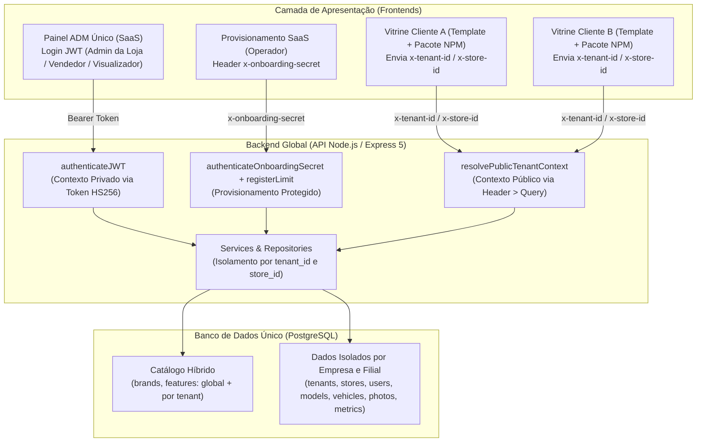
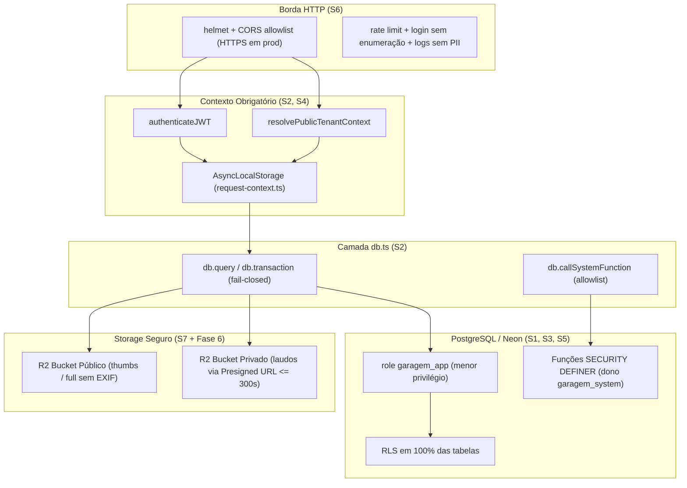

# Arquitetura do Ecossistema: Backend Global, ADM SaaS e Vitrine Whitelabel

> **Objetivo**: Documentar a arquitetura do ecossistema Multi-Tenant e Multi-Store, o estado atual validado no backend, as decisões arquiteturais consolidadas após o code review da Fase 5 e a visão alvo de defesa em profundidade definida em [roadmap-seguranca.md](./roadmaps/roadmap-seguranca.md).

---

## 1. Visão Geral dos 3 Pilares

### Pilar 1: Backend Global Multi-Tenant
- **Conceito**: Uma única instância da API e um único banco de dados PostgreSQL (*Shared Database, Shared Schema*).
- **Isolamento**: Tabelas operacionais possuem `tenant_id` (empresa) e, quando aplicável, `store_id` (filial/loja), reforçadas por chaves estrangeiras compostas `(tenant_id, store_id) REFERENCES stores(tenant_id, id)` no `schema.sql`.
- **Vantagem**: Zero duplicação de código de regra de negócio; manutenção e deploy centralizados.

### Pilar 2: Frontend ADM Único (SaaS)
- **Conceito**: Uma única aplicação web administrativa usada por todas as empresas clientes.
- **Funcionamento**: O usuário autentica com e-mail e senha (com suporte a `tenant_id` opcional para desambiguação caso o mesmo e-mail exista em mais de uma empresa). O backend emite JWT `HS256` (`1d`) contendo `id`, `email`, `role`, `tenantId` e `storeId`.

### Pilar 3: Frontend de Vitrine por Cliente (Template Repository + Pacote NPM Privado)
- **Conceito**: Cada garagem cliente possui seu próprio projeto frontend (gerado a partir de um *Template Repository*) permitindo identidade visual dedicada, domínio próprio e SEO.
- **Pacote NPM Privado (Core)**: Concentra o cliente HTTP configurado para enviar `x-tenant-id` / `x-store-id`, tipagens TypeScript e lógica de busca/filtros/comparação.

---

## 2. O que Já Está Implementado e Validado no Backend

1. **Separação Estrita dos Middlewares de Contexto**:
   - **Fluxo Privado (`authenticateJWT` em `src/middlewares/auth.middleware.ts`)**: Extrai o token via regex `/^Bearer\s+(\S+)$/i`, valida assinatura `HS256` + schema Zod em runtime (`validateToken` em `src/utils/jwt.util.ts`) e executa 1 única query SQL (`findAuthUserById`) validando usuário, `tenant` e `store` (quando `store_id != null`) ativos e não deletados. Nunca aceita `x-tenant-id` via Header/Query.
   - **Fluxo Público (`resolvePublicTenantContext` em `src/middlewares/tenant.middleware.ts`)**: Usado nas rotas abertas da vitrine (`GET /api/vehicles`, `GET /api/vehicles/compare`, `GET /api/vehicles/:id`). Não lê `req.user` e não possui tenant padrão de fallback. Aceita `x-tenant-id`/`x-store-id` (Headers) ou `tenant_id`/`store_id` (Query) com precedência **Header > Query**, valida existência e status ativo de loja e empresa e retorna `404` unificado (`"Loja não encontrada"`) contra enumeração entre tenants.
2. **Provisionamento SaaS Protegido (`POST /api/tenants/onboard`)**:
   - Protegido por `registerLimit` e `authenticateOnboardingSecret` (`crypto.timingSafeEqual` validando `x-onboarding-secret` contra `ONBOARDING_SECRET`).
   - Cria em transação ACID (`TenantRepository.onboardTenant`) a empresa, a matriz e o primeiro usuário `ADMIN`.
3. **Catálogo Híbrido (`brands`, `features`) e Modelos por Tenant (`models`)**:
   - `brands` e `features` permitem leitura combinada `(tenant_id IS NULL OR tenant_id = :tenantId)` e criação customizada por tenant, bloqueando alteração/exclusão de itens globais com `403 Forbidden`.
   - `models` é estritamente isolado por `tenant_id`, validando que o `brand_id` pertence ao catálogo visível do tenant.
4. **Restrição Multi-Store (`store_id`) e Blindagem SQL**:
   - Usuários vinculados a uma filial (`req.user.storeId !== null`) recebem `403` ao tentar criar, editar, transferir, excluir ou gerenciar mídias de veículos de outra filial, e têm `store_id` forçado em `findAdmin` e `findByIdAdmin`.
   - `buildUpdateQuery` (`src/utils/query.util.ts`) bloqueia mutação de `id`, `tenant_id` e `created_at` e injeta `tenant_id` no `WHERE`.
   - `StoreService.findPublicById` (`GET /api/stores/public/:id`) valida que tanto a loja quanto o seu tenant estão ativos e não deletados.
5. **Sanitização LGPD e Rate Limit com Proxy Reverso**:
   - `sanitizeVehicleForRole` (`src/utils/vehicle-sanitizer.util.ts`) oculta dados confidenciais (`full_license_plate`, `purchase_price`, `owner_*`, `store_commission_rate`) para `PUBLICO` e `VISUALIZADOR`.
   - `app.set('trust proxy', ...)` lê `TRUST_PROXY_HOPS` em `src/app.ts` e `loginLimit` utiliza `skipSuccessfulRequests: true`.

---

## 3. Visão Arquitetural Alvo de Segurança (Defesa em Profundidade)

Para elevar o isolamento multi-tenant do nível de aplicação para defesa em profundidade no banco, borda HTTP e storage, o plano em [roadmap-seguranca.md](./roadmaps/roadmap-seguranca.md) define:

1. **Banco de Dados (`S1`, `S3`, `S5`)**: Usuário da app `garagem_app` sem `SUPERUSER`/`BYPASSRLS`/DDL; funções estreitas `SECURITY DEFINER` com dono `garagem_system` para pré-autenticação e views; Row Level Security habilitado em todas as tabelas via `set_config('app.current_tenant_id', $1, true)` local à transação.
2. **Arquivos & Cloudflare R2 (`S6.3`, `S7`, `Fase 6`)**: Validação por *magic bytes*, garantia de remoção de metadados EXIF/GPS, chaves prefixadas por `tenants/<tenantId>/vehicles/<vehicleId>/...`, remoção da exposição estática de laudos (`/uploads/vehicles/reports`) substituída por `GET /api/vehicles/:id/inspection-report` (Presigned URL de no máximo 300s no bucket privado `R2_PRIVATE_BUCKET`).
3. **LGPD & Boot Seguro (`S8`, `S9`)**: Validação fail-fast de `.env`, TLS obrigatório em produção, recusa de boot caso conecte com usuário privilegiado, allowlist restrita de campos em `GET /api/stores/public/:id` (Decisão D2) e rotas de anonimização (`POST /api/vehicles/:id/anonymize` e `POST /api/users/:id/anonymize`).

---

## 4. Próximas Etapas do Backend (Sincronizadas com os Roadmaps)

1. **Concluir Revisão Socrática da Fase 5**: Finalizar os blocos pendentes de [roadmap-revisao-socratica-fase-5.md](./roadmaps/roadmap-revisao-socratica-fase-5.md) e alinhar `FeatureRepository` com as colunas `is_active`/`deleted_at` já adicionadas ao `schema.sql`.
2. **Executar Roadmap de Segurança (`S0–S10`)**: Implementar em TDD estrito conforme [roadmap-seguranca.md](./roadmaps/roadmap-seguranca.md).
3. **Fase 6 — Cloudflare R2 (`+ S7.4`)**: Migrar `StorageProvider` para buckets público/privado do R2 com Presigned URLs e remover `/uploads` estático.
4. **Fases 7–9**: Bancos/Simulador Financeiro, CRM (Leads e Propostas de Troca com `consent_at`/`consent_version`), Venda/Comissões, Auditoria (sem gravar valores de campos pessoais), Promoções/Banners e Cartaz PDF.
