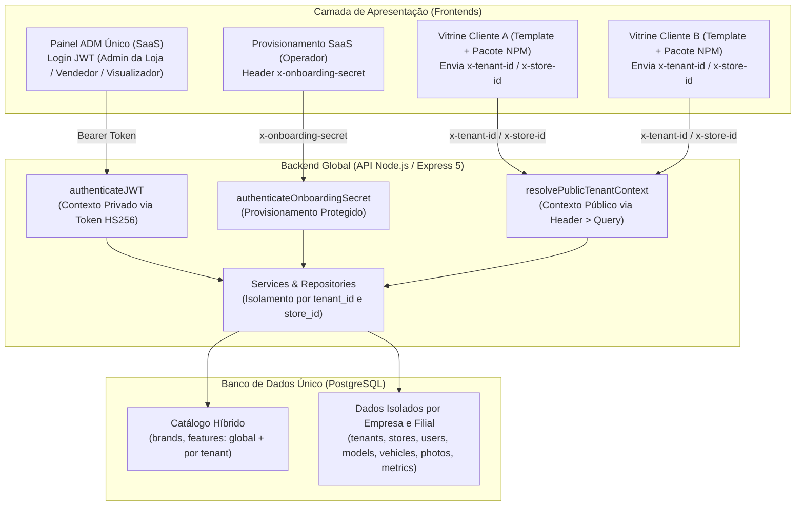
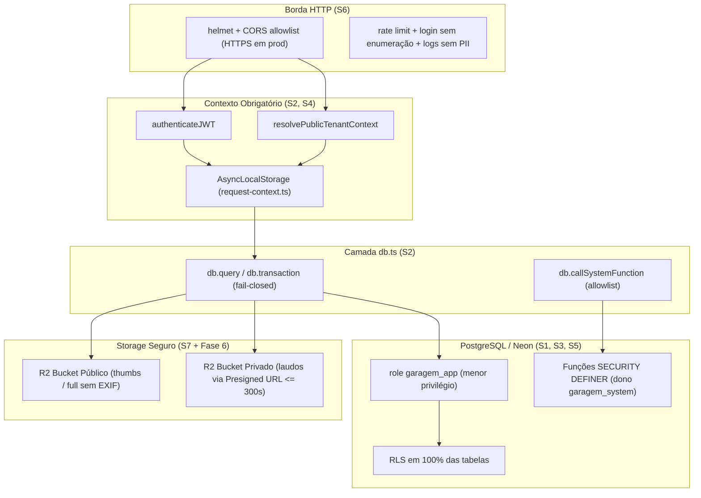

# Arquitetura do Ecossistema: Backend Global, ADM SaaS e Vitrine Whitelabel

> **Objetivo**: Documentar a arquitetura do ecossistema Multi-Tenant e Multi-Store, o estado atual validado no backend, as decisões arquiteturais consolidadas após o code review da Fase 5 e a visão alvo de defesa em profundidade definida em [roadmap-seguranca.md](./roadmaps/roadmap-seguranca.md).

---

## 1. Visão Geral dos 3 Pilares

### Pilar 1: Backend Global Multi-Tenant
- **Conceito**: Uma única instância da API e um único banco de dados PostgreSQL (*Shared Database, Shared Schema*).
- **Isolamento**: Tabelas operacionais possuem `tenant_id` (empresa) e, quando aplicável, `store_id` (filial/loja), reforçadas por chaves estrangeiras compostas `(tenant_id, store_id) REFERENCES stores(tenant_id, id)` no `schema.sql`.
- **Vantagem**: Zero duplicação de código de regra de negócio; manutenção e deploy centralizados.

### Pilar 2: Frontend ADM Único (SaaS)
- **Conceito**: Uma única aplicação web administrativa (`React + Vite` SPA) usada por todas as empresas clientes, hospedada no **Cloudflare Pages**.
- **Funcionamento**: O usuário autentica com e-mail e senha (com suporte a `tenant_id` opcional para desambiguação caso o mesmo e-mail exista em mais de uma empresa). O backend emite JWT `HS256` (`1d`) contendo `id`, `email`, `role`, `tenantId` e `storeId`.

### Pilar 3: Frontend de Vitrine por Cliente (Template Repository + Pacote NPM Privado)
- **Conceito**: Cada garagem cliente possui seu próprio projeto frontend em **Next.js (SSR)** (gerado a partir de um *Template Repository* no GitHub) hospedado no **Cloudflare Workers** (`@opennextjs/cloudflare`), garantindo domínio próprio, SEO no Google e preview de cards com foto/preço no WhatsApp (*OpenGraph*).
- **Pacote NPM Privado (`@garagem/sdk` via GitHub Packages)**: Dividido em **2 camadas** para atender diferentes perfis de clientes:
  1. **Camada Headless (`/api`, `/hooks`, `/types`)**: Cliente HTTP configurado para injetar `x-tenant-id` / `x-store-id`, tipagens geradas do OpenAPI (`Docs/openapi.yaml`), schemas Zod e hooks React Query (`useVehicles`, `useVehicleDetails`, `usePublicStore`). Usada sozinha quando o cliente contrata um **layout 100% personalizado do zero**.
  2. **Camada de Componentes Base (`/ui`)**: Componentes visuais prontos (`<VehicleCard />`, `<VehicleFilters />`, `<PhotoGallery />`) estilizados via variáveis CSS (`--color-primary`, `--radius`, etc.). Usada no `vitrine-template` para **clientes de menor custo**, exigindo apenas configurar cores, fontes e logo.

---

## 1.1. Organização dos 3 Repositórios e Fluxo de Desenvolvimento

Como o GitHub exige um repositório exclusivo para a função *Template Repository*, o ecossistema é dividido em **3 repositórios** para permitir desenvolvimento rápido sem precisar publicar versões no NPM a cada alteração:

| Repositório | Tecnologia | Papel no Ecossistema |
| :--- | :--- | :--- |
| **1. `back-end-site-garagem`** | Node.js, Express 5, PostgreSQL, R2 | API Global Multi-Tenant e fonte da verdade do contrato OpenAPI (`Docs/openapi.yaml` / `/api-docs.json`). |
| **2. `site-garagem-web` (Monorepo Core)** | `pnpm workspaces` | Contém **`apps/admin`** (React + Vite), **`packages/garagem-sdk`** (Pacote NPM privado) e **`apps/vitrine-dev`** (Next.js ligado localmente ao SDK via `workspace:*` para desenvolvimento em tempo real). |
| **3. `vitrine-template` (Template Repo)** | Next.js (App Router / SSR) | Repositório limpo marcado como *Template* no GitHub que consome `@garagem/sdk` publicado no **GitHub Packages**. A cada novo cliente, clica-se em *"Use this template"* para gerar o repositório dedicado da loja. |

---

## 1.2. Infraestrutura de Cloud e Homologação (`dev` vs `prod`)

| Camada | Serviço Escolhido | Estratégia de Ambientes (`dev` e `prod`) |
| :--- | :--- | :--- |
| **Banco de Dados** | **Neon (PostgreSQL Serverless)** | 1 projeto com *Database Branching* nativo: branch `dev` (homologação) e branch `main` (produção), rodando com roles de menor privilégio (`garagem_app` / `garagem_system`) e RLS ativo. |
| **Storage de Mídias** | **Cloudflare R2 (S3-Compatible)** | Buckets segregados por ambiente e visibilidade: `R2_PUBLIC_BUCKET` para fotos `.webp` (`thumbs`/`full`) e `R2_PRIVATE_BUCKET` para laudos `.pdf` servidos via Presigned URL (`<= 300s`). Zero custo de *egress*. |
| **Backend (API)** | **Northflank** *(ou Koyeb)* | Deploy contínuo a partir da branch `dev` (homologação) e `main` (produção). Northflank (*Developer Sandbox*) priorizado em homologação por manter o container ativo 24/7 sem *cold start*. |
| **Front Admin** | **Cloudflare Pages** | Build estático (`React + Vite`) com preview automático por branch (`dev` e `main`). |
| **Front Vitrines** | **Cloudflare Workers (OpenNext)** | Deploy SSR (`Next.js` via `@opennextjs/cloudflare`) por cliente, com variáveis `NEXT_PUBLIC_TENANT_ID` e `NEXT_PUBLIC_STORE_ID` e domínio customizado. |

---

## 1.3. Compartilhamento de Contratos (Backend -> Frontends e Agentes de IA)

Para garantir sincronia total de entradas (requests) e saídas (responses) entre o repositório do Backend e o Monorepo Frontend:

1. **Fonte Única de Verdade (`Docs/openapi.yaml` / `/api-docs.json`)**: Todo endpoint implementado no backend é obrigatoriamente documentado no `Docs/openapi.yaml` (regra da Seção 4 do `.agents/AGENTS.md`).
2. **Geração Automática de Tipos no SDK (`openapi-typescript` / `orval`)**: No pacote `packages/garagem-sdk`, um script (`pnpm generate:api`) lê o `Docs/openapi.yaml` (ou a rota `/api-docs.json` da API local/`dev`) e gera automaticamente todas as interfaces TypeScript de Request, Query Params e Response.
3. **Contexto para Agentes de IA no Frontend**: Os arquivos `Docs/openapi.yaml`, `Docs/api-routes.md` e `Docs/arquitetura-ecossistema.md` fornecem 100% do contrato necessário (rotas, headers `x-tenant-id`/`x-store-id`, códigos de erro `400`/`401`/`403`/`404`/`409` e regras de negócio `RN001`–`RN011`) sem que o frontend precise importar código interno do backend.

---

## 2. O que Já Está Implementado e Validado no Backend

1. **Separação Estrita dos Middlewares de Contexto**:
   - **Fluxo Privado (`authenticateJWT` em `src/middlewares/auth.middleware.ts`)**: Extrai o token via regex `/^Bearer\s+(\S+)$/i`, valida assinatura `HS256` + schema Zod em runtime (`validateToken` em `src/utils/jwt.util.ts`) e executa 1 única query SQL (`findAuthUserById`) validando usuário, `tenant` e `store` (quando `store_id != null`) ativos e não deletados. Nunca aceita `x-tenant-id` via Header/Query.
   - **Fluxo Público (`resolvePublicTenantContext` em `src/middlewares/tenant.middleware.ts`)**: Usado nas rotas abertas da vitrine (`GET /api/vehicles`, `GET /api/vehicles/compare`, `GET /api/vehicles/:id`). Não lê `req.user` e não possui tenant padrão de fallback. Aceita `x-tenant-id`/`x-store-id` (Headers) ou `tenant_id`/`store_id` (Query) com precedência **Header > Query**, valida existência e status ativo de loja e empresa e retorna `404` unificado (`"Loja não encontrada"`) contra enumeração entre tenants.
2. **Provisionamento SaaS Protegido (`POST /api/tenants/onboard`)**:
   - Protegido por `authenticateOnboardingSecret` (`crypto.timingSafeEqual` validando `x-onboarding-secret` contra `getOnboardingSecret()` / `ONBOARDING_SECRET`, com validação *fail-fast* no boot em `src/server.ts`).
   - Cria em transação ACID (`TenantRepository.onboardTenant`) a empresa, a matriz e o primeiro usuário `ADMIN`.
3. **Catálogo Híbrido (`brands`, `features`) e Modelos por Tenant (`models`)**:
   - `brands` e `features` permitem leitura combinada `(tenant_id IS NULL OR tenant_id = :tenantId)` e criação customizada por tenant, bloqueando alteração/exclusão de itens globais com `403 Forbidden`.
   - `models` é estritamente isolado por `tenant_id`, validando que o `brand_id` pertence ao catálogo visível do tenant.
4. **Restrição Multi-Store (`store_id`) e Blindagem SQL**:
   - Usuários vinculados a uma filial (`req.user.storeId !== null`) recebem `403` ao tentar criar, editar, transferir, excluir ou gerenciar mídias de veículos de outra filial, e têm `store_id` forçado em `findAdmin` e `findByIdAdmin`.
   - `buildUpdateQuery` (`src/utils/query.util.ts`) bloqueia mutação de `id`, `tenant_id` e `created_at` e injeta `tenant_id` no `WHERE`.
   - `StoreService.findPublicById` (`GET /api/stores/public/:id`) valida que tanto a loja quanto o seu tenant estão ativos e não deletados.
5. **Sanitização LGPD e Rate Limit com Proxy Reverso**:
   - `sanitizeVehicleForRole` (`src/utils/vehicle-sanitizer.util.ts`) oculta dados confidenciais (`full_license_plate`, `purchase_price`, `owner_*`, `store_commission_rate`) para `PUBLICO` e `VISUALIZADOR`.
   - `app.set('trust proxy', ...)` lê `TRUST_PROXY_HOPS` em `src/app.ts` e `loginLimit` utiliza `skipSuccessfulRequests: true` (em ambientes sem proxy reverso na frente, configurar `TRUST_PROXY_HOPS=0` para impedir spoofing de `X-Forwarded-For`).

---

## 3. Visão Arquitetural Alvo de Segurança (Defesa em Profundidade)

Para elevar o isolamento multi-tenant do nível de aplicação para defesa em profundidade no banco, borda HTTP e storage, o plano em [roadmap-seguranca.md](./roadmaps/roadmap-seguranca.md) define:

1. **Banco de Dados (`S1`, `S3`, `S5`)**: Usuário da app `garagem_app` sem `SUPERUSER`/`BYPASSRLS`/DDL; funções estreitas `SECURITY DEFINER` com dono `garagem_system` para pré-autenticação e views; Row Level Security habilitado em todas as tabelas via `set_config('app.current_tenant_id', $1, true)` local à transação.
2. **Arquivos & Cloudflare R2 (`S6.3`, `S7`, `Fase 6`)**: Validação por *magic bytes*, garantia de remoção de metadados EXIF/GPS, chaves prefixadas por `tenants/<tenantId>/vehicles/<vehicleId>/...`, remoção da exposição estática de laudos (`/uploads/vehicles/reports`) substituída por `GET /api/vehicles/:id/inspection-report` (Presigned URL de no máximo 300s no bucket privado `R2_PRIVATE_BUCKET`).
3. **LGPD & Boot Seguro (`S8`, `S9`)**: Validação fail-fast de `.env`, TLS obrigatório em produção, recusa de boot caso conecte com usuário privilegiado, allowlist restrita de campos em `GET /api/stores/public/:id` (Decisão D2) e rotas de anonimização (`POST /api/vehicles/:id/anonymize` e `POST /api/users/:id/anonymize`).

---

## 4. Roteiro de Execução (Backend + Homologação + Vertical Slice Frontends)

1. **Concluir Fechamento da Fase 5**: Finalizar os blocos pendentes de [roadmap-revisao-socratica-fase-5.md](./roadmaps/roadmap-revisao-socratica-fase-5.md) e alinhar `FeatureRepository` (`5.6`) com as colunas `is_active`/`deleted_at` já adicionadas ao `schema.sql`.
2. **Fase 5.5 — Executar Roadmap de Segurança (`S0–S10`)**: Implementar em TDD estrito conforme [roadmap-seguranca.md](./roadmaps/roadmap-seguranca.md) (menor privilégio `garagem_app`, `AsyncLocalStorage`, funções `SECURITY DEFINER`, RLS em 100% das tabelas, Helmet/CORS, magic bytes, chaves de storage por tenant, TLS/env e anonimização LGPD).
3. **Fase 6 — Cloudflare R2 (`+ S7.4`)**: Migrar `StorageProvider` para buckets público/privado do R2 com Presigned URLs (`<= 300s`) e remover `/uploads` estático.
4. **Fase 6.5 — Deploy de Homologação (`dev`) & Vertical Slice dos Frontends**:
   - Criar a branch `dev` e provisionar o ambiente de homologação (**Neon** branch `dev` + buckets **Cloudflare R2** + API no **Northflank**).
   - Pausar temporariamente o avanço para as Fases 7–10 do backend e construir o **Vertical Slice dos Frontends**: Monorepo `site-garagem-web` (`apps/admin` em React + Vite no Cloudflare Pages, `packages/garagem-sdk` com geração de tipos via OpenAPI e `apps/vitrine-dev`) + repositório `vitrine-template` (Next.js SSR no Cloudflare Workers), validando todo o fluxo real de cadastro e vitrine em homologação.
5. **Fases 7–9 (Retomada do Backend + Evolução dos Frontends)**: Bancos/Simulador Financeiro, CRM (Leads e Propostas de Troca com `consent_at`/`consent_version`), Venda/Comissões, Auditoria (sem gravar valores de campos pessoais), Promoções/Banners e Cartaz PDF.
6. **Fase 10 — Backoffice SaaS & Super Usuário (Operador Global)**: Identidade e autenticação isoladas dos usuários de tenant para gestão centralizada de empresas (onboarding via servidor sem expor `ONBOARDING_SECRET` no browser, suspensão/reativação, catálogo global `tenant_id IS NULL`, configurações e auditoria), preservando o RLS nas rotas de clientes.
