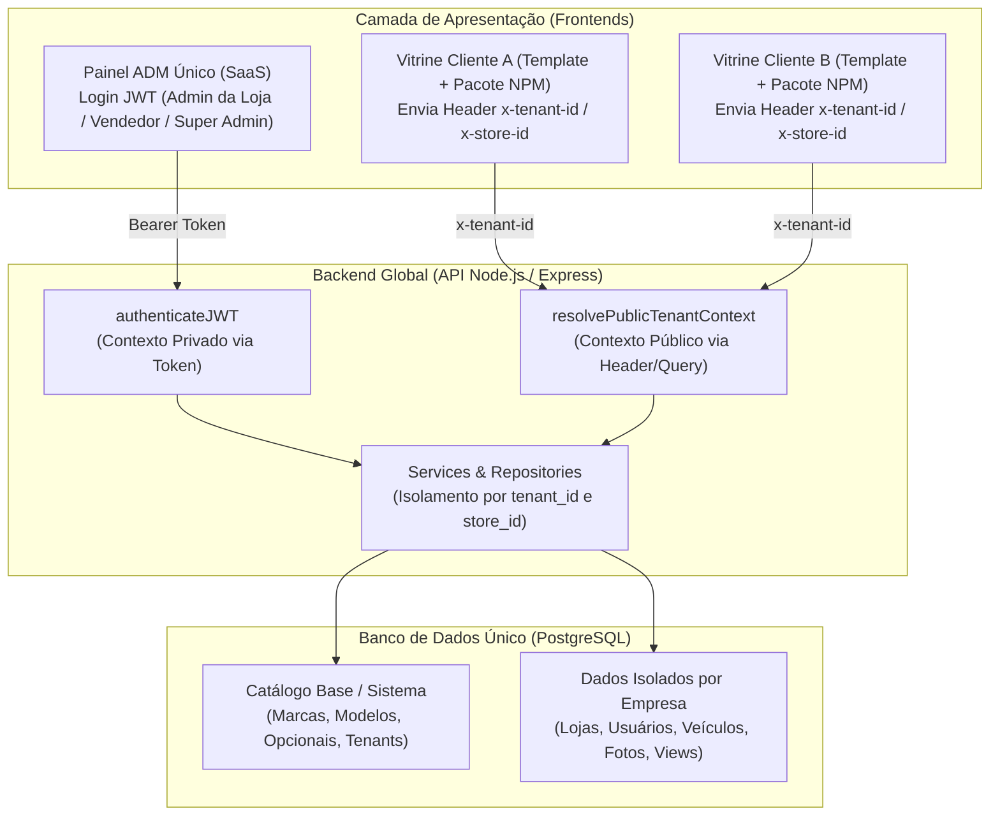

# Arquitetura do Ecossistema: Backend Global, ADM SaaS e Vitrine Whitelabel

> **Objetivo**: Documentar a validação arquitetural do ecossistema Multi-Tenant, o estado atual do backend, os ajustes pendentes e as decisões de design para simplificação de escopo (Super Admin vs. Tenant Admin).

---

## 1. Visão Geral dos 3 Pilares

### Pilar 1: Backend Global Multi-Tenant
- **Conceito**: Uma única instância da API e um único banco de dados PostgreSQL (*Shared Database, Shared Schema*).
- **Isolamento**: Todas as tabelas operacionais possuem `tenant_id` (empresa) e, quando aplicável, `store_id` (filial/loja).
- **Vantagem**: Zero duplicação de código de regra de negócio; manutenção e deploy centralizados.

### Pilar 2: Frontend ADM Único (SaaS)
- **Conceito**: Uma única aplicação web administrativa usada por todas as empresas clientes.
- **Funcionamento**: O usuário faz login com e-mail e senha. O backend retorna um JWT contendo `tenantId`, `storeId` e `role`. Todas as requisições subsequentes usam esse token para filtrar e restringir os dados exclusivamente à empresa do usuário logado.
- **Extensão para o Dono do SaaS (`SUPER_ADMIN`)**: Dentro do mesmo painel ADM, uma visão exclusiva para o proprietário da plataforma gerenciar empresas clientes (*Onboarding*) e cadastros padrões do sistema.

### Pilar 3: Frontend de Vitrine por Cliente (Template Repository + Pacote NPM Privado)
- **Conceito**: Cada garagem cliente possui seu próprio projeto frontend (gerado a partir de um *Template Repository*) para permitir personalização visual total, domínio próprio e SEO dedicado.
- **Pacote NPM Privado (Core)**: Concentra toda a lógica compartilhada para evitar retrabalho:
  - Cliente HTTP configurado para injetar `x-tenant-id` / `x-store-id` via variáveis de ambiente.
  - Tipagens TypeScript (contratos de resposta da API).
  - Hooks/funções de busca de catálogo, filtros, paginação, detalhes do veículo e comparador.
- **Template Repository (UI)**: Contém apenas componentes visuais, páginas, identidade da marca e configurações de deploy.

---

## 2. O que já está pronto e validado no Backend

1. **Isolamento Administrativo via JWT**:
   - O login em `src/services/user.service.ts` embute `tenantId` e `storeId` no token.
   - O middleware `src/middlewares/auth.middleware.ts` valida se o usuário e o `tenant` estão ativos no banco antes de liberar o acesso.
2. **Resolução de Contexto Público para a Vitrine**:
   - O middleware `src/middlewares/tenant.middleware.ts` lê `x-tenant-id` ou `x-store-id` para identificar de qual empresa é a vitrine que está fazendo a requisição.
3. **Sanitização de Dados por Perfil**:
   - O `src/services/vehicle.service.ts` em conjunto com `src/utils/vehicle-sanitizer.util.ts` oculta dados sensíveis (preço de compra, dados do proprietário consignado, placa completa, comissões) nas rotas públicas.
4. **Restrição por Filial (`store_id`)**:
   - Usuários vinculados a uma filial específica só conseguem cadastrar, editar ou gerenciar fotos de veículos da sua própria filial.

---

## 3. Decisões Arquiteturais de Simplificação

### 3.1. Separação Estrita dos Middlewares de Contexto
Para evitar mistura de responsabilidades e brechas de segurança, a resolução de contexto fica dividida em dois fluxos independentes:

- **Fluxo Privado (`authenticateJWT` em `src/middlewares/auth.middleware.ts`)**:
  - Usado exclusivamente nas rotas autenticadas do painel ADM.
  - Extrai `tenantId`, `storeId` e `role` diretamente do token JWT assinado.
  - Nunca aceita `x-tenant-id` via Header ou Query (impede que um usuário logado tente forjar acesso a outra empresa).
- **Fluxo Público (`resolvePublicTenantContext` em `src/middlewares/tenant.middleware.ts`)**:
  - Usado exclusivamente nas rotas abertas da Vitrine.
  - Não lê `req.user`. Lê apenas `x-tenant-id` ou `x-store-id` (Header/Query).
  - Valida no banco de dados se o `tenant` (ou `store`) existe e está ativo (`is_active = true` e `deleted_at IS NULL`) antes de popular `req.tenantContext`.

### 3.2. Catálogo Padrão 100% Global e Perfil `SUPER_ADMIN`
Em vez de cada garagem cadastrar suas próprias Marcas, Modelos e Opcionais (ou manter uma lógica híbrida complexa), esses cadastros passam a ser **100% globais da plataforma**:

1. **Padronização do Banco de Dados**:
   - As tabelas `brands`, `models` e `features` deixam de depender de `tenant_id`.
   - Evita duplicidades e erros de digitação entre lojistas (ex.: "VW", "Volks", "Volkswagen") e entrega o sistema pronto para uso imediato no *onboarding* de novas garagens.
2. **Simplificação de Código (YAGNI)**:
   - Remove toda a validação híbrida (`tenant_id IS NULL OR tenant_id = $1`) dos *Services* e *Repositories* de Marcas, Modelos e Opcionais.
3. **Permissões de Acesso nas Rotas de Catálogo Base (`brands`, `models`, `features`)**:
   - **Leitura (`GET`)**: Pública/aberta para alimentar tanto os filtros da Vitrine quanto os formulários de cadastro de veículos dos lojistas no ADM.
   - **Escrita (`POST`, `PUT`, `DELETE`)**: Restrita exclusivamente à role `SUPER_ADMIN` (dono do SaaS).
4. **Visão Exclusiva no Painel ADM**:
   - O painel ADM continua sendo único, mas renderiza uma área exclusiva de **Administração da Plataforma** quando o usuário logado possui a role `SUPER_ADMIN`:
     - **Gestão de Empresas (Tenants)**: Criação (*Onboarding*), ativação e desativação de clientes.
     - **Gestão do Catálogo Base**: Criação e edição de Marcas, Modelos e Opcionais padrões do sistema.

---

## 4. Checklist de Ajustes Pendentes no Backend

1. **Refatorar `tenant.middleware.ts`**:
   - Remover a referência a `req.user` e validar se o `tenant` resolvido está ativo no banco.
2. **Criar a role `SUPER_ADMIN`**:
   - Incluir `SUPER_ADMIN` nas validações de permissão e proteger a rota `POST /api/tenants/onboard` em `src/routes/tenant.routes.ts`.
3. **Tornar `brands`, `models` e `features` 100% Globais**:
   - Liberar as rotas `GET` para leitura pública (Vitrine + ADM) e restringir `POST`, `PUT` e `DELETE` apenas ao `SUPER_ADMIN`, removendo o filtro por `tenant_id` dessas três entidades.
4. **Suporte a Promoções e Relatórios**:
   - Adicionar suporte a preço promocional/destaque no veículo (para a seção de promoções da vitrine) e endpoints de métricas/relatórios para o painel ADM.
