# Data Dictionary and Entity-Relationship Diagram (ERD)

Este documento especifica a tipagem física em PostgreSQL, chaves primárias (PK), chaves estrangeiras (FK), nulabilidade (`NOT NULL`) e valores padrão de todas as entidades do sistema **SiteGaragem**, alinhado com [Docs/docs.md](./docs.md) e com o [schema.sql](../schema.sql).

> **Convenção:** `NULLABLE` indica coluna sem `NOT NULL` (mesmo quando possui `DEFAULT`), exatamente como definido no `schema.sql`.

---

## 1. Diagrama ERD em Formato Mermaid

```mermaid
erDiagram
    STORES ||--o{ VEHICLES : "belongs_to"
    STORES ||--o{ FINANCING_BANKS : "works_with"
    FINANCING_BANKS ||--|{ BANK_RATES : "has_rates"
    USERS ||--o{ VEHICLES : "registers"
    USERS ||--o{ VEHICLES : "sells"
    USERS ||--o{ VEHICLE_AUDITS : "audits"
    BRANDS ||--|{ MODELS : "has"
    MODELS ||--o{ VEHICLES : "specifies"
    PROMOTIONS ||--o{ VEHICLES : "applies_to"
    PROMOTIONS ||--o{ HERO_BANNER : "targets"
    VEHICLES ||--|{ VEHICLE_PHOTOS : "contains"
    VEHICLES ||--o{ VEHICLE_FEATURES : "has"
    FEATURES ||--o{ VEHICLE_FEATURES : "composes"
    VEHICLES ||--o{ TRADE_IN_PROPOSALS : "receives"
    VEHICLES ||--o{ VEHICLE_METRICS : "accumulates"
    VEHICLES ||--o{ VEHICLE_AUDITS : "logs"
    VEHICLES ||--o{ LEAD_INTERESTS : "receives"
    LEAD_INTERESTS }o--o| BRANDS : "wants"
    LEAD_INTERESTS }o--o| MODELS : "wants"

    STORES {
        uuid id PK "NOT NULL, DEFAULT gen_random_uuid()"
        varchar_255 name "NOT NULL"
        varchar_15 phone "NOT NULL"
        varchar_255 address "NOT NULL"
        varchar_18 cnpj "NOT NULL"
        boolean is_active "NULLABLE, DEFAULT true"
        timestamp created_at "NULLABLE, DEFAULT now()"
    }

    FINANCING_BANKS {
        uuid id PK "NOT NULL, DEFAULT gen_random_uuid()"
        uuid store_id FK "NOT NULL"
        varchar_255 name "NOT NULL"
        int display_order "NOT NULL"
        boolean is_active "NULLABLE, DEFAULT true"
        timestamp created_at "NULLABLE, DEFAULT now()"
    }

    BANK_RATES {
        uuid id PK "NOT NULL, DEFAULT gen_random_uuid()"
        uuid bank_id FK "NOT NULL"
        int months_from "NOT NULL"
        int months_to "NOT NULL"
        numeric_5_2 monthly_interest_rate "NOT NULL"
        timestamp created_at "NULLABLE, DEFAULT now()"
    }

    USERS {
        uuid id PK "NOT NULL, DEFAULT gen_random_uuid()"
        varchar_255 name "NOT NULL"
        varchar_255 email "NOT NULL"
        varchar_255 password_hash "NOT NULL"
        varchar_15 phone "NOT NULL"
        users_roles_types role "NULLABLE, DEFAULT 'VENDEDOR', ENUM: ADMIN, VENDEDOR, VISUALIZADOR, PUBLICO"
        numeric_5_2 commission_rates "NULLABLE"
        boolean is_active "NULLABLE, DEFAULT true"
        timestamp created_at "NULLABLE, DEFAULT now()"
    }

    BRANDS {
        uuid id PK "NOT NULL, DEFAULT gen_random_uuid()"
        varchar_255 name "NOT NULL"
    }

    MODELS {
        uuid id PK "NOT NULL, DEFAULT gen_random_uuid()"
        uuid brand_id FK "NOT NULL"
        varchar_255 name "NOT NULL"
    }

    FEATURES {
        uuid id PK "NOT NULL, DEFAULT gen_random_uuid()"
        varchar_255 name "NOT NULL, UNIQUE"
    }

    VEHICLE_FEATURES {
        uuid vehicle_id PK,FK "NOT NULL"
        uuid feature_id PK,FK "NOT NULL"
    }

    PROMOTIONS {
        uuid id PK "NOT NULL, DEFAULT gen_random_uuid()"
        varchar_255 name "NOT NULL"
        varchar_255 description "NULLABLE"
        date start_date "NOT NULL"
        date end_date "NOT NULL"
        boolean is_active "NULLABLE, DEFAULT true"
    }

    VEHICLES {
        uuid id PK "NOT NULL, DEFAULT gen_random_uuid()"
        uuid store_id FK "NOT NULL"
        uuid registered_by_user_id FK "NOT NULL"
        uuid sold_by_user_id FK "NULLABLE"
        uuid model_id FK "NOT NULL"
        uuid promotion_id FK "NULLABLE, ON DELETE SET NULL"
        vehicle_sale_types sale_type "NULLABLE, DEFAULT 'PROPRIO', ENUM: PROPRIO, CONSIGNADO"
        varchar_255 title "NOT NULL"
        text description "NOT NULL"
        numeric_10_2 sale_price "NOT NULL"
        numeric_10_2 purchase_price "NOT NULL"
        numeric_10_2 owner_price "NOT NULL"
        numeric_5_2 store_commission_rate "NULLABLE"
        varchar_255 owner_name "NULLABLE"
        varchar_15 owner_contact "NULLABLE"
        numeric_10_2 fipe_price "NULLABLE"
        numeric_10_2 min_down_payment "NULLABLE"
        int max_installments "NULLABLE"
        int manufacture_year "NOT NULL"
        int model_year "NOT NULL"
        int mileage "NOT NULL"
        vehicle_transmission_types transmission "NOT NULL, ENUM: AUTOMATICO, MANUAL, AUTOMATIZADO"
        varchar_20 color "NOT NULL"
        vehicle_category_types category "NOT NULL, ENUM: HATCH, SEDÃ, SUV, PICAPE, CUPE, CONVERSIVEL, PERUA, MINIVAN/VAN, ESPORTIVO"
        int horsepower "NULLABLE"
        vehicle_fuel_types fuel_type "NOT NULL, ENUM: GASOLINA, ALCOOL, DIESEL, FLEX, ELETRICO, HIBRIDO"
        varchar_20 steering "NOT NULL"
        int doors "NOT NULL"
        varchar_10 full_license_plate "NOT NULL"
        int plate_last_digit "NOT NULL"
        vehicle_status_types status "NULLABLE, DEFAULT 'ATIVO', ENUM: ATIVO, RESERVADO, EM_NEGOCIACAO, VENDIDO, INATIVO"
        timestamp reservation_expires_at "NULLABLE"
        varchar_255 video_url "NULLABLE"
        varchar_255 inspection_report_url "NULLABLE"
        int total_views "NULLABLE, DEFAULT 0"
        timestamp sold_at "NULLABLE"
        varchar_255 buyer_name "NULLABLE"
        varchar_255 buyer_contact "NULLABLE"
        boolean website_lead_origin "NULLABLE"
        timestamp created_at "NULLABLE, DEFAULT now()"
        timestamp updated_at "NULLABLE"
    }

    VEHICLE_PHOTOS {
        uuid id PK "NOT NULL, DEFAULT gen_random_uuid()"
        uuid vehicle_id FK "NOT NULL"
        varchar_255 thumb_path "NOT NULL"
        varchar_255 full_path "NOT NULL"
        int display_order "NULLABLE"
        boolean is_primary "NULLABLE"
        timestamp created_at "NULLABLE, DEFAULT now()"
    }

    TRADE_IN_PROPOSALS {
        uuid id PK "NOT NULL, DEFAULT gen_random_uuid()"
        uuid vehicle_id FK "NOT NULL"
        varchar_255 customer_name "NOT NULL"
        varchar_15 customer_phone "NOT NULL"
        lead_preferred_channel_type preferred_channel "NULLABLE, DEFAULT 'WHATSAPP', ENUM: WHATSAPP, LIGACAO, EMAIL"
        lead_preferred_shift_type preferred_shift "NULLABLE, DEFAULT 'TARDE', ENUM: MANHA, TARDE, NOITE"
        varchar_255 vehicle_brand "NOT NULL"
        varchar_255 vehicle_model "NOT NULL"
        int vehicle_year "NOT NULL"
        int vehicle_mileage "NOT NULL"
        numeric_10_2 intended_value "NOT NULL"
        text notes "NOT NULL"
        trade_in_proposals_status_types status "NULLABLE, DEFAULT 'PENDENTE', ENUM: PENDENTE, EM_AVALIACAO, APROVADA, RECUSADA, CANCELADA"
        timestamp created_at "NULLABLE, DEFAULT now()"
    }

    LEAD_INTERESTS {
        uuid id PK "NOT NULL, DEFAULT gen_random_uuid()"
        varchar_255 customer_name "NOT NULL"
        varchar_255 customer_phone "NOT NULL"
        lead_preferred_channel_type preferred_channel "NULLABLE, DEFAULT 'WHATSAPP', ENUM: WHATSAPP, LIGACAO, EMAIL"
        lead_preferred_shift_type preferred_shift "NULLABLE, DEFAULT 'TARDE', ENUM: MANHA, TARDE, NOITE"
        uuid vehicle_id FK "NULLABLE, ON DELETE SET NULL"
        uuid brand_id FK "NULLABLE"
        uuid model_id FK "NULLABLE"
        int min_year "NULLABLE"
        int max_year "NULLABLE"
        numeric_10_2 max_price "NULLABLE"
        lead_status_type status "NULLABLE, DEFAULT 'PENDENTE', ENUM: PENDENTE, EM_ATENDIMENTO, CONVERTIDO, ARQUIVADO"
        text notes "NULLABLE"
        timestamp created_at "NULLABLE, DEFAULT now()"
    }

    VEHICLE_METRICS {
        uuid id PK "NOT NULL, DEFAULT gen_random_uuid()"
        uuid vehicle_id FK "NOT NULL"
        date recorded_date "NULLABLE, DEFAULT now()"
        int views_count "NULLABLE, DEFAULT 0"
        int whatsapp_clicks_count "NULLABLE, DEFAULT 0"
    }

    VEHICLE_AUDITS {
        uuid id PK "NOT NULL, DEFAULT gen_random_uuid()"
        uuid vehicle_id FK "NOT NULL"
        uuid user_id FK "NOT NULL"
        timestamp changed_at "NULLABLE, DEFAULT now()"
        varchar_255 changed_field "NULLABLE"
        varchar_255 old_value "NULLABLE"
        varchar_255 new_value "NULLABLE"
    }

    HERO_BANNER {
        uuid id PK "NOT NULL, DEFAULT gen_random_uuid()"
        uuid promotion_id FK "NOT NULL"
        varchar_255 image_path "NOT NULL"
        varchar_255 title "NOT NULL"
        varchar_255 redirect_url "NOT NULL"
        int duration_seconds "NOT NULL"
        int display_order "NOT NULL"
        boolean is_active "NULLABLE, DEFAULT true"
    }
```

---

## 2. Resumo de Tipos Físicos e Restrições para o `schema.sql`

| Entidade | Chave Primária (PK) | Chaves Estrangeiras (FK) | Campos Obrigatórios (`NOT NULL`) Críticos |
| :--- | :--- | :--- | :--- |
| **STORES** | `id` (UUID) | - | `name`, `phone`, `address`, `cnpj` |
| **FINANCING_BANKS** | `id` (UUID) | `store_id` -> `STORES(id)` (ON DELETE CASCADE) | `store_id`, `name`, `display_order` |
| **BANK_RATES** | `id` (UUID) | `bank_id` -> `FINANCING_BANKS(id)` (ON DELETE CASCADE) | `bank_id`, `months_from`, `months_to`, `monthly_interest_rate` |
| **USERS** | `id` (UUID) | - | `name`, `email`, `password_hash`, `phone` |
| **BRANDS** | `id` (UUID) | - | `name` |
| **MODELS** | `id` (UUID) | `brand_id` -> `BRANDS(id)` (ON DELETE CASCADE) | `brand_id`, `name` |
| **FEATURES** | `id` (UUID) | - | `name` (UNIQUE) |
| **VEHICLE_FEATURES** | Composta (`vehicle_id`, `feature_id`) | `vehicle_id` -> `VEHICLES(id)` (ON DELETE CASCADE), `feature_id` -> `FEATURES(id)` (ON DELETE CASCADE) | Ambos compõem PK e são `NOT NULL` |
| **PROMOTIONS** | `id` (UUID) | - | `name`, `start_date`, `end_date` |
| **VEHICLES** | `id` (UUID) | `store_id`, `registered_by_user_id`, `sold_by_user_id`, `model_id`, `promotion_id` | `store_id`, `registered_by_user_id`, `model_id`, `title`, `description`, `sale_price`, `purchase_price`, `owner_price`, `manufacture_year`, `model_year`, `mileage`, `transmission`, `color`, `category`, `fuel_type`, `steering`, `doors`, `full_license_plate`, `plate_last_digit` |
| **VEHICLE_PHOTOS** | `id` (UUID) | `vehicle_id` -> `VEHICLES(id)` (ON DELETE CASCADE) | `vehicle_id`, `thumb_path`, `full_path` |
| **TRADE_IN_PROPOSALS** | `id` (UUID) | `vehicle_id` -> `VEHICLES(id)` (ON DELETE CASCADE) | `vehicle_id`, `customer_name`, `customer_phone`, `vehicle_brand`, `vehicle_model`, `vehicle_year`, `vehicle_mileage`, `intended_value`, `notes` |
| **LEAD_INTERESTS** | `id` (UUID) | `vehicle_id` -> `VEHICLES(id)` (ON DELETE SET NULL), `brand_id` -> `BRANDS(id)`, `model_id` -> `MODELS(id)` | `customer_name`, `customer_phone` |
| **VEHICLE_METRICS** | `id` (UUID) | `vehicle_id` -> `VEHICLES(id)` (ON DELETE CASCADE) | `vehicle_id` |
| **VEHICLE_AUDITS** | `id` (UUID) | `vehicle_id` -> `VEHICLES(id)` (ON DELETE CASCADE), `user_id` -> `USERS(id)` | `vehicle_id`, `user_id` |
| **HERO_BANNER** | `id` (UUID) | `promotion_id` -> `PROMOTIONS(id)` (ON DELETE CASCADE) | `promotion_id`, `image_path`, `title`, `redirect_url`, `duration_seconds`, `display_order` |

> **Observação — `LEAD_INTERESTS`:** o lead pode se originar de um veículo específico (`vehicle_id` preenchido, com `ON DELETE SET NULL`) ou de um alerta geral de procura (`vehicle_id` nulo). Por isso, os filtros `brand_id`, `model_id`, `min_year`, `max_year` e `max_price` são todos opcionais. O campo `status` controla o funil de atendimento (`PENDENTE`, `EM_ATENDIMENTO`, `CONVERTIDO`, `ARQUIVADO`) e `notes` armazena anotações livres do atendimento.

---

## 3. Tipos ENUM

| Tipo | Valores |
| :--- | :--- |
| `users_roles_types` | `ADMIN`, `VENDEDOR`, `VISUALIZADOR`, `PUBLICO` |
| `lead_preferred_channel_type` | `WHATSAPP`, `LIGACAO`, `EMAIL` |
| `lead_preferred_shift_type` | `MANHA`, `TARDE`, `NOITE` |
| `lead_status_type` | `PENDENTE`, `EM_ATENDIMENTO`, `CONVERTIDO`, `ARQUIVADO` |
| `trade_in_proposals_status_types` | `PENDENTE`, `EM_AVALIACAO`, `APROVADA`, `RECUSADA`, `CANCELADA` |
| `vehicle_sale_types` | `PROPRIO`, `CONSIGNADO` |
| `vehicle_transmission_types` | `AUTOMATICO`, `MANUAL`, `AUTOMATIZADO` |
| `vehicle_category_types` | `HATCH`, `SEDÃ`, `SUV`, `PICAPE`, `CUPE`, `CONVERSIVEL`, `PERUA`, `MINIVAN/VAN`, `ESPORTIVO` |
| `vehicle_fuel_types` | `GASOLINA`, `ALCOOL`, `DIESEL`, `FLEX`, `ELETRICO`, `HIBRIDO` |
| `vehicle_status_types` | `ATIVO`, `RESERVADO`, `EM_NEGOCIACAO`, `VENDIDO`, `INATIVO` |

---

## 4. Índices

| Índice | Tabela | Coluna(s) |
| :--- | :--- | :--- |
| `idx_vehicles_status` | `vehicles` | `status` |
| `idx_vehicles_model_id` | `vehicles` | `model_id` |
| `idx_vehicles_category` | `vehicles` | `category` |
| `idx_vehicles_sale_price` | `vehicles` | `sale_price` |
| `idx_vehicles_created_at` | `vehicles` | `created_at` |
