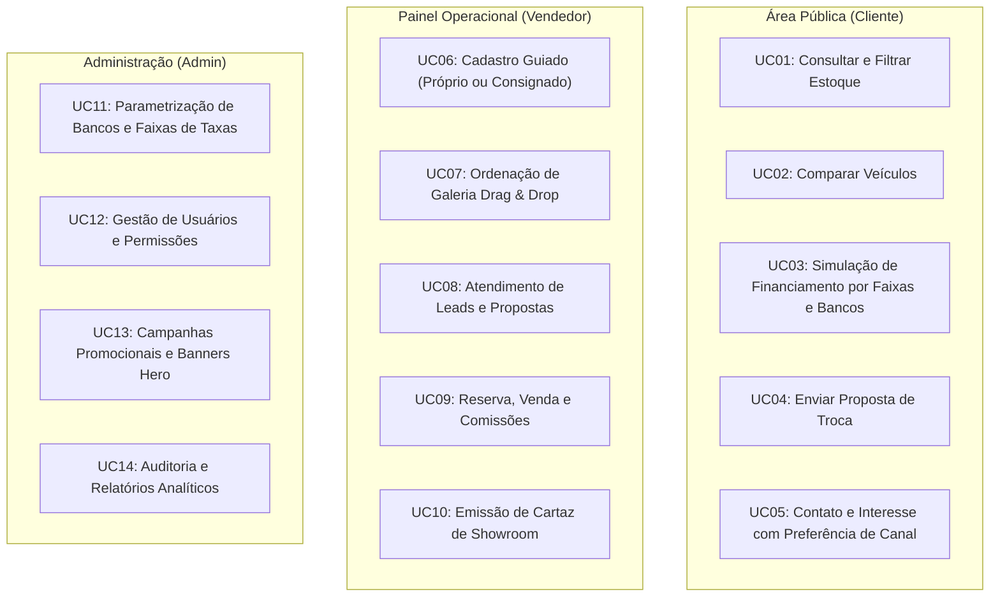

# Documento de Especificação e Arquitetura Geral (SiteGaragem)
## Sistema Integrado de Gestão de Estoque, CRM, Financiamento e Vitrine Digital Automotiva

---

### 1. Visão Geral do Projeto

O **SiteGaragem** é uma solução completa para lojas e concessionárias de compra e venda de veículos seminovos e novos, atendendo operações de estoque próprio e consignação. A plataforma integra dois ambientes sincronizados em tempo real:

1. **Backoffice Administrativo e Operacional (Lado Empresa)**: Gestão de pátio (próprio e consignado), ciclo de vida dos anúncios, esteira guiada de fotos com drag-and-drop, gestão de bancos e matriz de taxas por faixas de parcelamento, gestão de leads e propostas, apuração de margens e comissões, emissão de cartazes de showroom em PDF e relatórios analíticos de conversão.
2. **Vitrine Digital Pública e Responsiva (Lado Cliente)**: Catálogo dinâmico de alta performance com busca multicritério, visualizador de fotos em alta definição com vídeo demonstrativo, simulador multi-bancos por faixas de prazo com aviso legal de CPF, comparador de modelos lado a lado, módulo de avaliação de veículos na troca e triagem de contato multicanal (WhatsApp, Ligação, E-mail).

---

### 2. Perfis de Usuários e Controle de Acesso (RBAC)

O controle de acesso opera em arquitetura **Multi-Tenant** (`tenant_id` obrigatório por empresa) e **Multi-Store** (`store_id` opcional para restringir operadores a uma filial específica):

| Perfil | Identificador (`users_roles_types`) | Responsabilidades e Permissões |
| :--- | :--- | :--- |
| **Administrador** | `ADMIN` | Gestão de dados da empresa (`/api/tenants/me`), filiais (`/api/stores`), colaboradores (`/api/users`), exclusão lógica (`soft delete`) de veículos/marcas/modelos, cadastro de bancos/taxas (`bank_rates`), relatórios e auditoria. |
| **Vendedor** | `VENDEDOR` | Cadastro e edição de veículos (próprios/consignados), gestão de galeria de fotos e laudo cautelar, negociações/reservas, fechamento de vendas e atendimento de leads e propostas de troca (respeitando restrição de filial se `store_id != null`). |
| **Visualizador** | `VISUALIZADOR` | Consulta interna somente leitura ao catálogo de estoque administrativo (`GET /api/vehicles/admin*`) com dados financeiros e placa completa ocultos (`RN003`), além de relatórios consolidados. |
| **Cliente / Visitante** | `PUBLICO` | Acesso à vitrine pública isolada por `resolvePublicTenantContext` (`x-tenant-id`/`x-store-id`): consulta de estoque ativo, comparação de veículos, dados públicos da loja, simulação de financiamento e envio de leads/propostas. |

> **Provisionamento SaaS (`POST /api/tenants/onboard`)**: A criação de novas empresas clientes (Tenant + Loja Matriz + primeiro `ADMIN`) é protegida pela chave de provisionamento `ONBOARDING_SECRET` (`x-onboarding-secret`).

---

### 3. Casos de Uso Principais (Use Cases)

#### UC01: Consultar e Filtrar Catálogo de Veículos
- **Ator**: Cliente (`PUBLICO`).
- **Pré-condição**: Veículo com status `ATIVO` ou `RESERVADO` pertencente ao tenant/loja resolvido por `resolvePublicTenantContext`.
- **Fluxo Principal**:
  1. O cliente visualiza a vitrine paginada (`12`, `24`, `36` ou `48` itens).
  2. Aplica filtros combinados (categoria, marca, modelo dependente, combustível flex, faixa de preço, câmbio, opcionais, final de placa).
  3. A listagem atualiza os cards sem recarga total da tela.
  4. O cliente abre os detalhes com fotos, laudo cautelar aprovado em PDF, vídeo integrado e especificações.
- **Regras**: Placa mascarada exibindo apenas `plate_last_digit` para fins de rodízio (LGPD).

#### UC03: Simulação de Financiamento com Faixas de Prazos e Bancos
- **Ator**: Cliente (`PUBLICO`).
- **Fluxo Principal**:
  1. Na página de detalhes do veículo, o cliente visualiza o simulador de parcelamento.
  2. Escolhe o banco parceiro desejado entre os ativos (ex: Santander, BV, Itaú, Bradesco, PAN).
  3. Ajusta o valor de entrada e seleciona a quantidade de parcelas (12x, 24x, 36x, 48x ou 60x).
  4. O sistema consulta na tabela `bank_rates` a taxa de juros exata vinculada à faixa do prazo selecionado (`months_from <= prazo <= months_to`).
  5. O valor da parcela é calculado e apresentado com destaque para o **Aviso Legal Obrigatório**: *"Simulação com base na taxa média referencial da instituição para esta faixa de prazo. A aprovação, taxa real e valor final da parcela dependem de consulta ao CPF e score de crédito do cliente junto ao banco"*.
  6. Ao clicar em "Simular pelo WhatsApp", a mensagem é montada com o banco selecionado, entrada, parcelas calculadas e identificador do anúncio.

#### UC05: Captação de Lead e Interesse com Canal e Turno Preferencial
- **Atores**: Cliente (`PUBLICO`) e Vendedor (`VENDEDOR`).
- **Fluxo Principal**:
  1. Ao demonstrar interesse em um veículo do anúncio, preencher alerta de procura ou enviar avaliação de troca, o cliente seleciona o meio de contato de sua preferência (`WHATSAPP`, `LIGACAO`, `EMAIL`) e o turno (`MANHA`, `TARDE`, `NOITE`).
  2. O lead é catalogado no CRM interno (`lead_interests` ou `trade_in_proposals`) com os atributos selecionados e vínculo opcional ao veículo de interesse.
  3. No painel operacional (`UC08`), o vendedor visualiza a fila de leads e aciona o cliente pelo canal e turno escolhidos, conduzindo a negociação ou combinando o atendimento presencial diretamente.

#### UC06: Cadastro Guiado de Veículo (Estoque Próprio vs. Consignado)
- **Ator**: Vendedor (`VENDEDOR`) ou Administrador (`ADMIN`).
- **Fluxo Principal**:
  1. O operador escolhe o tipo de anúncio: `PROPRIO` ou `CONSIGNADO`.
  2. Se `PROPRIO`: informa `purchase_price` e `sale_price` para apuração direta de lucro da loja.
  3. Se `CONSIGNADO`: preenche os dados do proprietário (`owner_name`, `owner_contact`), o `owner_price` (valor líquido acordado com o dono) e a `store_commission_rate` (percentual de corretagem).
  4. Preenche características técnicas e descrição detalhada. Caso necessário, realiza inserção inline de novas marcas, modelos ou opcionais no catálogo do tenant.
  5. Realiza o upload das imagens e laudo cautelar em PDF.

#### UC07: Ordenação Manual da Galeria via Drag & Drop
- **Ator**: Vendedor (`VENDEDOR`) ou Administrador (`ADMIN`).
- **Fluxo Principal**:
  1. Na tela de fotos do anúncio, o operador reordena as miniaturas arrastando e soltando (*drag-and-drop*).
  2. O primeiro item da lista ordenada (índice 0) é automaticamente assumido como foto de capa principal (`is_primary = true`).
  3. O painel despacha requisição `PATCH /api/vehicles/:id/photos/reorder` com o array de UUIDs ordenados, atualizando a ordem de exibição pública em transação atômica.

#### UC09: Fechamento de Venda, Lucratividade e Comissões
- **Ator**: Vendedor (`VENDEDOR`) ou Administrador (`ADMIN`).
- **Fluxo Principal**:
  1. O vendedor confirma a venda e altera o status para `VENDIDO`.
  2. Informa dados do comprador e confirma se o lead foi originado pelo site.
  3. Para veículo `PROPRIO`: calcula lucro bruto = `sale_price - purchase_price`.
  4. Para veículo `CONSIGNADO`: calcula margem da loja = `sale_price - owner_price` e apura a comissão do vendedor sobre a taxa retida.
  5. Dispara rotina de retenção histórica e agenda expurgo dos arquivos físicos em 7 dias.

#### UC10: Emissão de Cartaz de Showroom para Pátio Físico
- **Ator**: Vendedor (`VENDEDOR`) ou Administrador (`ADMIN`).
- **Fluxo Principal**:
  1. No painel de estoque, o operador aciona "Imprimir Cartaz de Showroom".
  2. A API gera PDF em folha A4 com logo, especificações técnicas, preço de vitrine e QR Code dinâmico para a página do anúncio.
  3. O documento é impresso e afixado no para-brisa do veículo na loja física.

#### UC11: Parametrização de Bancos e Matriz de Taxas por Faixas
- **Ator**: Administrador (`ADMIN`).
- **Fluxo Principal**:
  1. O administrador cadastra as instituições parceiras (`financing_banks`).
  2. Para cada banco, cadastra as faixas de parcelamento em `bank_rates` (ex: 1 a 12 meses -> 1.19% a.m., 13 a 24 meses -> 1.35% a.m., 25 a 36 meses -> 1.49% a.m., etc.).
  3. A matriz abastece com precisão as simulações na vitrine pública.

---

### 4. Módulos Funcionais do Sistema

#### 4.1. Lado Empresa (Backoffice & ERP)
- **Gestão de Acessos (RBAC)**: Autenticação JWT, colaboradores e papéis de permissão.
- **Estoque Híbrido**: Gestão unificada de veículos próprios e consignados com cálculo automático de margens de intermediação.
- **Galeria Interativa (Drag & Drop)**: Reordenação manual de fotos com definição automática de foto de capa no índice 0.
- **Matriz de Financiamento por Faixas**: Cadastro de bancos e tabela auxiliar de taxas conforme prazo de financiamento.
- **CRM e Leads Multicanal**: Gestão centralizada de propostas de troca e demonstrações de interesse com indicação do canal (WhatsApp/Ligação/E-mail), turno escolhido e status de atendimento.
- **Cartaz de Showroom**: Emissão de PDF em folha A4 com QR Code dinâmico.
- **Auditoria e Métricas**: Trilha de alterações em anúncios e contagem com rate limiting anti-fraude.

#### 4.2. Lado Cliente (Vitrine Pública)
- **Home Page**: Header inteligente, carrossel Hero com tempo individual por banner (`tempo_segundos`), atalhos visuais por categoria e lista resumida de novidades.
- **Catálogo Geral**: Menu lateral de filtros acumulativos (combustível com regra flex, marcas, modelos vinculados, opcionais via tabela associativa, final de placa).
- **Detalhes do Veículo**: Galeria com zoom, vídeo do YouTube integrado, selo e visualizador de Laudo Cautelar em PDF e comparativo FIPE.
- **Simulador por Faixas de Bancos**: Seleção da instituição, busca automática da taxa pela faixa de parcelas e aviso legal obrigatório sobre CPF/score.
- **Formulário de Troca e Contato**: Envio de dados do veículo usado na troca e solicitação de atendimento direto para negociação.
- **Comparador Flutuante**: Comparação lado a lado de até 3 carros selecionados persistidos no `localStorage`.

---

### 5. Regras de Negócio Consolidadas (RN)

1. **[RN001] Compatibilidade de Combustível Flex**:
   Filtros por "Gasolina" ou "Álcool" incluem obrigatoriamente veículos cadastrados como "Flex".
2. **[RN002] Visibilidade Pública Estrita**:
   Apenas anúncios `ATIVO` e `RESERVADO` aparecem na vitrine. Anúncios em reserva exibem tarja visual de bloqueio.
3. **[RN003] Mascaramento de Identificadores e Dados Sensíveis (LGPD)**:
   `full_license_plate`, `purchase_price`, `owner_price`, `owner_name`, `owner_contact` e `store_commission_rate` são restritos a `ADMIN` e `VENDEDOR`. Na vitrine pública (`PUBLICO`) e para `VISUALIZADOR`, apenas `plate_last_digit` e `sale_price` são expostos.
4. **[RN004] Expiração Automática de Reservas e Negociações**:
   Status `RESERVADO` ou `EM_NEGOCIACAO` possui `reservation_expires_at` (padrão de até 7 dias). Após expiração sem venda, o status retorna automaticamente para `ATIVO`.
5. **[RN005] Política de Purga de Mídias, Retenção Histórica e Anonimização (LGPD)**:
   Registros e métricas de vendas são mantidos permanentemente no banco. Imagens e laudos de veículos vendidos serão expurgados do storage (R2/disco) após 7 dias, ou imediatamente em caso de exclusão manual. O roadmap de segurança prevê ainda endpoints dedicados de anonimização (`POST /api/vehicles/:id/anonymize` e `POST /api/users/:id/anonymize`).
6. **[RN006] Otimização Mandatória de Imagens (Sharp)**:
   Uploads de fotos são convertidos para WebP (qualidade 80%) e subdivididos em `thumb` (400x300px) e `full` (1280x960px). Originais temporários são descartados no `finally`.
7. **[RN007] Anti-fraude em Métricas de Visualização**:
   Acessos do mesmo par (`IP + User-Agent`) em janela inferior a 30 minutos contam como apenas 1 visualização (`viewTracker`), com consolidação em lote no banco a cada 60 segundos (`incrementBatchViews`).
8. **[RN008] Regra de Foto de Capa (Drag & Drop)**:
   A foto posicionada no índice 0 da galeria é automaticamente persistida com `is_primary = true`, e as demais como `false`.
9. **[RN009] Cálculo de Margem por Tipo de Venda**:
   - `PROPRIO`: `gross_profit = sale_price - purchase_price`.
   - `CONSIGNADO`: `store_margin = sale_price - owner_price`. A comissão do vendedor incide sobre a margem retida pela loja.
10. **[RN010] Cadastro Dinâmico Inline**:
    Inserção imediata de Marca, Modelo ou Opcional sem sair da tela de cadastro de anúncio.
11. **[RN011] Transparência e Disclaimer Legal de Financiamento**:
    Toda simulação consulta a taxa da faixa correspondente em `bank_rates` e exibe aviso legal obrigatório informando que o resultado é uma estimativa referencial sujeita a consulta de CPF/score de crédito.

---

### 6. Modelo de Entidades e Relacionamentos (MER)

> Para o dicionário de dados completo com nulabilidade, índices parciais, chaves estrangeiras compostas `(tenant_id, store_id)`, triggers e constraints do PostgreSQL, consulte [Docs/database_schema.md](./database_schema.md).

```mermaid
erDiagram
    TENANTS ||--|{ STORES : "owns"
    TENANTS ||--o{ USERS : "has"
    TENANTS ||--o{ BRANDS : "has"
    TENANTS ||--o{ MODELS : "has"
    TENANTS ||--o{ FEATURES : "has"
    TENANTS ||--o{ PROMOTIONS : "has"
    TENANTS ||--o{ VEHICLES : "owns"
    TENANTS ||--o{ TRADE_IN_PROPOSALS : "receives"
    TENANTS ||--o{ LEAD_INTERESTS : "receives"
    TENANTS ||--o{ FINANCING_BANKS : "configures"
    STORES ||--o{ USERS : "employs"
    STORES ||--o{ PROMOTIONS : "runs"
    STORES ||--o{ VEHICLES : "belongs_to"
    STORES ||--o{ TRADE_IN_PROPOSALS : "receives"
    STORES ||--o{ LEAD_INTERESTS : "receives"
    STORES ||--o{ FINANCING_BANKS : "works_with"
    FINANCING_BANKS ||--|{ BANK_RATES : "has_rates"
    USERS ||--o{ VEHICLES : "registers"
    USERS ||--o{ VEHICLES : "sells"
    USERS ||--o{ VEHICLE_AUDITS : "audits"
    BRANDS ||--|{ MODELS : "has"
    MODELS ||--o{ VEHICLES : "specifies"
    PROMOTIONS ||--o{ VEHICLES : "applies_to"
    PROMOTIONS ||--o{ HERO_BANNER : "targets"
    VEHICLES ||--|{ VEHICLE_PHOTOS : "contains"
    VEHICLES ||--o{ VEHICLE_FEATURES : "has"
    FEATURES ||--o{ VEHICLE_FEATURES : "composes"
    VEHICLES ||--o{ TRADE_IN_PROPOSALS : "receives"
    VEHICLES ||--o{ VEHICLE_METRICS : "accumulates"
    VEHICLES ||--o{ VEHICLE_AUDITS : "logs"
    VEHICLES ||--o{ LEAD_INTERESTS : "receives"
    LEAD_INTERESTS }o--o| BRANDS : "wants"
    LEAD_INTERESTS }o--o| MODELS : "wants"

    TENANTS {
        uuid id PK
        string corporate_name
        string trade_name
        string cnpj
        boolean is_active
        timestamp created_at
        timestamp deleted_at
    }

    STORES {
        uuid id PK
        uuid tenant_id FK
        string name
        string phone
        string zip_code
        string street
        string number
        string neighborhood
        string city
        string state
        string cnpj
        boolean is_active
        timestamp created_at
        timestamp deleted_at
    }

    FINANCING_BANKS {
        uuid id PK
        uuid tenant_id FK
        uuid store_id FK
        string name
        int display_order
        boolean is_active
        timestamp created_at
    }

    BANK_RATES {
        uuid id PK
        uuid bank_id FK
        int months_from
        int months_to
        decimal monthly_interest_rate
        timestamp created_at
    }

    USERS {
        uuid id PK
        uuid tenant_id FK
        uuid store_id FK
        string name
        string email
        string password_hash
        string phone
        string role
        decimal commission_rates
        boolean is_active
        timestamp created_at
        timestamp deleted_at
    }

    BRANDS {
        uuid id PK
        uuid tenant_id FK
        string name
        boolean is_active
        timestamp created_at
        timestamp deleted_at
    }

    MODELS {
        uuid id PK
        uuid tenant_id FK
        uuid brand_id FK
        string name
        boolean is_active
        timestamp created_at
        timestamp deleted_at
    }

    FEATURES {
        uuid id PK
        uuid tenant_id FK
        string name
        boolean is_active
        timestamp deleted_at
    }

    VEHICLE_FEATURES {
        uuid vehicle_id PK,FK
        uuid feature_id PK,FK
    }

    PROMOTIONS {
        uuid id PK
        uuid tenant_id FK
        uuid store_id FK
        string name
        string description
        date start_date
        date end_date
        boolean is_active
    }

    VEHICLES {
        uuid id PK
        uuid tenant_id FK
        uuid store_id FK
        uuid registered_by_user_id FK
        uuid sold_by_user_id FK
        uuid model_id FK
        uuid promotion_id FK
        string sale_type
        string title
        text description
        decimal sale_price
        decimal purchase_price
        decimal owner_price
        decimal store_commission_rate
        string owner_name
        string owner_contact
        decimal fipe_price
        decimal min_down_payment
        int max_installments
        int manufacture_year
        int model_year
        int mileage
        string transmission
        string color
        string category
        int horsepower
        string fuel_type
        string steering
        int doors
        string full_license_plate
        int plate_last_digit
        string status
        timestamp reservation_expires_at
        string video_url
        string inspection_report_url
        int total_views
        timestamp sold_at
        string buyer_name
        string buyer_contact
        boolean website_lead_origin
        timestamp created_at
        timestamp updated_at
        timestamp deleted_at
    }

    VEHICLE_PHOTOS {
        uuid id PK
        uuid vehicle_id FK
        string thumb_path
        string full_path
        int display_order
        boolean is_primary
        timestamp created_at
    }

    TRADE_IN_PROPOSALS {
        uuid id PK
        uuid tenant_id FK
        uuid store_id FK
        uuid vehicle_id FK
        string customer_name
        string customer_phone
        string preferred_channel
        string preferred_shift
        string vehicle_brand
        string vehicle_model
        int vehicle_year
        int vehicle_mileage
        decimal intended_value
        text notes
        string status
        timestamp created_at
    }

    LEAD_INTERESTS {
        uuid id PK
        uuid tenant_id FK
        uuid store_id FK
        uuid vehicle_id FK
        string customer_name
        string customer_phone
        string preferred_channel
        string preferred_shift
        uuid brand_id FK
        uuid model_id FK
        int min_year
        int max_year
        decimal max_price
        string status
        text notes
        timestamp created_at
    }

    VEHICLE_METRICS {
        uuid id PK
        uuid vehicle_id FK
        date recorded_date
        int views_count
        int whatsapp_clicks_count
    }

    VEHICLE_AUDITS {
        uuid id PK
        uuid vehicle_id FK
        uuid user_id FK
        timestamp changed_at
        string changed_field
        text old_value
        text new_value
    }

    HERO_BANNER {
        uuid id PK
        uuid promotion_id FK
        string image_path
        string title
        string redirect_url
        int duration_seconds
        int display_order
        boolean is_active
    }
```

---

### 7. Arquitetura Técnica e Documentação Relacionada

- **Back-end (API REST)**: Node.js com TypeScript, Express 5 (`async` error propagation nativo), arquitetura em camadas (Routes, Middlewares, Controllers, Services, Repositories) com SQL puro parametrizado via `node-postgres` (`pg`).
- **Validação & Segurança Aplicada**: Schemas `zod`, JWT `HS256` (`1d`) com validação runtime de payload e consulta unificada no banco, hash `bcrypt`, `express-rate-limit` (`loginLimit` com `skipSuccessfulRequests: true`, `registerLimit`) integrado a `TRUST_PROXY_HOPS`, provisionamento via `ONBOARDING_SECRET` (`crypto.timingSafeEqual`).
- **Banco de Dados**: PostgreSQL com UUIDv4 (`pgcrypto`), isolamento Multi-Tenant e Multi-Store (chaves compostas `(tenant_id, store_id)` e índices parciais `WHERE deleted_at IS NULL`).
- **Processamento de Mídias**: Multer (`diskStorage` temporário com limpeza no `finally`) + Sharp (WebP 80%, `thumb` 400x300 e `full` 1280x960) + contrato `StorageProvider` (`LocalStorageProvider`, preparado para `R2StorageProvider`).
- **Documentação Interativa**: Swagger UI (`/api-docs`) e OpenAPI 3.1 JSON (`/api-docs.json`) servidos em desenvolvimento/teste a partir de [Docs/openapi.yaml](./openapi.yaml).
- **Testes**: Vitest + Supertest (testes unitários, integração com PostgreSQL `_test` e E2E).
- **Documentos Complementares**:
  - [Docs/api-routes.md](./api-routes.md) — Contrato completo de endpoints.
  - [Docs/services-repositories.md](./services-repositories.md) — Regras de negócio e persistência.
  - [Docs/middlewares-and-utils.md](./middlewares-and-utils.md) — Middlewares e utilitários.
  - [Docs/database_schema.md](./database_schema.md) — Dicionário físico e ERD.
  - [Docs/arquitetura-ecossistema.md](./arquitetura-ecossistema.md) — Visão do ecossistema SaaS + Vitrine Whitelabel.
  - [Docs/roadmaps/roadmap.md](./roadmaps/roadmap.md) — Roadmap geral de desenvolvimento.
  - [Docs/roadmaps/roadmap-seguranca.md](./roadmaps/roadmap-seguranca.md) — Plano TDD de endurecimento de segurança e LGPD (`S0–S10`).
  - [Docs/roadmaps/roadmap-revisao-socratica-fase-5.md](./roadmaps/roadmap-revisao-socratica-fase-5.md) — Guia de revisão manual da Fase 5.

---

### 8. Roadmap de Implementações Futuras

1. **Segurança & Defesa em Profundidade (`S0–S10`)**: Menor privilégio no banco (`garagem_app`), `AsyncLocalStorage` + `db.ts`, funções `SECURITY DEFINER`, RLS em 100% das tabelas, `helmet`, CORS allowlist, rota dedicada para laudos, magic bytes, validação de ambiente/TLS no boot e anonimização LGPD.
2. **Armazenamento em Nuvem (Cloudflare R2)**: Buckets público/privado segregados e Presigned URLs temporárias para laudos.
3. **Módulo Financeiro, CRM e Vendas**: Bancos e matriz de taxas (`UC11`/`UC03`), leads e trocas com consentimento LGPD (`UC04`/`UC05`/`UC08`), reservas/vendas/comissões (`UC09`), auditoria sem vazamento de PII, promoções/banners (`UC13`), cartaz A4 (`UC10`) e relatórios (`UC14`).
4. **Expansões Futuras**: Integração com Marketplaces (OLX, Mercado Livre, Webmotors), esteira bancária automática, distribuição Round-Robin de leads e módulo fiscal.
