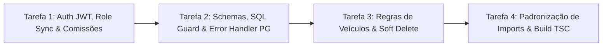

# Plano de Execução Guiado (TDD) — Correção de Bugs Funcionais e Segurança (`buf-fix`)

> **Objetivo**: Guiar um modelo de IA na correção pragmática dos 5 problemas críticos e funcionais identificados na auditoria da API (foco em pequenas e médias garagens de 10 a 15 funcionários, sem over-engineering).

---

## 🚨 PROTOCOLO DE EXECUÇÃO ESTRITA (REGRAS INEGOCIÁVEIS PARA O MODELO EXECUTOR)

1. **Ordem de Execução (Test-First / TDD)**:
   - Em cada tarefa, **atualize ou crie primeiro os testes automatizados** (`.spec.ts`), execute o comando de teste para confirmar a falha (*Red*), aplique a correção no código de produção até passar (*Green*) e valide a trava da tarefa.
2. **Proibição de Gambiarras (Anti-Reward Hacking)**:
   - **PROIBIDO** remover, comentar ou afrouxar asserções (`expect`) existentes para forçar testes a passarem.
   - **PROIBIDO** usar `any`, `@ts-ignore` ou `eslint-disable` para silenciar erros de compilação.
   - **PROIBIDO** alterar arquivos fora do escopo listado em cada tarefa.
3. **Trava de Qualidade (Quality Gate)**:
   - Você **ESTÁ BLOQUEADO** de avançar para a próxima Tarefa enquanto o comando de verificação da tarefa atual não passar com **100% de aprovação**.
4. **Padrão de Imports**:
   - Todo import interno deve usar os Subpath Imports do `package.json` com extensão `.js` (`#controllers/*`, `#services/*`, `#repositories/*`, `#schemas/*`, `#middlewares/*`, `#utils/*`, `#src/*`).

---

## Visão Geral das Tarefas



---

## Tarefa 1: Segurança de Autenticação, Sincronização de Role/Status e `commission_rates`

### Contexto do Problema
1. `src/utils/jwt.util.ts` usa fallback inseguro `'default-secret'` caso `JWT_SECRET` não esteja definido.
2. `src/middlewares/auth.middleware.ts` busca o usuário no banco, mas mantém `req.user.role` vindo do payload antigo do token em vez do banco.
3. `src/services/user.service.ts` (`login`) permite que usuários com `is_active = false` façam login e recebam token.
4. `src/repositories/user.repository.ts` (`create`) usa `data.commission_rates || 0`, gravando `0` em vez de `null` quando a comissão não é informada.

### Passo 1.1 — Variável de Ambiente de Teste e `jwt.util.ts`
1. No arquivo [`.env.test`](file:///c:/Users/User/Desktop/Projetos/back-end-site-garagem/.env.test), adicione ao final (se não existir):
   ```env
   JWT_SECRET=test_jwt_secret_key_for_vitest_suite
   ```
2. Edite [`src/utils/jwt.util.ts`](file:///c:/Users/User/Desktop/Projetos/back-end-site-garagem/src/utils/jwt.util.ts):
   - Substitua a leitura do segredo para validar a presença de `process.env.JWT_SECRET`:
   ```typescript
   import jwt from 'jsonwebtoken';

   const getSecretKey = (): string => {
     const secret = process.env.JWT_SECRET;
     if (!secret || secret.trim() === '') {
       throw new Error('Variável de ambiente JWT_SECRET não configurada.');
     }
     return secret;
   };

   export const generateToken = (payload: { id: string; email: string; role: string }) => {
     return jwt.sign(payload, getSecretKey(), { expiresIn: '30d' });
   };

   export const validateToken = (token: string) => {
     return jwt.verify(token, getSecretKey());
   };
   ```

### Passo 1.2 — Atualizar Testes Unitários (Red)
1. Em [`src/tests/middlewares/user/user.middleware.spec.ts`](file:///c:/Users/User/Desktop/Projetos/back-end-site-garagem/src/tests/middlewares/user/user.middleware.spec.ts), dentro do `describe('authenticateJWT')`, adicione o teste:
   ```typescript
   it('deve priorizar role e email atuais do banco sobre o payload antigo do token', async () => {
     const payload = {
       id: '7c9e6679-7425-40de-944b-e07fc1f90ae7',
       email: 'antigo@garagem.com',
       role: 'ADMIN',
     };
     const req = createRequest({
       headers: { authorization: 'Bearer token-valido' },
     });
     mockedValidateToken.mockReturnValue(payload as never);
     mockedFindById.mockResolvedValue({
       id: payload.id,
       email: 'novo@garagem.com',
       role: 'VISUALIZADOR',
       deleted_at: null,
       is_active: true,
     } as never);

     await authenticateJWT(req, res, next);

     expect(req.user).toEqual({
       id: payload.id,
       email: 'novo@garagem.com',
       role: 'VISUALIZADOR',
     });
     expect(next).toHaveBeenCalledTimes(1);
   });
   ```
2. Em [`src/tests/services/user/user.service.login.spec.ts`](file:///c:/Users/User/Desktop/Projetos/back-end-site-garagem/src/tests/services/user/user.service.login.spec.ts), adicione o teste:
   ```typescript
   it('deve lançar erro 401 quando o usuário estiver inativo (is_active = false)', async () => {
     mockUserRepository.findByEmail.mockResolvedValue(buildUser({ is_active: false }));
     vi.mocked(bcrypt.compare).mockResolvedValue(true as never);

     await expect(
       userService.login({
         email: USER_EMAIL,
         password: USER_PASSWORD,
       })
     ).rejects.toThrow('Credenciais inválidas');

     expect(jwt.sign).not.toHaveBeenCalled();
   });
   ```
3. Em [`src/tests/repositories/user/user.repository.spec.ts`](file:///c:/Users/User/Desktop/Projetos/back-end-site-garagem/src/tests/repositories/user/user.repository.spec.ts), no teste `'deve criar usuário com role padrão VENDEDOR quando role não for informada'`, adicione a asserção:
   ```typescript
   expect(user.commission_rates).toBeNull();
   ```

### Passo 1.3 — Implementar Correções em `auth.middleware.ts`, `user.service.ts` e `user.repository.ts` (Green)
1. Em [`src/middlewares/auth.middleware.ts`](file:///c:/Users/User/Desktop/Projetos/back-end-site-garagem/src/middlewares/auth.middleware.ts) (linhas 24-28), atualize a atribuição de `req.user` (usando `??` para manter compatibilidade com mocks parciais):
   ```typescript
   req.user = {
     id: user.id,
     email: user.email ?? payload.email,
     role: user.role ?? payload.role,
   };
   ```
2. Em [`src/services/user.service.ts`](file:///c:/Users/User/Desktop/Projetos/back-end-site-garagem/src/services/user.service.ts) (linhas 40-46), bloqueie usuários inativos no `login`:
   ```typescript
   const user = await this.userRepository.findByEmail(email);

   if (user === null || !user.is_active) {
     throw new AppError('Credenciais inválidas', 401);
   }

   const isMatch = await comparePassword(password, user.password_hash);

   if (isMatch === false) {
     throw new AppError('Credenciais inválidas', 401);
   }
   ```
3. Em [`src/repositories/user.repository.ts`](file:///c:/Users/User/Desktop/Projetos/back-end-site-garagem/src/repositories/user.repository.ts) (linha 51), altere `data.commission_rates || 0` para usar nullish coalescing:
   ```typescript
   data.commission_rates ?? null,
   ```

> 🔒 **TRAVA DA TAREFA 1 (Quality Gate)**:
> Execute: `npx vitest run src/tests/middlewares/user/ src/tests/services/user/ src/tests/repositories/user/ src/tests/e2e/user/`
> **Condição**: 100% dos testes passando.

---

## Tarefa 2: Correção do `baseFindQuerySchema`, Proteção de Identificadores SQL e Erros do PostgreSQL

### Contexto do Problema
1. [`src/schemas/base.schema.ts`](file:///c:/Users/User/Desktop/Projetos/back-end-site-garagem/src/schemas/base.schema.ts) expõe `updated_at_gte` e `updated_at_lte`, mas as tabelas `users`, `stores`, `brands` e `models` não possuem coluna `updated_at` no `schema.sql`, gerando erro 500 se filtradas.
2. [`src/utils/query.util.ts`](file:///c:/Users/User/Desktop/Projetos/back-end-site-garagem/src/utils/query.util.ts) interpola nomes de tabelas e colunas sem validar se são identificadores seguros.
3. [`src/middlewares/error.middleware.ts`](file:///c:/Users/User/Desktop/Projetos/back-end-site-garagem/src/middlewares/error.middleware.ts) não trata violações de chave única (`23505`) nem de chave estrangeira (`23503`, como tentar deletar uma marca que possui modelos vinculados), retornando erro 500.

### Passo 2.1 — Atualizar Testes de Middleware e Utilitários (Red)
1. Em [`src/tests/middlewares/error.middleware.spec.ts`](file:///c:/Users/User/Desktop/Projetos/back-end-site-garagem/src/tests/middlewares/error.middleware.spec.ts), adicione dois testes:
   ```typescript
   it('deve responder com status 409 quando ocorrer erro 23505 (violação de unicidade do PostgreSQL)', () => {
     const pgError = Object.assign(new Error('duplicate key value violates unique constraint'), {
       code: '23505',
     });

     errorHandler(pgError, req, res, next);

     expect(res.status).toHaveBeenCalledWith(409);
     expect(res.json).toHaveBeenCalledWith({
       message: 'Registro duplicado ou já existente.',
     });
   });

   it('deve responder com status 409 quando ocorrer erro 23503 (violação de chave estrangeira do PostgreSQL)', () => {
     const pgError = Object.assign(new Error('update or delete on table violates foreign key constraint'), {
       code: '23503',
     });

     errorHandler(pgError, req, res, next);

     expect(res.status).toHaveBeenCalledWith(409);
     expect(res.json).toHaveBeenCalledWith({
       message: 'Operação não permitida: registro vinculado a outros dados.',
     });
   });
   ```

### Passo 2.2 — Implementar Correções em `base.schema.ts`, `query.util.ts` e `error.middleware.ts` (Green)
1. Em [`src/schemas/base.schema.ts`](file:///c:/Users/User/Desktop/Projetos/back-end-site-garagem/src/schemas/base.schema.ts), remova `updated_at_gte` e `updated_at_lte`:
   ```typescript
   import { z } from 'zod';

   const deleteActiveEnumValidate = z.enum(['true', 'false'], 'Este campo aceita apenas "true" ou "false"').optional();
   const dateValidation = z.string().date().optional();

   export const baseFindQuerySchema = z.object({
     include_deleted: z.string().optional(),
     is_active: deleteActiveEnumValidate,
     created_at_gte: dateValidation,
     created_at_lte: dateValidation,
     page: z.coerce.number().min(1, 'A paginação não pode ser menor que 1').optional(),
     limit: z.coerce.number().min(1, 'O limte da consulta não pode ser menor que 1').optional()
   });
   ```
2. Em [`src/utils/query.util.ts`](file:///c:/Users/User/Desktop/Projetos/back-end-site-garagem/src/utils/query.util.ts), adicione validação de identificador seguro (`assertValidIdentifier`) para `tableName`, `columns` e `filter.field`:
   ```typescript
   import { FindData } from '#repositories/base.repository.js';
   import { BadRequestError } from '#src/errors/app.error.js';

   const SAFE_IDENTIFIER_REGEX = /^[a-zA-Z_][a-zA-Z0-9_]*$/;

   function assertValidIdentifier(identifier: string): void {
     if (!SAFE_IDENTIFIER_REGEX.test(identifier)) {
       throw new BadRequestError(`Identificador inválido: ${identifier}`);
     }
   }
   ```
   - Chame `assertValidIdentifier(tableName)` no início de `buildInsertQuery`, `buildUpdateQuery` e `buildFindQuery`.
   - Chame `columns.forEach(assertValidIdentifier)` em `buildInsertQuery` e `buildUpdateQuery`.
   - Chame `assertValidIdentifier(filter.field)` dentro do loop de `buildFindQuery`.
3. Em [`src/middlewares/error.middleware.ts`](file:///c:/Users/User/Desktop/Projetos/back-end-site-garagem/src/middlewares/error.middleware.ts), adicione o tratamento de códigos do PostgreSQL antes do retorno 500:
   ```typescript
   const pgCode = (error as { code?: string }).code;

   if (pgCode === '23505') {
     return res.status(409).json({ message: 'Registro duplicado ou já existente.' });
   }

   if (pgCode === '23503') {
     return res.status(409).json({
       message: 'Operação não permitida: registro vinculado a outros dados.',
     });
   }
   ```

> 🔒 **TRAVA DA TAREFA 2 (Quality Gate)**:
> Execute: `npx vitest run src/tests/middlewares/error.middleware.spec.ts src/tests/schemas/`
> **Condição**: 100% dos testes passando.

---

## Tarefa 3: Blindagem de Regras de Negócio e Soft Delete em Veículos (`vehicles`)

### Contexto do Problema
1. Na vitrine pública (`GET /api/vehicles`), enviar `?include_deleted=true` desativa o filtro `v.deleted_at IS NULL` porque `VehicleService.parseQueryFilters` lê `query.include_deleted` mesmo quando `publicOnly === true`.
2. `buildUpdateQuery` e `VehicleRepository.updateWithFeatures` não filtram `AND deleted_at IS NULL`, permitindo atualizar registros que já foram deletados via soft delete.
3. `VehicleService.update` permite mudar um veículo para `CONSIGNADO` sem informar dados de proprietário/comissão, ou zerar `purchase_price` de um veículo `PROPRIO`.

### Passo 3.1 — Atualizar Testes de Serviço, Repositório e E2E de Veículos (Red)
1. Em [`src/tests/services/vehicle/vehicle.service.spec.ts`](file:///c:/Users/User/Desktop/Projetos/back-end-site-garagem/src/tests/services/vehicle/vehicle.service.spec.ts), dentro do `describe('Criação e atualização com extração automática de plate_last_digit')`, configure `vi.mocked(vehicleRepository.findById).mockResolvedValue(mockVehicle);` no teste de `update` e adicione os seguintes testes:
   ```typescript
   it('deve lançar BadRequestError no update ao mudar para CONSIGNADO sem dados do proprietário', async () => {
     vi.mocked(vehicleRepository.findById).mockResolvedValue(mockVehicle);

     await expect(
       vehicleService.update(mockVehicle.id, { sale_type: 'CONSIGNADO' })
     ).rejects.toThrow(BadRequestError);

     expect(vehicleRepository.updateWithFeatures).not.toHaveBeenCalled();
   });

   it('deve ignorar include_deleted=true na busca pública (findPublic)', async () => {
     vi.mocked(vehicleRepository.findCatalog).mockResolvedValue({
       items: [],
       total: 0,
       page: 1,
       limit: 12,
     });

     await vehicleService.findPublic({ include_deleted: 'true' });

     expect(vehicleRepository.findCatalog).toHaveBeenCalledWith(
       expect.objectContaining({
         publicOnly: true,
         include_deleted: false,
       })
     );
   });
   ```
2. Em [`src/tests/repositories/vehicle/vehicle.repository.spec.ts`](file:///c:/Users/User/Desktop/Projetos/back-end-site-garagem/src/tests/repositories/vehicle/vehicle.repository.spec.ts), dentro do `describe('updateWithFeatures')`, adicione o teste:
   ```typescript
   it('deve retornar null ao tentar atualizar um veículo já deletado (soft delete)', async () => {
     const store = await createHelperStore();
     const { model } = await createHelperBrandAndModel();

     const vehicle = await vehicleRepository.createWithFeatures(
       makeVehicleData(store.id, model.id),
       []
     );
     createdVehicleIds.add(vehicle.id);

     await vehicleRepository.delete(vehicle.id);

     const updated = await vehicleRepository.updateWithFeatures(
       vehicle.id,
       { sale_price: 85000 }
     );
     expect(updated).toBeNull();
   });
   ```

### Passo 3.2 — Implementar Correções em `query.util.ts`, `base.repository.ts`, `vehicle.repository.ts` e `vehicle.service.ts` (Green)
1. Em [`src/utils/query.util.ts`](file:///c:/Users/User/Desktop/Projetos/back-end-site-garagem/src/utils/query.util.ts), adicione parâmetro opcional `options?: { softDelete?: boolean }` em `buildUpdateQuery`:
   ```typescript
   export function buildUpdateQuery(
     tableName: string,
     data: Record<string, unknown>,
     id: string,
     options?: { softDelete?: boolean }
   ): { query: string; values: unknown[] } {
     assertValidIdentifier(tableName);
     const columns = Object.keys(data);
     columns.forEach(assertValidIdentifier);
     const values = Object.values(data);
     const setClause = columns.map((column, index) => `${column} = $${index + 1}`).join(', ');
     const useSoftDelete = options?.softDelete !== false;
     const softDeleteClause = useSoftDelete ? ' AND deleted_at IS NULL' : '';
     const query = `UPDATE ${tableName} SET ${setClause} WHERE id = $${columns.length + 1}${softDeleteClause} RETURNING *;`;

     return { query, values: [...values, id] };
   }
   ```
2. Em [`src/repositories/base.repository.ts`](file:///c:/Users/User/Desktop/Projetos/back-end-site-garagem/src/repositories/base.repository.ts) (linha 69), repasse `this.options` para `buildUpdateQuery`:
   ```typescript
   const { query, values } = buildUpdateQuery(this.tableName, data as Record<string, unknown>, id, this.options);
   ```
3. Em [`src/repositories/vehicle.repository.ts`](file:///c:/Users/User/Desktop/Projetos/back-end-site-garagem/src/repositories/vehicle.repository.ts) (linhas 200-210), garanta que `updateWithFeatures` filtre `deleted_at IS NULL` tanto no `buildUpdateQuery` (que já usa `softDelete: true` por padrão) quanto no `SELECT`:
   ```typescript
   const res = await client.query<Vehicle>(
     'SELECT * FROM vehicles WHERE id = $1 AND deleted_at IS NULL',
     [id]
   );
   ```
4. Em [`src/services/vehicle.service.ts`](file:///c:/Users/User/Desktop/Projetos/back-end-site-garagem/src/services/vehicle.service.ts):
   - No método `parseQueryFilters` (linha 178), altere `include_deleted` para:
     ```typescript
     include_deleted: publicOnly ? false : query.include_deleted === 'true',
     ```
   - No método `update` (linhas 48-75), busque o veículo atual, valide a existência e valide a regra `PROPRIO` vs `CONSIGNADO` sobre o estado mesclado antes de chamar `updateWithFeatures`:
     ```typescript
     const currentVehicle = await this.repository.findById(id);
     if (!currentVehicle) {
       throw new NotFoundError('Veículo não encontrado');
     }

     const merged = { ...currentVehicle, ...cleanData };
     if (merged.sale_type === 'PROPRIO') {
       if (
         merged.purchase_price === undefined ||
         merged.purchase_price === null ||
         Number(merged.purchase_price) <= 0
       ) {
         throw new BadRequestError(
           'Preço de compra é obrigatório e deve ser maior que zero para veículos próprios'
         );
       }
     } else if (merged.sale_type === 'CONSIGNADO') {
       if (
         !merged.owner_name ||
         merged.owner_name.trim().length < 2 ||
         !merged.owner_contact ||
         merged.owner_contact.trim().length < 8 ||
         merged.owner_price === undefined ||
         merged.owner_price === null ||
         Number(merged.owner_price) <= 0 ||
         merged.store_commission_rate === undefined ||
         merged.store_commission_rate === null ||
         Number(merged.store_commission_rate) < 0
       ) {
         throw new BadRequestError(
           'Dados do proprietário, valor líquido e comissão são obrigatórios para veículos consignados'
         );
       }
     }
     ```

> 🔒 **TRAVA DA TAREFA 3 (Quality Gate)**:
> Execute: `npx vitest run src/tests/services/vehicle/ src/tests/repositories/vehicle/ src/tests/e2e/vehicle/`
> **Condição**: 100% dos testes passando.

---

## Tarefa 4: Padronização de Imports (`.js`) e Correção do Build de Produção (`npm run build`)

### Contexto do Problema
Com `"moduleResolution": "NodeNext"` no `tsconfig.json`, imports relativos sem extensão `.js` funcionam no `tsx` em desenvolvimento, mas quebram o build ou a execução em produção (`node dist/server.js`). Além disso, `src/server.ts` possui um `.catch()` interno que engole falhas de conexão com o PostgreSQL no boot.

### Passo 4.1 — Padronizar Imports para Subpath Imports com `.js`
Substitua os imports sem extensão `.js` nos seguintes arquivos:

1. **Controllers** (`src/controllers/brand.controller.ts`, `feature.controller.ts`, `model.controller.ts`, `store.controller.ts`, `vehicle.controller.ts`):
   - De: `import BaseController from './base.controller';`
   - Para: `import BaseController from '#controllers/base.controller.js';`
2. **Services** (`src/services/brand.service.ts`, `feature.service.ts`, `model.service.ts`, `store.service.ts`, `vehicle.service.ts`):
   - De: `import BaseService from './base.service';`
   - Para: `import BaseService from '#services/base.service.js';`
3. **`src/services/user.service.ts`**:
   - De: `import { comparePassword, hashPassword } from '../utils/hash.util';`
   - Para: `import { comparePassword, hashPassword } from '#utils/hash.util.js';`
4. **Repositories** (`src/repositories/brand.repository.ts`, `feature.repository.ts`, `model.repository.ts`, `store.repository.ts`, `user.repository.ts`, `vehicle.repository.ts`):
   - De: `import BaseRepository from './base.repository';`
   - Para: `import BaseRepository from '#repositories/base.repository.js';`
5. **Conexão Database nos Repositories** (`src/repositories/base.repository.ts`, `store.repository.ts`, `user.repository.ts`):
   - De: `import pool from '../config/database';`
   - Para: `import pool from '#src/config/database.js';`
6. **Schemas** (`src/schemas/brand.schema.ts`, `model.schema.ts`, `store.schema.ts`, `user.schema.ts`):
   - De: `import { baseFindQuerySchema } from './base.schema';`
   - Para: `import { baseFindQuerySchema } from '#schemas/base.schema.js';`
7. **`src/server.ts`**:
   - Atualize os imports e o `main()` para abortar o processo caso o PostgreSQL esteja inacessível no boot:
   ```typescript
   import 'dotenv/config';
   import app from '#src/app.js';
   import pool from '#src/config/database.js';

   const PORT = process.env.PORT || 3000;

   async function main() {
     try {
       await pool.query('SELECT NOW()');
       console.log('PostgreSQL conectado com sucesso!');

       app.listen(PORT, () => {
         console.log(`Servidor rodando em http://localhost:${PORT}`);
       });
     } catch (error) {
       console.error('Erro ao conectar ao PostgreSQL:', error);
       process.exit(1);
     }
   }

   main();
   ```

> 🔒 **TRAVA FINAL DA TAREFA 4 (Quality Gate Global)**:
> Execute na sequência:
> 1. `npm run build` (deve compilar `tsc` sem erros)
> 2. `npm run lint` (deve passar sem erros)
> 3. `npx vitest run` (toda a suíte unitária, de integração e E2E deve passar 100%)
