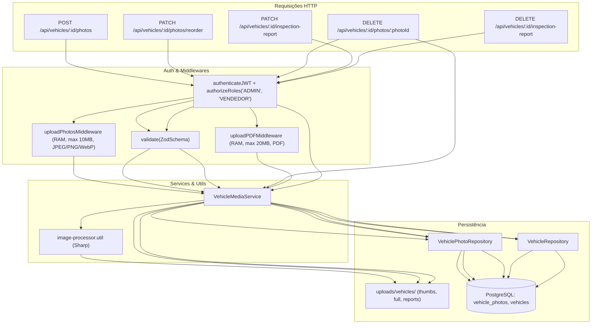

# Plano de Execução Guiado (TDD) — Fase 4: Processamento de Mídias, Galeria Drag & Drop e Laudo PDF

> **Objetivo**: Guiar um modelo menor (Executor) na implementação estrita da Fase 4 com **zero ambiguidade**, e fornecer critérios claros para que um modelo maior (Auditor Sênior) realize a revisão de código e garanta conformidade com as regras (`RN006`, `RN008`, `UC07`).

---

## 🚨 PROTOCOLO DE EXECUÇÃO ESTRITA (PARA O MODELO EXECUTOR)

1. **Test-First Obrigatório (TDD)**:
   - Em cada subfase, você **DEVE** criar primeiro o arquivo de teste especificado (`.spec.ts`), rodar o comando da trava para confirmar o estado *Red* (falha esperada), e só então criar o código de produção até que todos passem (*Green*).
2. **Proibição de Gambiarras (Anti-Reward Hacking)**:
   - **PROIBIDO** alterar, simplificar, comentar ou apagar asserções (`expect`) de testes existentes ou novos.
   - **PROIBIDO** usar `any`, `@ts-ignore` ou `eslint-disable`.
   - **PROIBIDO** criar caminhos estáticos ou mocks no código de produção para enganar testes.
3. **Trava de Qualidade por Subfase (Quality Gate)**:
   - Você **ESTÁ BLOQUEADO** de passar para a subfase seguinte enquanto o comando da trava atual não retornar **100% de aprovação**.
4. **Padrão de Imports**:
   - Todo import interno deve usar os Subpath Imports do `package.json` com extensão `.js` (`#controllers/*`, `#services/*`, `#repositories/*`, `#schemas/*`, `#middlewares/*`, `#utils/*`, `#src/config/database.js`, `#src/errors/app.error.js`).

---

## 🔍 PROTOCOLO DE AUDITORIA (PARA O MODELO SÊNIOR / REVISOR)

O modelo auditor deve inspecionar os arquivos criados checando este checklist:
- [ ] **Segurança & Path Traversal**: Nomes de arquivos gerados usam UUIDs ou hashes aleatórios. Nunca confiar no `originalname` do cliente para salvar em disco.
- [ ] **Limpeza de Memória & Arquivos Órfãos**: Multer usa `memoryStorage`. Buffers são liberados após o processamento. Ao atualizar ou excluir laudo/foto, o arquivo físico correspondente é removido do disco.
- [ ] **Atomicidade de Transações (ACID)**: Métodos que alteram múltiplas fotos (`createMany`, `reorder`) usam transação explícita com `BEGIN`, `COMMIT`, `ROLLBACK` e `client.release()` no `finally`.
- [ ] **Conformidade com RN006 e RN008**:
  - `thumb` = 400x300, WebP, 80% qualidade, `fit: cover`.
  - `full` = 1280x960, WebP, 80% qualidade, `fit: inside`, `withoutEnlargement: true`.
  - Índice `0` na reordenação tem obrigatoriamente `is_primary = true`, todos os demais `false`.
- [ ] **Tipagem e Linter**: `npm run lint` e `npm run build` passam sem avisos ou erros.

---

## Fluxo Geral de Arquitetura



---

## Subfase 4.1: Dependências, .gitignore e Utilitário Sharp (`RN006`)

### Passo 4.1.1 — Instalar Dependências e Atualizar `.gitignore`
1. Executar comandos:
   ```bash
   npm install multer sharp
   npm install -D @types/multer @types/sharp
   ```
2. Adicionar ao final de `.gitignore`:
   ```
   uploads/
   ```

### Passo 4.1.2 — Criar Contrato de Teste (`src/tests/utils/image-processor.util.spec.ts`)
Criar o arquivo de testes validando:
1. `processVehiclePhoto(buffer, vehicleId, photoId)`:
   - Recebe buffer de imagem válido (gerar buffer PNG/JPEG mínimo com Sharp no teste).
   - Gera arquivo `thumb` em `uploads/vehicles/thumbs/${photoId}.webp` com dimensões 400x300 e formato WebP.
   - Gera arquivo `full` em `uploads/vehicles/full/${photoId}.webp` com largura máxima 1280 e formato WebP.
   - Retorna `{ thumb_path: '/uploads/vehicles/thumbs/...', full_path: '/uploads/vehicles/full/...' }`.
   - Cria os diretórios automaticamente se não existirem.
2. `processVehiclePhoto` com buffer inválido (texto corrompido):
   - Rejeita com erro apropriado (`AppError` ou erro tratado do Sharp).
3. `deletePhotoFiles(thumbPath, fullPath)`:
   - Remove com segurança os dois arquivos do disco se existirem, sem lançar erro caso o arquivo já tenha sido removido.

### Passo 4.1.3 — Implementar `src/utils/image-processor.util.ts`
Implementar e exportar:
- `ensureUploadDirs()`: garante a existência de `uploads/vehicles/thumbs`, `uploads/vehicles/full` e `uploads/vehicles/reports` usando `fs.mkdirSync(..., { recursive: true })`.
- `processVehiclePhoto(buffer: Buffer, vehicleId: string, photoId: string): Promise<{ thumb_path: string; full_path: string }>`:
  - Redimensiona e comprime para WebP (quality 80).
  - Salva em disco e retorna caminhos relativos para acesso estático.
- `deletePhotoFiles(thumbPath: string, fullPath: string): Promise<void>`:
  - Remove arquivos via `fs.promises.unlink`. Ignora se o arquivo não existir (`ENOENT`).
- `deleteReportFile(reportPath: string): Promise<void>`:
  - Remove arquivo de laudo físico com segurança.

> 🔒 **TRAVA DA SUBFASE 4.1 (Quality Gate)**:
> ```bash
> npx vitest run src/tests/utils/image-processor.util.spec.ts
> ```
> **Condição**: 100% dos testes devem passar.

---

## Subfase 4.2: Schemas Zod e Middleware de Upload (`Multer`)

### Passo 4.2.1 — Criar Contrato de Testes dos Schemas (`src/tests/schemas/vehicle/vehicle-media.schema.spec.ts`)
Validar os novos schemas:
1. `reorderPhotosSchema`:
   - Aceitar `params.id` como UUID e `body.photo_ids` como array de UUIDs.
   - Rejeitar `body.photo_ids` vazio (`[]`).
   - Rejeitar `body.photo_ids` com UUIDs duplicados.
   - Rejeitar se contiver strings que não sejam UUIDs.
2. `deletePhotoSchema`:
   - Aceitar `params.id` (UUID do veículo) e `params.photoId` (UUID da foto).
   - Rejeitar parâmetros inválidos.

### Passo 4.2.2 — Implementar Schemas em `src/schemas/vehicle.schema.ts`
Exportar:
- `reorderPhotosSchema`:
  ```typescript
  export const reorderPhotosSchema = z.object({
    params: z.object({
      id: idValidation,
    }),
    body: z.object({
      photo_ids: z
        .array(z.string().uuid('ID de foto inválido'))
        .min(1, 'Informe ao menos um ID de foto')
        .refine(
          (ids) => new Set(ids).size === ids.length,
          'A lista de fotos não pode conter IDs duplicados'
        ),
    }),
  });
  ```
- `deletePhotoSchema`:
  ```typescript
  export const deletePhotoSchema = z.object({
    params: z.object({
      id: idValidation,
      photoId: z.string().uuid('ID da foto inválido'),
    }),
  });
  ```

### Passo 4.2.3 — Criar Contrato de Testes do Middleware (`src/tests/middlewares/upload.middleware.spec.ts`)
Validar com app Express minimalista:
1. `uploadVehiclePhotos`:
   - Aceitar envio de 1 a 15 arquivos de imagem (`image/jpeg`, `image/png`, `image/webp`).
   - Arquivos ficam disponíveis em `req.files` como `Buffer` (`memoryStorage`).
   - Rejeitar arquivo com extensão/MIME não permitido (ex: `.pdf`, `.txt`) com status 400 e mensagem explicativa.
   - Rejeitar quando arquivo ultrapassar 10MB (`MulterError: LIMIT_FILE_SIZE`).
2. `uploadInspectionReport`:
   - Aceitar arquivo único `report` com MIME `application/pdf`.
   - Rejeitar arquivo de imagem ou texto com status 400.
   - Rejeitar quando arquivo ultrapassar 20MB.

### Passo 4.2.4 — Implementar `src/middlewares/upload.middleware.ts`
- Configurar `multer.memoryStorage()`.
- Filtros de validação de MIME type com lançamento de `AppError(400, ...)`.
- Criar wrappers para capturar `MulterError` e retornar respostas padronizadas via `AppError`.
- Exportar `uploadVehiclePhotos` e `uploadInspectionReport`.
- Atualizar `src/middlewares/error.middleware.ts` se necessário para garantir que qualquer `multer.MulterError` que escape receba status 400.

> 🔒 **TRAVA DA SUBFASE 4.2 (Quality Gate)**:
> ```bash
> npx vitest run src/tests/schemas/vehicle/vehicle-media.schema.spec.ts src/tests/middlewares/upload.middleware.spec.ts
> ```
> **Condição**: 100% dos testes devem passar.

---

## Subfase 4.3: Contrato de Repositório (`VehiclePhotoRepository`)

### Passo 4.3.1 — Criar Contrato de Teste de Integração (`src/tests/repositories/vehicle/vehicle-photo.repository.spec.ts`)
Validar no PostgreSQL real de testes (`api_garage_test`):
1. `createMany(vehicleId, photos)`:
   - Insere múltiplas fotos em lote vinculadas ao `vehicleId`.
   - Grava campos: `vehicle_id`, `thumb_path`, `full_path`, `display_order`, `is_primary`.
   - Retorna os registros inseridos.
2. `findByVehicleId(vehicleId)`:
   - Retorna as fotos do veículo ordenadas por `display_order ASC`.
3. `reorder(vehicleId, photoIds)`:
   - Em transação atômica (`BEGIN ... COMMIT`):
     - Atualiza `display_order = index` para cada foto no array.
     - Define `is_primary = true` estritamente para o índice 0 (`RN008`).
     - Define `is_primary = false` para todos os índices > 0.
   - Faz **rollback** e lança erro se algum `photoId` não pertencer àquele `vehicleId`.
4. `countByVehicleId(vehicleId)`:
   - Retorna `{ count: number; maxOrder: number }`.
5. `delete(id)`:
   - Remove a linha de `vehicle_photos`.
6. Atualização em `VehicleRepository`:
   - `updateInspectionReport(id, url)`: atualiza `inspection_report_url` e `updated_at` na tabela `vehicles`.

### Passo 4.3.2 — Implementar `src/repositories/vehicle-photo.repository.ts` e Atualizar `VehicleRepository`
1. Criar `src/repositories/vehicle-photo.repository.ts`:
   - Tipos explícitos: `VehiclePhoto`, `CreatePhotoData`.
   - Queries parametrizadas `$1, $2...` para proteção contra SQL Injection.
   - Transação SQL explícita no `reorder` usando `pool.connect()`.
2. Em `src/repositories/vehicle.repository.ts`:
   - Adicionar método `updateInspectionReport(id: string, url: string | null): Promise<Vehicle | null>`.

> 🔒 **TRAVA DA SUBFASE 4.3 (Quality Gate)**:
> ```bash
> npx vitest run src/tests/repositories/vehicle/vehicle-photo.repository.spec.ts
> ```
> **Condição**: 100% dos testes devem passar.

---

## Subfase 4.4: Regras de Negócio e Service Layer (`VehicleMediaService`)

### Passo 4.4.1 — Criar Contrato de Testes Unitários (`src/tests/services/vehicle/vehicle-media.service.spec.ts`)
Testar com mocks de repositório e de processador de imagem:
1. `uploadPhotos(vehicleId, files)`:
   - Lança `NotFoundError` (404) se veículo não existir.
   - Lança `AppError(400)` se nenhum arquivo for enviado.
   - Se o veículo tem 0 fotos: primeira foto recebe `display_order = 0` e `is_primary = true` (`RN008`).
   - Se o veículo já tem fotos: novas fotos entram no final (`display_order = maxOrder + 1 + index`) com `is_primary = false`.
   - Retorna as fotos criadas.
2. `reorderPhotos(vehicleId, photoIds)`:
   - Lança `NotFoundError` (404) se veículo não existir.
   - Lança `AppError(400)` se a quantidade de `photoIds` for diferente da quantidade total de fotos do veículo.
   - Chama `vehiclePhotoRepository.reorder(vehicleId, photoIds)` e retorna as fotos reordenadas.
3. `deletePhoto(vehicleId, photoId)`:
   - Lança `NotFoundError` (404) se veículo ou foto não existir.
   - Lança `AppError(400)` se a foto não pertencer ao veículo.
   - Remove arquivos físicos do disco via `deletePhotoFiles`.
   - Deleta do banco.
   - Se a foto deletada era a capa (`is_primary = true`) e sobraram fotos: elege a foto de menor `display_order` como nova capa (`is_primary = true`).
4. `uploadInspectionReport(vehicleId, file)`:
   - Lança `NotFoundError` (404) se veículo não existir.
   - Lança `AppError(400)` se arquivo não for enviado.
   - Salva PDF no diretório `uploads/vehicles/reports/<uuid>.pdf`.
   - Se o veículo já possuía `inspection_report_url`, remove o arquivo antigo do disco.
   - Atualiza URL no banco e retorna o veículo atualizado.
5. `deleteInspectionReport(vehicleId)`:
   - Remove o PDF físico e atualiza banco com `inspection_report_url = null`.

### Passo 4.4.2 — Implementar `src/services/vehicle-media.service.ts`
Implementar a classe `VehicleMediaService` com os métodos descritos e tratamento limpo de exceções.

> 🔒 **TRAVA DA SUBFASE 4.4 (Quality Gate)**:
> ```bash
> npx vitest run src/tests/services/vehicle/vehicle-media.service.spec.ts
> ```
> **Condição**: 100% dos testes devem passar.

---

## Subfase 4.5: Controller, Rotas e Exposição de Estáticos Express

### Passo 4.5.1 — Implementar `src/controllers/vehicle-media.controller.ts`
Handlers HTTP:
- `uploadPhotos`: extrai `req.params.id` e `req.files as Express.Multer.File[]` -> status `201`.
- `reorderPhotos`: extrai `req.params.id` e `req.body.photo_ids` -> status `200`.
- `deletePhoto`: extrai `req.params.id` e `req.params.photoId` -> status `200`.
- `uploadInspectionReport`: extrai `req.params.id` e `req.file` -> status `200`.
- `deleteInspectionReport`: extrai `req.params.id` -> status `200`.

### Passo 4.5.2 — Atualizar `src/routes/vehicle.routes.ts` e `src/app.ts`
1. Em `src/routes/vehicle.routes.ts`, adicionar as rotas:
   - `POST /:id/photos`: `authenticateJWT`, `authorizeRoles('ADMIN', 'VENDEDOR')`, `uploadVehiclePhotos`, `vehicleMediaController.uploadPhotos`
   - `PATCH /:id/photos/reorder`: `authenticateJWT`, `authorizeRoles('ADMIN', 'VENDEDOR')`, `validate(reorderPhotosSchema)`, `vehicleMediaController.reorderPhotos`
   - `DELETE /:id/photos/:photoId`: `authenticateJWT`, `authorizeRoles('ADMIN', 'VENDEDOR')`, `validate(deletePhotoSchema)`, `vehicleMediaController.deletePhoto`
   - `PATCH /:id/inspection-report`: `authenticateJWT`, `authorizeRoles('ADMIN', 'VENDEDOR')`, `uploadInspectionReport`, `vehicleMediaController.uploadInspectionReport`
   - `DELETE /:id/inspection-report`: `authenticateJWT`, `authorizeRoles('ADMIN', 'VENDEDOR')`, `vehicleMediaController.deleteInspectionReport`
2. Em `src/app.ts`:
   - Importar `path` do Node.
   - Adicionar middleware: `app.use('/uploads', express.static(path.resolve(process.cwd(), 'uploads')));`.

> 🔒 **TRAVA DA SUBFASE 4.5 (Quality Gate)**:
> ```bash
> npm run build
> ```
> **Condição**: Compilação TypeScript com 0 erros de tipagem.

---

## Subfase 4.6: Contrato E2E, Validação Global e Limpeza

### Passo 4.6.1 — Criar `src/tests/e2e/vehicle/vehicle-media.e2e.spec.ts`
Criar suíte de testes de ponta a ponta com Supertest:
1. `POST /api/vehicles/:id/photos`:
   - Faz upload real de 2 imagens anexadas via `.attach('photos', ...)`.
   - Valida retorno `201` com `thumb_path` e `full_path`.
   - Verifica existência física dos arquivos WebP no disco.
   - Confirma que a primeira foto tem `is_primary = true` e `display_order = 0`.
   - Tenta upload sem token -> `401`.
   - Tenta upload com token de `VISUALIZADOR` -> `403`.
   - Tenta upload de arquivo `.txt` -> `400`.
2. `PATCH /api/vehicles/:id/photos/reorder`:
   - Inverte a ordem das duas fotos criadas -> `200`.
   - Confirma que a nova foto no índice 0 passou a ter `is_primary = true` e a antiga passou a ter `false` (`RN008`).
   - Tenta enviar UUIDs inexistentes ou duplicados -> `400`.
3. `PATCH /api/vehicles/:id/inspection-report`:
   - Anexa arquivo PDF real via `.attach('report', ...)`.
   - Retorna `200` com `inspection_report_url`.
   - Acesso estático via `GET /uploads/vehicles/reports/...` retorna `200` e `content-type: application/pdf`.
   - Upload de arquivo não PDF retorna `400`.
4. `DELETE /api/vehicles/:id/photos/:photoId`:
   - Exclui uma foto -> `200`.
   - Confirma que arquivo físico foi apagado do disco.
5. Hook `afterAll`:
   - Remove todos os arquivos e pastas criados dentro de `uploads/` durante o teste para manter o repositório limpo.

### Passo 4.6.2 — Atualizar Documentação da API
- Sincronizar endpoints em `Docs/api-routes.md`.
- Sincronizar OpenAPI em `Docs/openapi.yaml`.

---

## 🔒 TRAVA FINAL DE ENTREGA (GLOBAL QUALITY GATE)

Executar obrigatoriamente nesta ordem no terminal:

```bash
# 1. Executar todos os testes do repositório (40+ arquivos devem passar)
npm test -- --run

# 2. Executar linter em todo o projeto
npm run lint

# 3. Compilar projeto para dist
npm run build
```

**Condição de Sucesso**:
- Zero testes falhando (`100% passed`).
- Zero erros de ESLint.
- Zero erros de TypeScript (`tsc`).
