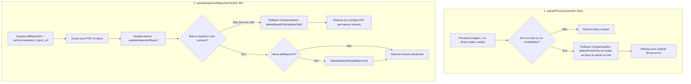

# Plano de Execução Guiado (TDD) — Fase 4.7: Rollback Compensatório de Mídias e Atomicidade

> **Objetivo**: Guiar um modelo menor (Executor) na correção estrita de 3 pontos identificados na auditoria da Fase 4: Rollback Compensatório no upload de fotos, substituição segura do laudo PDF e transação explícita em `createMany`.

---

## 🚨 PROTOCOLO DE EXECUÇÃO ESTRITA (PARA O MODELO EXECUTOR)

1. **Test-First Obrigatório (TDD)**:
   - Em cada passo, você **DEVE** atualizar primeiro o arquivo de teste especificado (`.spec.ts`), rodar o comando da trava para confirmar o estado *Red* (falha esperada dos novos testes), e só então alterar o código de produção até que todos passem (*Green*).
2. **Proibição de Gambiarras (Anti-Reward Hacking)**:
   - **PROIBIDO** alterar, simplificar, comentar ou apagar asserções (`expect`) de testes existentes.
   - **PROIBIDO** usar `any`, `@ts-ignore` ou `eslint-disable`.
   - Manter todos os Subpath Imports com extensão `.js`.
3. **Trava de Qualidade (Quality Gate)**:
   - Você **ESTÁ BLOQUEADO** de concluir a tarefa enquanto os comandos da trava final não retornarem **100% de aprovação**.

---

## 🔍 PROTOCOLO DE AUDITORIA (PARA O MODELO SÊNIOR / REVISOR)

- [ ] **Transação Explícita em `createMany`**: `VehiclePhotoRepository.createMany` utiliza `const client = await pool.connect()`, `BEGIN`, `COMMIT`, `ROLLBACK` no `catch` e `client.release()` no `finally`.
- [ ] **Rollback Compensatório em `uploadPhotos`**: Se qualquer imagem do lote falhar no processamento ou se `createMany` falhar no banco, todos os arquivos físicos `.webp` já gerados naquele lote são deletados no bloco `catch` via `deletePhotoFiles`.
- [ ] **Substituição Segura em `uploadInspectionReport`**: O laudo antigo (`oldReportUrl`) só é apagado do disco **após** o banco confirmar a atualização do novo laudo. Se a atualização do banco falhar ou retornar `null`, o novo arquivo PDF recém-criado é apagado do disco no `catch` e o laudo antigo permanece intacto.
- [ ] **Testes, Linter e Build**: Todos os testes unitários, de integração e E2E da Fase 4 passam, `npm run lint` tem 0 erros e `npm run build` compila limpo.

---

## Fluxo de Rollback Compensatório



---

## Passo 1 — Adicionar Novos Testes Unitários (`src/tests/services/vehicle/vehicle-media.service.spec.ts`)

Adicionar os seguintes testes unitários (sem remover nenhum teste existente):

1. Dentro de `describe('uploadPhotos', ...)`:
   ```typescript
   it('deve remover do disco as fotos já processadas no lote se ocorrer erro no banco (rollback compensatório)', async () => {
     vi.spyOn(photoRepo, 'countByVehicleId').mockResolvedValue({ count: 0, maxOrder: -1 });
     vi.spyOn(photoRepo, 'createMany').mockRejectedValue(new Error('DB failure'));

     const files = [
       { buffer: Buffer.from('img1') },
       { buffer: Buffer.from('img2') },
     ] as Express.Multer.File[];

     await expect(service.uploadPhotos(vehicleId, files)).rejects.toThrow('DB failure');

     expect(imageProcessor.deletePhotoFiles).toHaveBeenCalledTimes(2);
   });
   ```

2. Dentro de `describe('uploadInspectionReport', ...)`:
   ```typescript
   it('não deve apagar o laudo antigo e deve remover o novo PDF se a atualização no banco falhar', async () => {
     vi.spyOn(vehicleRepo, 'findById').mockResolvedValue({
       ...fakeVehicle,
       inspection_report_url: '/uploads/vehicles/reports/antigo.pdf',
     } as unknown as Vehicle);

     vi.spyOn(vehicleRepo, 'updateInspectionReport').mockResolvedValue(null);

     const file = { buffer: Buffer.from('%PDF-1.4 test') } as Express.Multer.File;

     await expect(service.uploadInspectionReport(vehicleId, file)).rejects.toThrow(AppError);

     expect(imageProcessor.deleteReportFile).not.toHaveBeenCalledWith(
       '/uploads/vehicles/reports/antigo.pdf'
     );
     expect(imageProcessor.deleteReportFile).toHaveBeenCalledWith(
       expect.stringMatching(/\/uploads\/vehicles\/reports\/.*\.pdf$/)
     );
   });
   ```

> **Confirmação TDD (Red)**: Rodar `npx vitest run src/tests/services/vehicle/vehicle-media.service.spec.ts` e confirmar que os 2 novos testes falham antes de prosseguir para o Passo 2.

---

## Passo 2 — Atualizar Transação em `src/repositories/vehicle-photo.repository.ts`

No método `createMany(vehicleId: string, photos: CreatePhotoData[]): Promise<VehiclePhoto[]>`, substituir a chamada direta `pool.query` por uma transação explícita com `pool.connect()`:

```typescript
  async createMany(vehicleId: string, photos: CreatePhotoData[]): Promise<VehiclePhoto[]> {
    if (photos.length === 0) {
      return [];
    }

    const client = await pool.connect();
    try {
      await client.query('BEGIN');

      const valueRows: string[] = [];
      const values: unknown[] = [vehicleId];
      let paramIndex = 2;

      for (const photo of photos) {
        valueRows.push(
          `($1, $${paramIndex++}, $${paramIndex++}, $${paramIndex++}, $${paramIndex++})`
        );
        values.push(photo.thumb_path, photo.full_path, photo.display_order, photo.is_primary);
      }

      const query = `
        INSERT INTO vehicle_photos (vehicle_id, thumb_path, full_path, display_order, is_primary)
        VALUES ${valueRows.join(', ')}
        RETURNING id, vehicle_id, thumb_path, full_path, display_order, is_primary, created_at
      `;

      const result = await client.query<VehiclePhoto>(query, values);
      await client.query('COMMIT');
      return result.rows;
    } catch (error) {
      await client.query('ROLLBACK');
      throw error;
    } finally {
      client.release();
    }
  }
```

---

## Passo 3 — Implementar Rollback Compensatório em `src/services/vehicle-media.service.ts`

1. Em **`uploadPhotos`**:
   Envolver o loop de processamento e a chamada `createMany` em um bloco `try / catch` para remover os arquivos físicos gerados caso ocorra falha:

   ```typescript
    const countData = await this.vehiclePhotoRepository.countByVehicleId(vehicleId);
    const photosToInsert: CreatePhotoData[] = [];

    try {
      for (let i = 0; i < files.length; i++) {
        const file = files[i];
        const photoId = crypto.randomUUID();

        const { thumb_path, full_path } = await processVehiclePhoto(
          file.buffer,
          vehicleId,
          photoId
        );

        const isPrimary = countData.count === 0 ? i === 0 : false;
        const displayOrder = countData.count === 0 ? i : countData.maxOrder + 1 + i;

        photosToInsert.push({
          thumb_path,
          full_path,
          display_order: displayOrder,
          is_primary: isPrimary,
        });
      }

      return await this.vehiclePhotoRepository.createMany(vehicleId, photosToInsert);
    } catch (error) {
      for (const photo of photosToInsert) {
        await deletePhotoFiles(photo.thumb_path, photo.full_path);
      }
      throw error;
    }
   ```

2. Em **`uploadInspectionReport`**:
   Salvar o novo PDF e atualizar o banco **antes** de apagar o laudo antigo. Caso a atualização no banco falhe, apagar o novo PDF recém-escrito e manter o antigo intacto:

   ```typescript
    ensureUploadDirs();

    const oldReportUrl = vehicle.inspection_report_url;
    const reportId = crypto.randomUUID();
    const relativePath = `/uploads/vehicles/reports/${reportId}.pdf`;
    const absolutePath = path.resolve(process.cwd(), relativePath.slice(1));

    await fs.promises.writeFile(absolutePath, file.buffer);

    let updated: Vehicle | null = null;
    try {
      updated = await this.vehicleRepository.updateInspectionReport(vehicleId, relativePath);
      if (!updated) {
        throw new AppError('Falha ao atualizar registro do laudo', 500);
      }
    } catch (error) {
      await deleteReportFile(relativePath);
      throw error;
    }

    if (oldReportUrl) {
      await deleteReportFile(oldReportUrl);
    }

    return updated;
   ```

---

## 🔒 TRAVA FINAL DE QUALIDADE (QUALITY GATE)

Executar obrigatoriamente nesta ordem no terminal:

```bash
# 1. Executar suíte de testes da Fase 4
npx vitest run src/tests/utils/image-processor.util.spec.ts src/tests/schemas/vehicle/vehicle-media.schema.spec.ts src/tests/middlewares/upload.middleware.spec.ts src/tests/repositories/vehicle/vehicle-photo.repository.spec.ts src/tests/services/vehicle/vehicle-media.service.spec.ts src/tests/e2e/vehicle/vehicle-media.e2e.spec.ts

# 2. Executar linter
npm run lint

# 3. Compilar TypeScript
npm run build
```

**Condição de Sucesso**:
- 100% dos testes passando (`0 failed`).
- Zero erros no ESLint.
- Zero erros de compilação no `npm run build`.
