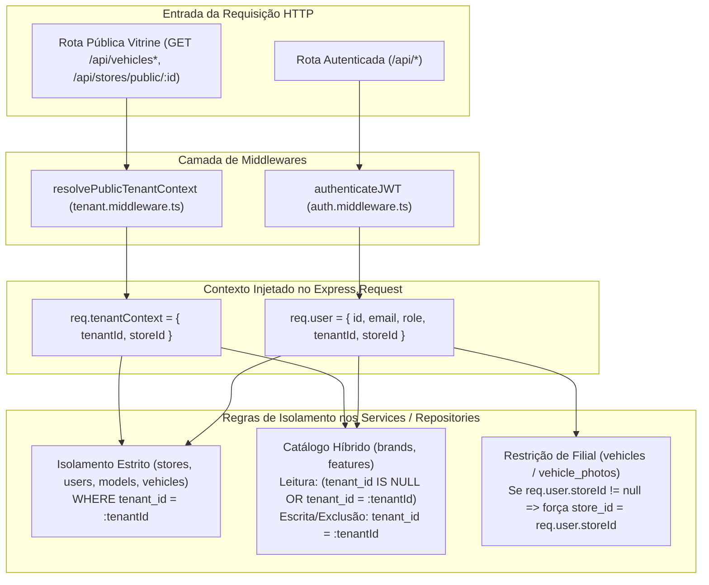

# Plano de Execução TDD — Fase 5: Arquitetura Multi-Tenant e Multi-Store

> **Objetivo**: Adaptar toda a camada de aplicação (Tipagens, JWT, Middlewares, Repositories, Services, Controllers, Routes, Scripts e Testes) para o modelo **Multi-Tenant (`tenant_id`) e Multi-Store (`store_id`)** já consolidado no `schema.sql` (Fase 5.1), garantindo isolamento absoluto entre empresas (*Zero Cross-Tenant Leakage*), catálogo híbrido para Marcas e Opcionais, restrição operacional por filial e fluxo transacional de *Onboarding*.

---

## 🚨 PROTOCOLO DE EXECUÇÃO ESTRITA (PARA O MODELO EXECUTOR)

Você é o **Agente Executor**. Sua missão é implementar esta fase seguindo **TDD estrito (Test-Driven Development)**, uma tarefa por vez, sem pular etapas.

### Regras Inegociáveis:
1. **Fluxo TDD Obrigatório (`Red -> Green -> Refactor`)**:
   - **Passo 1 (RED)**: Em cada tarefa, crie ou atualize **primeiro** o arquivo de teste (`.spec.ts`) correspondente ao requisito. Execute o teste e confirme que ele falha pelo motivo esperado.
   - **Passo 2 (GREEN)**: Implemente ou refatore o código de produção mínimo e preciso para fazer o teste passar.
   - **Passo 3 (REFACTOR)**: Limpe duplicações mantendo 100% dos testes da tarefa verdes.
2. **Proibição de *Reward Hacking***:
   - **NUNCA** comente testes, **NUNCA** use `.skip` / `.todo` para forçar aprovação, **NUNCA** afrouxe *assertions* e **NUNCA** use `as any` para silenciar erros de tipagem do TypeScript.
   - Se um teste antigo quebrar por falta de `tenant_id` ou `store_id` após a mudança do `schema.sql`, atualize a *fixture*/*helper* do teste conforme instruído na respectiva subfase.
3. **Execução Sequencial com Gate Bloqueante (`🔒 TRAVA DA SUBFASE`)**:
   - Ao concluir as tarefas de uma subfase, você **DEVE** executar todos os comandos listados na seção `🔒 TRAVA DA SUBFASE (Quality Gate)`.
   - **PROIBIDO** avançar para a próxima subfase se houver qualquer erro de compilação, *lint* ou falha nos testes da trava atual.
4. **Padrão de Imports do Projeto**:
   - Utilize sempre os *path aliases* do `package.json` com sufixo `.js` (ex.: `#repositories/tenant.repository.js`, `#services/store.service.js`, `#middlewares/auth.middleware.js`, `#utils/AppError.js`).
5. **Escopo de Banco de Dados**:
   - O arquivo `schema.sql` já possui a tabela `tenants` e as colunas `tenant_id` / `store_id` (Fase 5.1 concluída). **NÃO** remova constraints nem índices do `schema.sql`.

---

## 🔍 PROTOCOLO DE AUDITORIA (PARA O MODELO SÊNIOR / REVISOR)

Ao revisar a entrega de cada subfase executada pelo modelo menor, verifique:
1. **Isolamento SQL**: Nenhuma query de leitura, atualização ou deleção em `stores`, `users`, `models` ou `vehicles` pode executar sem filtrar por `tenant_id`.
2. **Catálogo Híbrido (`brands` e `features`)**:
   - Leituras (`find`, `findById`) devem permitir itens globais e do tenant: `(tenant_id IS NULL OR tenant_id = $n)`.
   - Mutações (`update`, `delete`) devem exigir estritamente `tenant_id = $n` (impedindo que um tenant edite ou apague registros globais `tenant_id IS NULL` ou de outro tenant).
3. **Integridade de Escopo Cruzado**:
   - Vincular um `store_id` a um usuário ou veículo exige validar que a loja pertence ao mesmo `tenant_id`.
   - Usuários com `req.user.storeId !== null` só podem criar/editar/excluir veículos da sua própria filial (`store_id === req.user.storeId`).
4. **Transação de Onboarding**: O cadastro inicial de Tenant (`onboardTenant`) deve usar `pool.connect()` com `BEGIN`, `COMMIT` e `ROLLBACK` garantindo atomicidade entre `tenants`, `stores` e `users`.

---

## 📐 Visão Arquitetural Multi-Tenant e Multi-Store



---

## Subfase 5.1: Contexto de Tenant e Loja no JWT, Tipagem Express e Middlewares (`5.2` do Roadmap)

### Objetivo da Subfase
Incluir `tenantId` e `storeId` no payload do token JWT e na tipagem global do Express, atualizar o middleware `authenticateJWT` para hidratar e validar o vínculo de empresa/filial do usuário autenticado, e criar o middleware `resolvePublicTenantContext` para rotas públicas da vitrine.

---

### Tarefa 5.1.1: Atualizar `jwt.util.ts` e Tipagem `src/@types/express.d.ts`

- **Arquivos Alvo**:
  - `src/utils/jwt.util.ts`
  - `src/@types/express.d.ts`
- **O que fazer em `src/utils/jwt.util.ts`**:
  1. Atualizar a interface `TokenPayload` para exigir `tenantId: string` e aceitar `storeId?: string | null`:
     ```typescript
     export interface TokenPayload {
       id: string;
       email: string;
       role: string;
       tenantId: string;
       storeId?: string | null;
     }
     ```
  2. Em `generateToken(payload: TokenPayload): string`, incluir `tenantId: payload.tenantId` e `storeId: payload.storeId ?? null` no objeto assinado pelo `jwt.sign`.
- **O que fazer em `src/@types/express.d.ts`**:
  1. Atualizar a interface `Express.Request` para refletir o contexto multi-tenant autenticado e público:
     ```typescript
     declare global {
       namespace Express {
         interface Request {
           user?: {
             id: string;
             email: string;
             role: string;
             tenantId: string;
             storeId: string | null;
           };
           tenantContext?: {
             tenantId: string;
             storeId: string | null;
           };
         }
       }
     }
     export {};
     ```

---

### Tarefa 5.1.2: Adaptar `authenticateJWT` (`auth.middleware.ts`) com TDD

- **Arquivos Alvo**:
  - Teste: `src/tests/middlewares/user.middleware.spec.ts`
  - Produção: `src/middlewares/auth.middleware.ts`
- **Passo 1 (RED) — Atualizar/Criar testes em `src/tests/middlewares/user.middleware.spec.ts`**:
  1. Atualizar os *mocks* de `verifyToken` e `userRepository.findById` nos testes existentes para incluir `tenantId: 'tenant-uuid-1'`, `storeId: null` (no token) e `tenant_id: 'tenant-uuid-1'`, `store_id: null` (no retorno do banco).
  2. Adicionar teste: **"deve popular `req.user.tenantId` e `req.user.storeId` a partir do registro atualizado do banco de dados"**.
  3. Adicionar teste: **"deve retornar 401 se o usuário retornado do banco não possuir `tenant_id` vinculado"**.
- **Passo 2 (GREEN) — Atualizar `src/middlewares/auth.middleware.ts`**:
  1. Em `authenticateJWT`, após buscar `const user = await userRepository.findById(payload.id)`:
     - Verificar `if (!user || !user.is_active || !user.tenant_id)` -> retornar `next(new AppError('Usuário inválido, inativo ou sem empresa vinculada', 401))`.
  2. Preencher `req.user`:
     ```typescript
     req.user = {
       id: user.id,
       email: user.email ?? payload.email,
       role: user.role ?? payload.role,
       tenantId: user.tenant_id,
       storeId: user.store_id ?? null,
     };
     ```

---

### Tarefa 5.1.3: Criar Middleware `resolvePublicTenantContext` (`tenant.middleware.ts`) com TDD

- **Arquivos Alvo**:
  - Teste (Novo): `src/tests/middlewares/tenant.middleware.spec.ts`
  - Produção (Novo): `src/middlewares/tenant.middleware.ts`
- **Regras de Negócio do Middleware Público**:
  - Rotas públicas da vitrine (`GET /api/vehicles`, `GET /api/vehicles/compare`, `GET /api/vehicles/:id`) precisam saber de qual empresa (`tenantId`) e, opcionalmente, de qual filial (`storeId`) estão listando veículos.
  - Ordem de extração:
    1. Se `req.user?.tenantId` já estiver presente (ex.: chamada autenticada), usar `tenantId = req.user.tenantId` e `storeId = (req.query.store_id as string) || (req.headers['x-store-id'] as string) || req.user.storeId || null`.
    2. Caso contrário, extrair `rawTenantId` de `req.headers['x-tenant-id']` ou `req.query.tenant_id` (como string) e `rawStoreId` de `req.headers['x-store-id']` ou `req.query.store_id` (como string).
    3. Validar formato UUID de `rawTenantId` e `rawStoreId` (quando informados) usando `z.uuid()`. Se inválido, lançar `new AppError('Identificador de empresa ou loja inválido', 400)`.
    4. Se apenas `rawStoreId` for enviado (sem `rawTenantId`), consultar `storeRepository.findById(rawStoreId)`:
       - Se a loja não existir, lançar `new AppError('Loja não encontrada', 404)`.
       - Extrair `tenantId = store.tenant_id` e `storeId = store.id`.
    5. Se ambos `rawTenantId` e `rawStoreId` forem enviados, consultar `storeRepository.findById(rawStoreId)`:
       - Se a loja não existir ou `store.tenant_id !== rawTenantId`, lançar `new AppError('Loja não pertence à empresa informada', 404)`.
    6. Se nenhum dos dois (`tenantId` nem `storeId`) puder ser resolvido, lançar `new AppError('Contexto da empresa ou loja é obrigatório (informe x-tenant-id, x-store-id, tenant_id ou store_id)', 400)`.
    7. Preencher `req.tenantContext = { tenantId, storeId: storeId ?? null }` e chamar `next()`.
- **Passo 1 (RED)**: Criar `src/tests/middlewares/tenant.middleware.spec.ts` cobrindo:
  - Resolução via header `x-tenant-id`.
  - Resolução via query `store_id` (buscando `tenant_id` na loja via `storeRepository.findById`).
  - Erro `404` quando `store_id` não pertence ao `tenant_id` enviado.
  - Erro `400` quando UUID é inválido ou quando nenhum identificador é enviado.
- **Passo 2 (GREEN)**: Implementar `src/middlewares/tenant.middleware.ts` com factory `createTenantMiddleware(storeRepo = storeRepository)` e exportar `resolvePublicTenantContext`.

---

### 🔒 TRAVA DA SUBFASE 5.1 (Quality Gate)
Execute os comandos abaixo. **Só avance para a Subfase 5.2 se todos passarem com 0 erros**:
```bash
npx vitest run src/tests/middlewares/user.middleware.spec.ts src/tests/middlewares/tenant.middleware.spec.ts
```

---

## Subfase 5.2: Novo Módulo de Empresas (`tenants`) e Onboarding Transacional (`5.3` do Roadmap)

### Objetivo da Subfase
Criar a estrutura completa da entidade `tenants` (Schema Zod, Repository, Service, Controller, Routes) incluindo a função transacional `onboardTenant` que cria em uma única transação SQL a Empresa (`tenants`), a Matriz/Primeira Filial (`stores`) e o primeiro usuário `ADMIN` (`users`).

---

### Tarefa 5.2.1: Criar `tenant.schema.ts` com TDD

- **Arquivos Alvo**:
  - Teste (Novo): `src/tests/schemas/tenant.schema.spec.ts`
  - Produção (Novo): `src/schemas/tenant.schema.ts`
- **Especificação dos Schemas (`src/schemas/tenant.schema.ts`)**:
  1. `createTenantSchema`:
     - `corporate_name`: `z.string().trim().min(2).max(255)`
     - `trade_name`: `z.string().trim().min(2).max(255)`
     - `cnpj`: `z.string().trim().min(14).max(18).refine(validateCNPJ, { message: 'CNPJ inválido' })`
     - `is_active`: `z.boolean().optional().default(true)`
  2. `updateTenantSchema`: `createTenantSchema.partial()`
  3. `onboardTenantSchema`:
     - `tenant`: `createTenantSchema`
     - `store`: `createStoreSchema` (reutilizar de `#schemas/store.schema.js`)
     - `admin`: objeto com `name` (`min(2).max(255)`), `email` (`z.email()`), `password` (`min(8).max(255)`), `phone` (`min(10).max(20)`), `cpf` (`validateCPF`), `birth_date` (opcional).
- **Passo 1 (RED)**: Criar `src/tests/schemas/tenant.schema.spec.ts` testando CNPJ válido/inválido e payload completo de `onboardTenantSchema`.
- **Passo 2 (GREEN)**: Implementar `src/schemas/tenant.schema.ts`.

---

### Tarefa 5.2.2: Criar `TenantRepository` (`tenant.repository.ts`) com TDD

- **Arquivos Alvo**:
  - Teste (Novo): `src/tests/repositories/tenant.repository.spec.ts`
  - Produção (Novo): `src/repositories/tenant.repository.ts`
- **Especificação do `TenantRepository` (estende `BaseRepository<Tenant, CreateTenantData, UpdateTenantData>`)**:
  - Interface `Tenant`:
    ```typescript
    export interface Tenant {
      id: string;
      corporate_name: string;
      trade_name: string;
      cnpj: string;
      is_active: boolean;
      created_at: Date;
      deleted_at?: Date | null;
    }
    ```
  - Colunas: `['id', 'corporate_name', 'trade_name', 'cnpj', 'is_active', 'created_at', 'deleted_at']`, `softDelete = true`.
  - Métodos:
    1. `findByCNPJ(cnpj: string): Promise<Tenant | null>`: busca `WHERE cnpj = $1 AND deleted_at IS NULL`.
    2. `onboardTenant(input: OnboardTenantDbInput): Promise<{ tenant: Tenant; store: Store; admin: Omit<User, 'password_hash'> }>`:
       - Obtém cliente dedicado com `const client = await this.pool.connect()`.
       - Executa `await client.query('BEGIN')`.
       - Insere em `tenants` (`corporate_name, trade_name, cnpj, is_active`) `RETURNING *`.
       - Insere em `stores` (`tenant_id, corporate_name, trade_name, cnpj, email, phone, address_street, address_number, address_complement, address_neighborhood, address_city, address_state, opening_hours`) vinculando `tenant.id` `RETURNING *`.
       - Insere em `users` (`tenant_id, store_id, name, email, password_hash, phone, cpf, role, is_active, birth_date`) com `role = 'ADMIN'`, `tenant_id = tenant.id`, `store_id = store.id`, retornando colunas sem `password_hash`.
       - Executa `await client.query('COMMIT')`.
       - Em caso de erro no `catch`, executa `await client.query('ROLLBACK')` e relança o erro; no `finally`, executa `client.release()`.
- **Passo 1 (RED)**: Criar `src/tests/repositories/tenant.repository.spec.ts` testando `create`, `findByCNPJ`, `update`, `delete` (soft delete) e `onboardTenant` (incluindo teste de rollback quando o CNPJ da loja ou CPF do admin falha).
- **Passo 2 (GREEN)**: Implementar `src/repositories/tenant.repository.ts`.

---

### Tarefa 5.2.3: Criar `TenantService`, `TenantController` e `tenant.routes.ts` com TDD

- **Arquivos Alvo**:
  - Testes (Novos):
    - `src/tests/services/tenant.service.spec.ts`
    - `src/tests/e2e/tenants/tenant.e2e.spec.ts`
  - Produção (Novos / Atualizados):
    - `src/services/tenant.service.ts`
    - `src/controllers/tenant.controller.ts`
    - `src/routes/tenant.routes.ts`
    - `src/app.ts`
- **Regras de Negócio do `TenantService`**:
  1. `onboard(data: OnboardTenantDTO)`:
     - Valida com `onboardTenantSchema`.
     - Verifica se já existe tenant com `data.tenant.cnpj` (`tenantRepository.findByCNPJ`) -> se existir, `new AppError('CNPJ da empresa já está em uso', 409)`.
     - Verifica se já existe loja com `data.store.cnpj` (`storeRepository.findByCNPJ`) -> se existir, `new AppError('CNPJ da loja já está em uso', 409)`.
     - Gera hash da senha do admin com `bcrypt.hash(data.admin.password, 10)`.
     - Chama `tenantRepository.onboardTenant(...)`.
     - Gera token JWT inicial (`generateToken({ id: admin.id, email: admin.email, role: admin.role, tenantId: tenant.id, storeId: store.id })`) e retorna `{ tenant, store, admin, token }`.
  2. `getById(tenantId: string)`: retorna dados do tenant ou lança `404`.
  3. `update(tenantId: string, data: UpdateTenantDTO)`: valida com `updateTenantSchema`, verifica duplicidade de CNPJ se alterado (`409`), e atualiza o próprio tenant.
- **Rotas em `src/routes/tenant.routes.ts` (registradas em `app.use('/api/tenants', tenantRoutes)` no `src/app.ts`)**:
  - `POST /api/tenants/onboard` (Pública — cria empresa + loja matriz + admin inicial, retorna `201`).
  - `GET /api/tenants/me` (`authenticateJWT` — retorna dados do tenant do usuário logado `req.user.tenantId`).
  - `PUT /api/tenants/me` (`authenticateJWT`, `authorizeRole(['ADMIN'])` — atualiza dados do tenant `req.user.tenantId`).

---

### 🔒 TRAVA DA SUBFASE 5.2 (Quality Gate)
Execute os comandos abaixo. **Só avance para a Subfase 5.3 se todos passarem com 0 erros**:
```bash
npx vitest run src/tests/schemas/tenant.schema.spec.ts src/tests/repositories/tenant.repository.spec.ts src/tests/services/tenant.service.spec.ts src/tests/e2e/tenants/tenant.e2e.spec.ts
```

---

## Subfase 5.3: Escopo Multi-Tenant em `BaseRepository` / `BaseService` e Módulo de Lojas (`stores`)

### Objetivo da Subfase
Adaptar `BaseRepository` e `StoreRepository`/`StoreService`/`StoreController` para que toda operação sobre filiais (`stores`) exija e respeite o `tenant_id`, além de expor uma rota pública para consulta de cabeçalho/rodapé da filial na vitrine.

---

### Tarefa 5.3.1: Suporte a `tenantId` em `BaseRepository` e `BaseService`

- **Arquivos Alvo**:
  - `src/repositories/base.repository.ts`
  - `src/services/base.service.ts`
- **O que fazer em `src/repositories/base.repository.ts`**:
  1. Atualizar as assinaturas de `findById`, `update` e `delete` para aceitar `tenantId?: string` opcional:
     - `async findById(id: string, tenantId?: string): Promise<Entity | null>`:
       - Se `tenantId` for informado e `'tenant_id'` estiver em `this.columns`, adicionar `AND tenant_id = $2` na cláusula `WHERE`.
     - `async update(id: string, data: UpdateDTO, tenantId?: string): Promise<Entity | null>`:
       - Se `tenantId` for informado e `'tenant_id'` estiver em `this.columns`, adicionar `AND tenant_id = $n` na cláusula `WHERE` do `UPDATE` para impedir atualização Cross-Tenant.
     - `async delete(id: string, tenantId?: string): Promise<boolean>`:
       - Se `tenantId` for informado e `'tenant_id'` estiver em `this.columns`, adicionar `AND tenant_id = $2` na cláusula `WHERE` do `UPDATE ... SET deleted_at = NOW()` (ou `DELETE FROM`).
- **O que fazer em `src/services/base.service.ts`**:
  1. Atualizar `find(filters: FindOptions = {}, tenantId?: string)`, `findById(id: string, tenantId?: string)`, `update(id: string, data: unknown, tenantId?: string)` e `delete(id: string, tenantId?: string)` para repassar `tenantId` (injetando `where: { ...filters.where, ...(tenantId ? { tenant_id: tenantId } : {}) }` no `find`).

---

### Tarefa 5.3.2: Adaptar `StoreRepository` (`store.repository.ts`) com TDD

- **Arquivos Alvo**:
  - Teste: `src/tests/repositories/store.repository.spec.ts`
  - Produção: `src/repositories/store.repository.ts`
- **Passo 1 (RED) — Atualizar `src/tests/repositories/store.repository.spec.ts`**:
  1. No `beforeEach`, criar um `tenant` padrão (`tenantA`) e um segundo `tenant` (`tenantB`) na tabela `tenants`.
  2. Incluir `tenant_id: tenantA.id` nos payloads de criação de loja.
  3. Adicionar testes:
     - **"deve filtrar lojas por `tenant_id` no `find` e `findById`"**.
     - **"não deve permitir que `tenantB` atualize ou delete uma loja pertencente ao `tenantA`"**.
     - **`findByIdAndTenant(id, tenantId)` deve retornar a loja apenas se pertencer ao `tenantId` informado**.
- **Passo 2 (GREEN) — Atualizar `src/repositories/store.repository.ts`**:
  1. Adicionar `tenant_id: string` nas interfaces `Store` e `CreateStoreData`.
  2. Adicionar `'tenant_id'` ao array `columns` do `StoreRepository`.
  3. Implementar `async findByIdAndTenant(id: string, tenantId: string): Promise<Store | null>` que executa `SELECT ... FROM stores WHERE id = $1 AND tenant_id = $2 AND deleted_at IS NULL`.

---

### Tarefa 5.3.3: Adaptar `StoreService`, `StoreController`, `store.routes.ts` e Testes Unitários/E2E com TDD

- **Arquivos Alvo**:
  - Testes:
    - `src/tests/services/store.service.spec.ts`
    - `src/tests/e2e/stores/store.e2e.helpers.ts`
    - `src/tests/e2e/stores/store.e2e.spec.ts`
  - Produção:
    - `src/services/store.service.ts`
    - `src/controllers/store.controller.ts`
    - `src/routes/store.routes.ts`
- **Regras de Negócio em `StoreService`**:
  1. `create(data: unknown, tenantId: string)`:
     - Valida body com `createStoreSchema`.
     - Verifica se `tenantId` foi informado (se não, `AppError('Tenant não identificado', 401)`).
     - Verifica unicidade global de CNPJ (`findByCNPJ`).
     - Chama `storeRepository.create({ ...validatedData, tenant_id: tenantId })`.
  2. `find(filters: FindOptions = {}, tenantId: string)`: filtra obrigatoriamente por `where: { ...filters.where, tenant_id: tenantId }`.
  3. `findById(id: string, tenantId: string)`: chama `super.findById(id, tenantId)`.
  4. `findPublicById(id: string)`: busca a loja ativa pelo `id` (`storeRepository.findById(id)`) para exibir informações públicas da vitrine (nome fantasia, endereço, telefone, horário de funcionamento, `tenant_id`).
  5. `update(id: string, data: unknown, tenantId: string)` e `delete(id: string, tenantId: string)`: validam existência dentro do `tenantId` (`super.findById(id, tenantId)`) e executam restritos ao `tenantId`.
- **Ajustes em `StoreController` e `store.routes.ts`**:
  - Em `create`, `find`, `findById`, `update`, `delete`: extrair `req.user!.tenantId` e repassar ao `storeService`.
  - Adicionar `getPublicById` em `StoreController` e rota pública `GET /api/stores/public/:id` em `store.routes.ts` (antes das rotas protegidas ou sem `authenticateJWT`).
- **Ajustes nos Helpers e Testes (`store.service.spec.ts`, `store.e2e.helpers.ts`, `store.e2e.spec.ts`)**:
  - Em `store.e2e.helpers.ts`, criar um `tenant` no banco antes de criar o usuário admin/vendedor e a loja, passando `tenant_id` na inserção SQL e `tenantId` no `generateToken`.
  - Adicionar teste E2E garantindo que o Admin do Tenant A recebe `404` ao tentar ler, editar ou deletar uma loja do Tenant B.

---

### 🔒 TRAVA DA SUBFASE 5.3 (Quality Gate)
Execute os comandos abaixo. **Só avance para a Subfase 5.4 se todos passarem com 0 erros**:
```bash
npx vitest run src/tests/repositories/store.repository.spec.ts src/tests/services/store.service.spec.ts src/tests/e2e/stores/store.e2e.spec.ts
```

---

## Subfase 5.4: Adaptação do Módulo de Usuários (`users`) e Script `create-admin.ts`

### Objetivo da Subfase
Adaptar o módulo de usuários para suportar `tenant_id` (obrigatório) e `store_id` (opcional: `NULL` para atuação global na rede do tenant; `UUID` para restringir o usuário a uma filial), garantir unicidade de e-mail por empresa `(tenant_id, lower(email))` e validar que qualquer `store_id` vinculado pertence ao `tenant_id` do usuário.

---

### Tarefa 5.4.1: Adaptar `user.schema.ts` e `UserRepository` (`user.repository.ts`) com TDD

- **Arquivos Alvo**:
  - Teste: `src/tests/repositories/user.repository.spec.ts`
  - Produção:
    - `src/schemas/user.schema.ts`
    - `src/repositories/user.repository.ts`
- **O que fazer em `src/schemas/user.schema.ts`**:
  1. Em `createUserSchema` e `updateUserSchema`: adicionar `store_id: z.uuid({ message: 'ID da loja inválido' }).nullable().optional()`.
  2. Em `loginSchema`: adicionar `tenant_id: z.uuid({ message: 'ID da empresa inválido' }).optional()`.
- **Passo 1 (RED) — Atualizar `src/tests/repositories/user.repository.spec.ts`**:
  1. No `beforeEach`, inserir um registro em `tenants` (`tenantA`) e usar `tenant_id: tenantA.id` em todos os testes de criação de usuário.
  2. Adicionar teste: **"deve permitir cadastrar o mesmo e-mail em dois tenants diferentes (`tenantA` e `tenantB`) e buscar cada um pelo seu `tenantId` em `findByEmail`"**.
  3. Adicionar teste: **"deve isolar `find`, `findById`, `update` e `delete` por `tenantId`"**.
- **Passo 2 (GREEN) — Atualizar `src/repositories/user.repository.ts`**:
  1. Adicionar `tenant_id: string` e `store_id?: string | null` nas interfaces `User` e `CreateUserData`.
  2. Adicionar `'tenant_id'` e `'store_id'` em `columns` e `safeColumns`.
  3. Atualizar `findByEmail(email: string, tenantId?: string): Promise<User | null>`:
     - Se `tenantId` for informado: `SELECT ... FROM users WHERE tenant_id = $1 AND LOWER(email) = LOWER($2) AND deleted_at IS NULL`.
     - Se `tenantId` não for informado: `SELECT ... FROM users WHERE LOWER(email) = LOWER($1) AND deleted_at IS NULL ORDER BY created_at ASC LIMIT 1`.

---

### Tarefa 5.4.2: Adaptar `UserService` e `UserController` com TDD

- **Arquivos Alvo**:
  - Testes:
    - `src/tests/services/user/user.service.fixtures.ts`
    - `src/tests/services/user/user.service.create.spec.ts`
    - `src/tests/services/user/user.service.login.spec.ts`
    - `src/tests/services/user/user.service.read.spec.ts`
    - `src/tests/services/user/user.service.update.spec.ts`
    - `src/tests/services/user/user.service.delete.spec.ts`
    - `src/tests/controllers/user.controller.spec.ts`
  - Produção:
    - `src/services/user.service.ts`
    - `src/controllers/user.controller.ts`
- **Regras de Negócio em `UserService`**:
  1. Receber `storeRepository` no construtor (`constructor(repository: UserRepository = userRepository, private readonly storeRepo: StoreRepository = storeRepository)`).
  2. `login(data: unknown)`:
     - Valida com `loginSchema`.
     - Busca usuário com `this.userRepository.findByEmail(validatedData.email, validatedData.tenant_id)`.
     - Valida senha e status `is_active`.
     - Chama `generateToken({ id: user.id, email: user.email, role: user.role, tenantId: user.tenant_id, storeId: user.store_id ?? null })`.
  3. `create(data: unknown, tenantId: string)`:
     - Valida body com `createUserSchema`.
     - Verifica duplicidade de e-mail dentro do tenant: `await this.userRepository.findByEmail(validatedData.email, tenantId)`.
     - Se `validatedData.store_id` for informado (não nulo), valida escopo: `const store = await this.storeRepo.findByIdAndTenant(validatedData.store_id, tenantId)`. Se não existir, lança `new AppError('Filial informada não encontrada nesta empresa', 404)`.
     - Cria o usuário passando `tenant_id: tenantId` e `store_id: validatedData.store_id ?? null`.
  4. `update(id: string, data: unknown, tenantId: string)`:
     - Verifica se o usuário pertence ao `tenantId` (`await super.findById(id, tenantId)`).
     - Se `validatedData.email` mudou, verifica duplicidade no `tenantId`.
     - Se `validatedData.store_id` foi enviado e não é `null`, valida se a loja pertence ao `tenantId` via `this.storeRepo.findByIdAndTenant(validatedData.store_id, tenantId)`.
     - Atualiza restrito ao `tenantId`.
  5. `find(filters: FindOptions = {}, tenantId: string)`, `findById(id: string, tenantId: string)` e `delete(id: string, tenantId: string)`:
     - Escopados obrigatoriamente por `tenantId`.
- **Ajustes em `UserController`**:
  - Repassar `req.user!.tenantId` para `userService.create`, `userService.find`, `userService.findById`, `userService.update` e `userService.delete`.
- **Passo 1 (RED) -> Passo 2 (GREEN)**:
  - Atualizar `user.service.fixtures.ts` incluindo `tenant_id: 'tenant-123'` e `store_id: null` no `mockUser`, além do mock de `storeRepository`.
  - Atualizar os testes unitários em `src/tests/services/user/*.spec.ts` e `src/tests/controllers/user.controller.spec.ts` (incluindo teste de erro `404` ao vincular `store_id` de outro tenant).

---

### Tarefa 5.4.3: Atualizar `create-admin.ts` e Testes E2E de Usuários

- **Arquivos Alvo**:
  - `src/scripts/create-admin.ts`
  - `src/tests/e2e/users/user.e2e.helpers.ts`
  - `src/tests/e2e/users/user.e2e.create.spec.ts`
  - `src/tests/e2e/users/user.e2e.login.spec.ts`
  - `src/tests/e2e/users/user.e2e.read.spec.ts`
  - `src/tests/e2e/users/user.e2e.update.spec.ts`
  - `src/tests/e2e/users/user.e2e.delete.spec.ts`
- **O que fazer em `src/scripts/create-admin.ts`**:
  1. Antes de criar o admin, verificar se existe um tenant com CNPJ padrão (`process.env.ADMIN_TENANT_CNPJ || '45723174000110'`). Se não existir, criar o tenant padrão via `tenantRepository.create`.
  2. Criar o usuário admin vinculando `tenant_id: tenant.id`.
- **O que fazer em `src/tests/e2e/users/user.e2e.helpers.ts` e `user.e2e.*.spec.ts`**:
  1. No `setupUsersTestDb` / helpers de criação de usuário E2E, criar um `tenant` padrão e injetar `tenant_id` nas queries de inserção e no `generateToken`.
  2. Adicionar caso de teste E2E garantindo que o Admin do Tenant A não consegue listar, visualizar, editar ou excluir um usuário do Tenant B.

---

### 🔒 TRAVA DA SUBFASE 5.4 (Quality Gate)
Execute os comandos abaixo. **Só avance para a Subfase 5.5 se todos passarem com 0 erros**:
```bash
npx vitest run src/tests/repositories/user.repository.spec.ts src/tests/services/user/ src/tests/controllers/user.controller.spec.ts src/tests/e2e/users/
```

---

## Subfase 5.5: Catálogo Híbrido (`brands` e `features`) e Modelos por Tenant (`models`)

### Objetivo da Subfase
Implementar as regras de **Catálogo Híbrido** para `brands` e `features` (`tenant_id IS NULL` para catálogo global do sistema + `tenant_id = :currentTenantId` para itens criados pela empresa, bloqueando edição/exclusão de itens globais por empresas) e o isolamento estrito por `tenant_id` em `models`.

---

### Tarefa 5.5.1: Adaptar Módulo de Marcas (`brands`) para Catálogo Híbrido com TDD

- **Arquivos Alvo**:
  - Testes:
    - `src/tests/repositories/brand.repository.spec.ts`
    - `src/tests/services/brand.service.spec.ts`
    - `src/tests/e2e/brands/brand.e2e.spec.ts`
  - Produção:
    - `src/repositories/brand.repository.ts`
    - `src/services/brand.service.ts`
    - `src/controllers/brand.controller.ts`
- **Regras do Catálogo Híbrido em `BrandRepository` e `BrandService`**:
  1. `Brand` e `CreateBrandData` passam a conter `tenant_id?: string | null` (`'tenant_id'` incluído em `columns`).
  2. `findForTenant(tenantId: string, options: FindOptions = {}): Promise<Brand[]>`:
     - Retorna marcas ativas onde `deleted_at IS NULL AND (tenant_id IS NULL OR tenant_id = $1)` (aplicando `search` em `name`, ordenação e paginação).
  3. `findByIdForTenant(id: string, tenantId: string): Promise<Brand | null>`:
     - `SELECT ... FROM brands WHERE id = $1 AND (tenant_id IS NULL OR tenant_id = $2) AND deleted_at IS NULL`.
  4. `findByNameForTenant(name: string, tenantId: string): Promise<Brand | null>`:
     - `SELECT ... FROM brands WHERE LOWER(name) = LOWER($1) AND (tenant_id IS NULL OR tenant_id = $2) AND deleted_at IS NULL`.
  5. `create(data: unknown, tenantId: string)`:
     - Verifica duplicidade via `findByNameForTenant(validated.name, tenantId)` -> se já existir globalmente ou no tenant, lança `409 Conflict`.
     - Insere com `tenant_id: tenantId`.
  6. `update(id: string, data: unknown, tenantId: string)` e `delete(id: string, tenantId: string)`:
     - Busca a marca com `findByIdForTenant(id, tenantId)` -> se não existir, lança `404 Not Found`.
     - **Regra Crítica**: Se `brand.tenant_id === null` (marca global do sistema) ou `brand.tenant_id !== tenantId`, lançar `new AppError('Não é permitido alterar ou excluir uma marca global do sistema', 403)`.
     - Executa `UPDATE` / soft `DELETE` com `WHERE id = $1 AND tenant_id = $2`.

---

### Tarefa 5.5.2: Adaptar Módulo de Opcionais (`features`) para Catálogo Híbrido com TDD

- **Arquivos Alvo**:
  - Testes:
    - `src/tests/repositories/feature.repository.spec.ts`
    - `src/tests/services/feature.service.spec.ts`
    - `src/tests/e2e/features/feature.e2e.spec.ts`
  - Produção:
    - `src/repositories/feature.repository.ts`
    - `src/services/feature.service.ts`
    - `src/controllers/feature.controller.ts`
- **Regras do Catálogo Híbrido em `FeatureRepository` e `FeatureService`**:
  1. `Feature` e `CreateFeatureData` passam a conter `tenant_id?: string | null` (`'tenant_id'` incluído em `columns`, mantendo `softDelete = false` pois `features` usa *Hard Delete*).
  2. `findForTenant(tenantId: string, options: FindOptions = {}): Promise<Feature[]>`:
     - Filtra por `(tenant_id IS NULL OR tenant_id = $1)` e aplica busca/ordenação/paginação.
  3. `findByIdForTenant(id: string, tenantId: string): Promise<Feature | null>`:
     - `SELECT ... FROM features WHERE id = $1 AND (tenant_id IS NULL OR tenant_id = $2)`.
  4. `findByIdsForTenant(ids: string[], tenantId: string): Promise<Feature[]>`:
     - `SELECT ... FROM features WHERE id = ANY($1::uuid[]) AND (tenant_id IS NULL OR tenant_id = $2)` (usado na validação de veículos).
  5. `findByNameForTenant(name: string, tenantId: string): Promise<Feature | null>`:
     - `SELECT ... FROM features WHERE LOWER(name) = LOWER($1) AND (tenant_id IS NULL OR tenant_id = $2)`.
  6. `create(data: unknown, tenantId: string)`:
     - Verifica duplicidade via `findByNameForTenant` (`409 Conflict`) e cria com `tenant_id: tenantId`.
  7. `update(id: string, data: unknown, tenantId: string)` e `delete(id: string, tenantId: string)`:
     - Busca com `findByIdForTenant(id, tenantId)` (`404` se não achar).
     - Se `feature.tenant_id === null` ou `feature.tenant_id !== tenantId`, lança `new AppError('Não é permitido alterar ou excluir um opcional global do sistema', 403)`.
     - Executa `UPDATE` / `DELETE` com `WHERE id = $1 AND tenant_id = $2`.

---

### Tarefa 5.5.3: Adaptar Módulo de Modelos (`models`) com Isolamento por Tenant com TDD

- **Arquivos Alvo**:
  - Testes:
    - `src/tests/repositories/model.repository.spec.ts`
    - `src/tests/services/model.service.spec.ts`
    - `src/tests/e2e/models/model.e2e.spec.ts`
  - Produção:
    - `src/repositories/model.repository.ts`
    - `src/services/model.service.ts`
    - `src/controllers/model.controller.ts`
- **Regras em `ModelRepository`, `ModelService` e `ModelController`**:
  1. `Model` e `CreateModelData` incluem `tenant_id: string` (`'tenant_id'` adicionado em `columns`).
  2. `findByNameAndBrand(name: string, brandId: string, tenantId: string): Promise<Model | null>`:
     - `SELECT ... FROM models WHERE tenant_id = $1 AND brand_id = $2 AND LOWER(name) = LOWER($3) AND deleted_at IS NULL`.
  3. `findByBrandId(brandId: string, tenantId: string): Promise<Model[]>`:
     - `SELECT ... FROM models WHERE tenant_id = $1 AND brand_id = $2 AND deleted_at IS NULL ORDER BY name ASC`.
  4. Em `ModelService.create(data: unknown, tenantId: string)` e `ModelService.update(id: string, data: unknown, tenantId: string)`:
     - Validar que a marca (`brand_id`) existe e é visível ao tenant via `brandRepository.findByIdForTenant(brand_id, tenantId)` (se não existir, lançar `404 Marca informada não encontrada`).
     - Validar unicidade do nome do modelo na marca dentro do `tenantId` (`409 Conflict`).
     - Escopar `find`, `findById`, `findByBrandId`, `update` e `delete` estritamente por `tenantId`.

---

### 🔒 TRAVA DA SUBFASE 5.5 (Quality Gate)
Execute os comandos abaixo. **Só avance para a Subfase 5.6 se todos passarem com 0 erros**:
```bash
npx vitest run src/tests/repositories/brand.repository.spec.ts src/tests/services/brand.service.spec.ts src/tests/e2e/brands/brand.e2e.spec.ts src/tests/repositories/feature.repository.spec.ts src/tests/services/feature.service.spec.ts src/tests/e2e/features/feature.e2e.spec.ts src/tests/repositories/model.repository.spec.ts src/tests/services/model.service.spec.ts src/tests/e2e/models/model.e2e.spec.ts
```

---

## Subfase 5.6: Isolamento Multi-Tenant e Multi-Store em Veículos (`vehicles`) e Mídias (`vehicle-media`)

### Objetivo da Subfase
Adaptar o módulo central de veículos e o processamento de mídias/laudos para exigir `tenant_id` e `store_id`, validar integridade de escopo (loja pertence ao tenant, modelo pertence ao tenant, opcionais pertencem ao catálogo do tenant), restringir usuários de filial (`req.user.storeId !== null`) à sua própria loja e aplicar `resolvePublicTenantContext` nas rotas públicas da vitrine.

---

### Tarefa 5.6.1: Adaptar `VehicleRepository` e Testes de Repositório (`vehicle` e `vehicle-photo`) com TDD

- **Arquivos Alvo**:
  - Testes:
    - `src/tests/repositories/vehicle.repository.spec.ts`
    - `src/tests/repositories/vehicle-photo.repository.spec.ts`
  - Produção:
    - `src/repositories/vehicle.repository.ts`
- **Passo 1 (RED) — Atualizar `vehicle.repository.spec.ts` e `vehicle-photo.repository.spec.ts`**:
  1. Nos `beforeEach` de ambos os testes, criar `tenantA` (e `tenantB` para testes de isolamento) na tabela `tenants`, e passar `tenant_id: tenantA.id` ao criar `stores`, `models` e `vehicles`.
  2. Adicionar testes em `vehicle.repository.spec.ts`:
     - Permitir cadastrar a mesma placa (`full_license_plate`) em `tenantA` e `tenantB`.
     - `findCatalog` deve retornar apenas veículos do `tenant_id` solicitado (e filtrar por `store_id` quando informado).
     - `findDetailedById` e `findByIds` não devem retornar veículos de outro `tenant_id`.
- **Passo 2 (GREEN) — Atualizar `src/repositories/vehicle.repository.ts`**:
  1. Adicionar `tenant_id: string` em `Vehicle` e `CreateVehicleData`, e incluir `'tenant_id'` em `columns`.
  2. `findByPlate(plate: string, tenantId: string): Promise<Vehicle | null>`:
     - `SELECT ... FROM vehicles WHERE tenant_id = $1 AND UPPER(full_license_plate) = UPPER($2) AND deleted_at IS NULL`.
  3. `updateWithFeatures(id: string, vehicleData: UpdateVehicleData, featureIds: string[] | undefined, tenantId: string): Promise<Vehicle | null>`:
     - Cláusula `WHERE id = $n AND tenant_id = $(n+1) AND deleted_at IS NULL`.
  4. `findCatalog(filters: VehicleCatalogFilters & { tenant_id: string; store_id?: string }): Promise<{ data: VehicleCatalogItem[]; total: number }>`:
     - Exigir `v.tenant_id = $1` como condição base obrigatória.
     - Se `filters.store_id` for informado, adicionar `AND v.store_id = $n`.
  5. `findDetailedById(id: string, tenantId: string, storeId?: string | null): Promise<VehicleDetailed | null>`:
     - Filtrar por `v.id = $1 AND v.tenant_id = $2 AND v.deleted_at IS NULL` (e `AND v.store_id = $3` se `storeId` for informado).
  6. `findByIds(ids: string[], tenantId: string, storeId?: string | null): Promise<VehicleDetailed[]>`:
     - Filtrar por `v.id = ANY($1::uuid[]) AND v.tenant_id = $2 AND v.deleted_at IS NULL` (e `AND v.store_id = $3` se `storeId` for informado).
  7. `updateInspectionReport(id: string, reportUrl: string | null, tenantId: string): Promise<Vehicle | null>`:
     - Filtrar por `WHERE id = $2 AND tenant_id = $3 AND deleted_at IS NULL`.

---

### Tarefa 5.6.2: Adaptar `VehicleService`, `VehicleController`, `vehicle.routes.ts` e Testes com TDD

- **Arquivos Alvo**:
  - Testes:
    - `src/tests/services/vehicle.service.spec.ts`
    - `src/tests/e2e/vehicles/vehicle.e2e.helpers.ts`
    - `src/tests/e2e/vehicles/vehicle.e2e.spec.ts`
  - Produção:
    - `src/schemas/vehicle.schema.ts`
    - `src/services/vehicle.service.ts`
    - `src/controllers/vehicle.controller.ts`
    - `src/routes/vehicle.routes.ts`
- **O que fazer em `src/schemas/vehicle.schema.ts`**:
  1. Em `vehicleQuerySchema`: adicionar `tenant_id: z.uuid().optional()` e `store_id: z.uuid().optional()`.
- **Regras de Negócio em `VehicleService`**:
  1. Definir interface de contexto `export interface TenantExecutionContext { tenantId: string; userStoreId?: string | null; filterStoreId?: string | null }`.
  2. Em `create(data: unknown, ctx: TenantExecutionContext)`:
     - Se `ctx.userStoreId` estiver definido (usuário restrito a uma filial) e `validatedData.store_id !== ctx.userStoreId`, lançar `new AppError('Usuário só tem permissão para operar veículos da sua própria filial', 403)`.
     - Validar que `store_id` pertence ao `ctx.tenantId` via `this.storeRepository.findByIdAndTenant(validatedData.store_id, ctx.tenantId)` -> se não existir, lançar `new AppError('Loja informada não encontrada nesta empresa', 404)`.
     - Validar que `model_id` pertence ao `ctx.tenantId` via `this.modelRepository.findById(validatedData.model_id, ctx.tenantId)` -> se não existir, lançar `new AppError('Modelo informado não encontrado nesta empresa', 404)`.
     - Validar unicidade da placa dentro do tenant: `this.vehicleRepository.findByPlate(validatedData.full_license_plate, ctx.tenantId)` (`409 Conflict`).
     - Se `feature_ids.length > 0`, validar que todos pertencem ao catálogo visível do tenant via `this.featureRepository.findByIdsForTenant(feature_ids, ctx.tenantId)`: se `foundFeatures.length !== uniqueFeatureIds.length`, lançar `new AppError('Um ou mais opcionais informados não existem ou não pertencem à empresa', 404)`.
     - Criar veículo com `tenant_id: ctx.tenantId`.
  3. Em `update(id: string, data: unknown, ctx: TenantExecutionContext)`:
     - Buscar veículo existente no tenant: `const existing = await this.vehicleRepository.findById(id, ctx.tenantId)` (`404` se não existir).
     - Se `ctx.userStoreId` estiver definido:
       - Verificar se `existing.store_id === ctx.userStoreId` (se não, `403 Forbidden`).
       - Se `validatedData.store_id` for enviado e `validatedData.store_id !== ctx.userStoreId`, lançar `403 Forbidden`.
     - Se `validatedData.store_id` mudou, validar `this.storeRepository.findByIdAndTenant(validatedData.store_id, ctx.tenantId)`.
     - Se `validatedData.model_id` mudou, validar `this.modelRepository.findById(validatedData.model_id, ctx.tenantId)`.
     - Se `validatedData.full_license_plate` mudou, validar `this.vehicleRepository.findByPlate(validatedData.full_license_plate, ctx.tenantId)`.
     - Se `validatedData.feature_ids` foi enviado, validar com `this.featureRepository.findByIdsForTenant`.
     - Atualizar via `this.vehicleRepository.updateWithFeatures(id, updatePayload, feature_ids, ctx.tenantId)`.
  4. Em `delete(id: string, ctx: TenantExecutionContext)`:
     - Buscar `existing = await this.vehicleRepository.findById(id, ctx.tenantId)` (`404` se não existir).
     - Se `ctx.userStoreId && existing.store_id !== ctx.userStoreId`, lançar `403 Forbidden`.
     - Deletar via `super.delete(id, ctx.tenantId)`.
  5. Em `listCatalog(queryParams, userRole, ctx)`, `getDetails(id, userRole, viewerIp, viewerUserAgent, ctx)` e `compare(rawIds, userRole, ctx)`:
     - Repassar `ctx.tenantId` e `ctx.filterStoreId` para o `vehicleRepository`.
- **O que fazer em `src/routes/vehicle.routes.ts` e `src/controllers/vehicle.controller.ts`**:
  1. Nas rotas públicas `GET /`, `GET /compare` e `GET /:id` em `vehicle.routes.ts`, adicionar o middleware `resolvePublicTenantContext` (criado na Subfase 5.1) antes do controller.
  2. No `VehicleController`, extrair o contexto:
     - Para rotas públicas/híbridas: `tenantId = req.user?.tenantId ?? req.tenantContext!.tenantId` e `filterStoreId = (req.query.store_id as string) ?? req.tenantContext?.storeId ?? null`.
     - Para rotas autenticadas (`create`, `update`, `delete`): `tenantId = req.user!.tenantId` e `userStoreId = req.user!.storeId`.

---

### Tarefa 5.6.3: Adaptar `VehicleMediaService`, `VehicleMediaController` e Testes com TDD

- **Arquivos Alvo**:
  - Testes:
    - `src/tests/services/vehicle-media.service.spec.ts`
    - `src/tests/e2e/vehicles/vehicle-media.e2e.spec.ts`
  - Produção:
    - `src/services/vehicle-media.service.ts`
    - `src/controllers/vehicle-media.controller.ts`
- **Regras de Negócio em `VehicleMediaService`**:
  1. Criar método privado auxiliar `private async ensureVehicleAccess(vehicleId: string, tenantId: string, userStoreId?: string | null): Promise<Vehicle>`:
     - Busca `const vehicle = await this.vehicleRepo.findById(vehicleId, tenantId)`.
     - Se `!vehicle`, lança `new AppError('Veículo não encontrado', 404)`.
     - Se `userStoreId && vehicle.store_id !== userStoreId`, lança `new AppError('Usuário só tem permissão para gerenciar mídias de veículos da sua própria filial', 403)`.
     - Retorna `vehicle`.
  2. Atualizar `uploadPhotos`, `reorderPhotos`, `deletePhoto`, `uploadInspectionReport` e `deleteInspectionReport` para receber `tenantId: string, userStoreId?: string | null`, chamar `await this.ensureVehicleAccess(vehicleId, tenantId, userStoreId)` no início e usar `this.vehicleRepo.updateInspectionReport(vehicleId, url, tenantId)` nos métodos de laudo cautelar.
  3. Atualizar `VehicleMediaController` para repassar `req.user!.tenantId` e `req.user!.storeId`.

---

### 🔒 TRAVA DA SUBFASE 5.6 (Quality Gate)
Execute os comandos abaixo. **Só avance para a Subfase 5.7 se todos passarem com 0 erros**:
```bash
npx vitest run src/tests/repositories/vehicle.repository.spec.ts src/tests/repositories/vehicle-photo.repository.spec.ts src/tests/services/vehicle.service.spec.ts src/tests/services/vehicle-media.service.spec.ts src/tests/e2e/vehicles/vehicle.e2e.spec.ts src/tests/e2e/vehicles/vehicle-media.e2e.spec.ts
```

---

## Subfase 5.7: Suíte E2E de Isolamento Cross-Tenant / Multi-Store e Documentação (`5.4` do Roadmap)

### Objetivo da Subfase
Criar uma suíte de testes E2E dedicada a auditar e comprovar o isolamento absoluto entre duas empresas (`Tenant A` vs `Tenant B`) e entre duas filiais da mesma empresa (`Store A1` vs `Store A2`), além de atualizar a documentação técnica e validar toda a suíte do projeto.

---

### Tarefa 5.7.1: Criar Suíte `multi-tenant-isolation.e2e.spec.ts`

- **Arquivo Alvo (Novo)**:
  - `src/tests/e2e/multi-tenant/multi-tenant-isolation.e2e.spec.ts`
- **Cenários Obrigatórios na Suíte**:
  1. **Onboarding Transacional**: `POST /api/tenants/onboard` cria `Tenant A` (`Store A1` + `Admin A`) e `Tenant B` (`Store B1` + `Admin B`), retornando tokens JWT funcionais com `tenantId` e `storeId`.
  2. **Isolamento Cross-Tenant de Lojas e Usuários**:
     - `Admin A` tenta ler (`GET`), editar (`PUT`) ou excluir (`DELETE`) `Store B1` ou `Admin B` -> recebe `404 Not Found`.
  3. **Proteção do Catálogo Híbrido (`brands` e `features`)**:
     - Inserir uma marca global (`tenant_id = NULL`) e um opcional global (`tenant_id = NULL`).
     - Ambos `Tenant A` e `Tenant B` enxergam os itens globais no `GET /api/brands` e `GET /api/features`.
     - `Admin A` tenta editar ou deletar a marca/opcional global -> recebe `403 Forbidden`.
     - `Admin A` cria uma marca própria (`tenant_id = Tenant A`) -> `Tenant B` **não** enxerga essa marca.
  4. **Isolamento Cross-Tenant de Veículos e Mídias**:
     - `Tenant A` e `Tenant B` cadastram veículos com a **mesma placa** (`ABC1D23`) -> ambos têm sucesso (`201 Created`).
     - `Admin A` tenta atualizar, deletar ou enviar foto para o veículo do `Tenant B` -> recebe `404 Not Found`.
     - Vitrine pública (`GET /api/vehicles?tenant_id=TenantA`) retorna exclusivamente veículos do `Tenant A`.
  5. **Restrição Multi-Store (Filial `Store A1` vs `Store A2`)**:
     - `Admin A` cria uma segunda filial `Store A2` e um usuário `VENDEDOR` vinculado exclusivamente à `Store A1` (`store_id = Store A1`).
     - O vendedor restrito tenta cadastrar ou editar um veículo apontando para `Store A2` -> recebe `403 Forbidden`.
     - O vendedor restrito cadastra um veículo na sua própria filial `Store A1` -> recebe `201 Created`.

---

### Tarefa 5.7.2: Atualização da Documentação Técnica e Roadmap

- **Arquivos Alvo**:
  - `Docs/roadmaps/roadmap.md` (marcar itens `5.2`, `5.3` e `5.4` como `[x]`)
  - `Docs/api-routes.md` (documentar `/api/tenants/onboard`, `/api/tenants/me`, `/api/stores/public/:id` e headers/query params `x-tenant-id` / `tenant_id` / `store_id`)
  - `Docs/services-repositories.md` (documentar `TenantRepository`, `TenantService` e regras de escopo `tenantId`/`storeId`)
  - `Docs/middlewares-and-utils.md` (documentar `resolvePublicTenantContext` e novo payload do JWT)

---

### 🔒 TRAVA FINAL DA FASE 5 (Global Quality Gate)
Execute todos os comandos abaixo na raiz do projeto. **A Fase 5 só está concluída se 100% dos testes unitários, de integração e E2E passarem, o linter retornar 0 erros e o build TypeScript compilar limpo**:
```bash
npm test -- --run
npm run lint
npm run build
```
