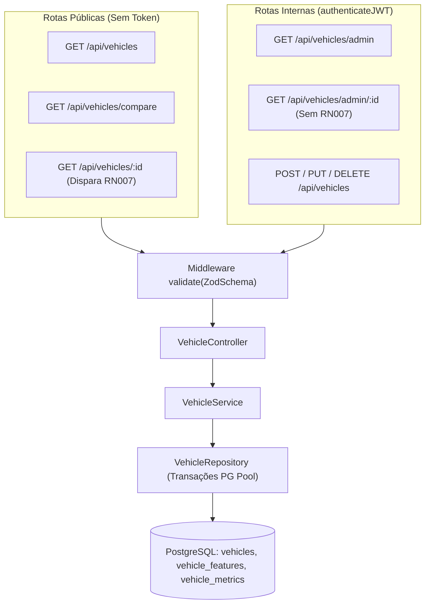

# Roadmap e Protocolo de Execução Guiado por Contratos (TDD) — Módulo `vehicles`

> **Objetivo**: Guiar um modelo de IA na implementação completa do módulo central de veículos (`vehicles`) e vitrine pública (`UC01`, `UC02`, `UC06`, `RN001`, `RN002`, `RN003`, `RN007`), com **travas rígidas de qualidade por subfase** e contratos explícitos para impedir alucinações ou soluções paliativas.

---

## 🚨 PROTOCOLO DE EXECUÇÃO ESTRITA (REGRAS INEGOCIÁVEIS PARA A IA)

1. **Testes como Contrato Imutável (Test-First)**:
   - Em cada subfase, você **DEVE** criar primeiro o arquivo de testes (`.spec.ts`) com todos os cenários exigidos, executá-lo para confirmar a falha inicial (*Red*) e só então implementar o código de produção até que todos passem (*Green*).
2. **Proibição Absoluta de "Gambiarras" (Anti-Reward Hacking)**:
   - **PROIBIDO** alterar, simplificar, comentar ou apagar asserções (`expect`) de um teste para fazê-lo passar.
   - **PROIBIDO** retornar valores fixos (*hardcoded*), condicionais artificiais para IDs de teste ou dados falsos dentro de `src/schemas`, `src/repositories`, `src/services`, `src/controllers` ou `src/utils`.
   - **PROIBIDO** usar `any`, `@ts-ignore` ou `eslint-disable` para esconder erros de tipagem.
   - Quando um teste falhar (seja no código novo ou em código pré-existente do projeto), **analise a causa raiz real** e aplique a correção arquitetural definitiva no código de produção.
3. **Trava de Avanço entre Subfases (Quality Gate)**:
   - Você **ESTÁ BLOQUEADO** de avançar para a Subfase seguinte enquanto o **Comando de Trava** da subfase atual não retornar **100% de aprovação** no terminal.
4. **Padrão de Imports do Projeto**:
   - Utilize obrigatoriamente os subpath imports do `package.json` com extensão `.js`: `#schemas/*`, `#repositories/*`, `#services/*`, `#controllers/*`, `#routes/*`, `#middlewares/*`, `#utils/*`, `#src/config/database.js` e `#src/errors/app.error.js`.

---

## Arquitetura do Fluxo (Rotas Públicas vs. Rotas Admin)

---

## Subfase 3.1: Banco de Dados e Contrato de Schemas (`Zod`)

### Passo 3.1.1 — Atualização Real do Banco de Dados e `schema.sql`
Na tabela `vehicles` do [schema.sql](file:///c:/Users/User/Desktop/Projetos/back-end-site-garagem/schema.sql), `purchase_price` e `owner_price` estão como `NOT NULL`, o que impede cadastrar veículos `PROPRIO` (sem `owner_price`) ou `CONSIGNADO` (sem `purchase_price`). Além disso, `vehicle_metrics` precisa de chave única por `(vehicle_id, recorded_date)`.

1. Edite `schema.sql`:
   - Na tabela `vehicles`: altere `purchase_price DECIMAL(10, 2) DEFAULT NULL` e `owner_price DECIMAL(10, 2) DEFAULT NULL`.
   - Na tabela `vehicle_metrics`: adicione `CONSTRAINT uq_vehicle_metrics_date UNIQUE (vehicle_id, recorded_date)`.
2. Aplique a alteração física no banco de testes ativo (`api_garage_test`) executando uma query via script/comando Node com o `pool` do projeto:
   - `ALTER TABLE vehicles ALTER COLUMN purchase_price DROP NOT NULL, ALTER COLUMN owner_price DROP NOT NULL;`
   - `ALTER TABLE vehicle_metrics DROP CONSTRAINT IF EXISTS uq_vehicle_metrics_date; ALTER TABLE vehicle_metrics ADD CONSTRAINT uq_vehicle_metrics_date UNIQUE (vehicle_id, recorded_date);`

### Passo 3.1.2 — Criar Contrato de Testes (`src/tests/schemas/vehicle/vehicle.schema.spec.ts`)
Crie o arquivo de testes cobrindo **todos** os seguintes cenários obrigatórios:
1. `createVehicleSchema`:
   - Aceitar veículo `PROPRIO` válido (com `purchase_price` e `sale_price`, sem `owner_price`, `owner_name`, `owner_contact`, `store_commission_rate`).
   - Rejeitar veículo `PROPRIO` quando `purchase_price` não for informado ou for `<= 0`.
   - Aceitar veículo `CONSIGNADO` válido (com `owner_name`, `owner_contact`, `owner_price`, `store_commission_rate` e `sale_price`, sem `purchase_price`).
   - Rejeitar veículo `CONSIGNADO` se faltar qualquer um entre `owner_name`, `owner_contact`, `owner_price` ou `store_commission_rate`.
   - Aceitar e normalizar placas no padrão antigo (`abc-1234` -> `ABC1234`) e Mercosul (`abc1d23` -> `ABC1D23`).
   - Rejeitar placas em formato inválido (ex: `1234567`, `ABCD123`).
   - Aceitar array opcional `feature_ids` contendo UUIDs válidos e rejeitar se contiver string que não seja UUID.
2. `updateVehicleSchema`:
   - Aceitar atualização parcial com `params.id` (UUID válido) e ao menos 1 campo no `body`.
   - Rejeitar `body` vazio (`{}`).
3. `findVehicleSchema`:
   - Aceitar `limit` apenas com valores `12`, `24`, `36` ou `48` (default `12`) e `page >= 1` (default `1`).
   - Rejeitar `limit` fora do padrão (ex: `10`, `50`).
   - Aceitar filtros opcionais: `category`, `brand_id`, `model_id`, `fuel_type`, `transmission`, `min_price`, `max_price`, `min_year`, `max_year`, `max_mileage`, `plate_last_digit` (`0` a `9`), `feature_ids` (UUIDs separados por vírgula), `status`, `include_deleted`.
4. `compareVehiclesSchema`:
   - Aceitar query `ids` com 2 ou 3 UUIDs válidos separados por vírgula, transformando ou validando cada UUID.
   - Rejeitar quando houver menos de 2 UUIDs, mais de 3 UUIDs ou UUID inválido.

### Passo 3.1.3 — Implementar `src/schemas/vehicle.schema.ts`
Implemente os schemas exportando exatamente:
- `createVehicleSchema`, `updateVehicleSchema`, `findVehicleSchema`, `findByIdVehicleSchema`, `deleteVehicleSchema`, `compareVehiclesSchema`.
- Tipos inferidos correspondentes.

> 🔒 **TRAVA DA SUBFASE 3.1 (Quality Gate)**:
> Execute `npx vitest run src/tests/schemas/vehicle/`
> **Condição de avanço**: Todos os testes de schema devem passar (`100% passed`). Proibido avançar para a Subfase 3.2 se houver falhas.

---

## Subfase 3.2: Contrato de Repositório e Consultas SQL (`PostgreSQL`)

### Passo 3.2.1 — Criar Contrato de Testes (`src/tests/repositories/vehicle/vehicle.repository.spec.ts`)
Crie os testes de integração no banco real (`_test`) validando:
1. `createWithFeatures(data, featureIds)`:
   - Insere veículo `PROPRIO` e grava os vínculos na tabela `vehicle_features` na mesma transação.
   - Insere veículo `CONSIGNADO` (com `purchase_price = null`) com sucesso.
   - Faz **rollback completo** (não cria o veículo em `vehicles`) se um `feature_id` inexistente for enviado (violação de FK em `vehicle_features`).
2. `updateWithFeatures(id, data, featureIds?)`:
   - Atualiza campos do veículo e, quando `featureIds` é passado, substitui os opcionais antigos pelos novos em `vehicle_features`.
3. **`[RN001]` Regra do Combustível Flex em `findCatalog`**:
   - Filtrar por `fuel_type: 'GASOLINA'` deve retornar veículos `GASOLINA` **e** veículos `FLEX` (mas não `DIESEL` ou `ALCOOL` puro).
   - Filtrar por `fuel_type: 'ALCOOL'` deve retornar veículos `ALCOOL` **e** veículos `FLEX`.
4. **`[RN002]` Regra de Visibilidade em `findCatalog`**:
   - Com `publicOnly: true`: retorna **apenas** veículos com `status` `'ATIVO'` ou `'RESERVADO'` e `deleted_at IS NULL` (ignorando `'EM_NEGOCIACAO'`, `'VENDIDO'`, `'INATIVO'`).
   - Com `publicOnly: false`: retorna veículos de qualquer status.
5. **Filtro Cumulativo de Opcionais (`feature_ids`) e Faixas em `findCatalog`**:
   - Filtrar por `feature_ids: [idA, idB]` retorna apenas veículos que possuem **ambos** os opcionais.
   - Filtrar por `brand_id` (via `JOIN models`), `min_price`/`max_price` e `plate_last_digit`.
6. `findDetailedById(id, options)`:
   - Retorna o veículo com `brand` (`id`, `name`), `model` (`id`, `name`), array `features` (`id`, `name`) e array `photos` ordenado por `display_order ASC`.
7. `findByIds(ids, options)`:
   - Retorna a lista de veículos detalhados correspondentes aos IDs informados.
8. `incrementViewMetrics(id)`:
   - Incrementa `total_views` em `+1` na tabela `vehicles` e faz *upsert* em `vehicle_metrics` para a data atual (`views_count + 1`).
9. `delete(id)`:
   - Realiza soft delete definindo `deleted_at = NOW()`, `status = 'INATIVO'` e `updated_at = NOW()`.

### Passo 3.2.2 — Implementar `src/repositories/vehicle.repository.ts`
Implemente `VehicleRepository` estendendo `BaseRepository` com `{ softDelete: true, hasActiveStatus: false }`:
- Use `const client = await pool.connect()` com `BEGIN`, `COMMIT` e `ROLLBACK` no `catch` + `client.release()` no `finally` para `createWithFeatures`, `updateWithFeatures` e `incrementViewMetrics`.
- Construa queries SQL parametrizadas reais (prevenindo SQL Injection).

> 🔒 **TRAVA DA SUBFASE 3.2 (Quality Gate)**:
> Execute `npx vitest run src/tests/repositories/vehicle/`
> **Condição de avanço**: Todos os testes de integração com o PostgreSQL devem passar (`100% passed`).

---

## Subfase 3.3: Utilitários (`RN003` e `RN007`) e Contrato de `VehicleService`

### Passo 3.3.1 — Criar Contrato de Testes (`src/tests/services/vehicle/vehicle.service.spec.ts`)
Crie os testes unitários cobrindo:
1. **Extração automática de `plate_last_digit`**:
   - Ao criar ou atualizar `full_license_plate` (ex: `'BRA2E19'`), o service calcula e envia `plate_last_digit: 9` para o repositório.
2. **`[RN003]` Sanitização LGPD (`sanitizeVehicleForRole`)**:
   - Quando o perfil for `'PUBLICO'` ou `'VISUALIZADOR'`: o retorno **NÃO PODE** conter as chaves `full_license_plate`, `purchase_price`, `owner_price`, `owner_name`, `owner_contact` e `store_commission_rate`, mantendo `plate_last_digit` e `sale_price`.
   - Quando o perfil for `'ADMIN'` ou `'VENDEDOR'`: o retorno preserva todos os campos originais.
3. **`[RN007]` Janela Anti-Fraude de 30 Minutos (`ViewTracker` + `findByIdPublic`)**:
   - Usando `vi.useFakeTimers()`:
     - 1ª chamada a `findByIdPublic(id, ip, userAgent)` chama `repository.incrementViewMetrics(id)`.
     - 2ª chamada com mesmo `id`, `ip` e `userAgent` após 10 minutos **não** chama `incrementViewMetrics`.
     - Chamada com outro `ip` ou após avançar o relógio em 31 minutos (`vi.advanceTimersByTime(31 * 60 * 1000)`) chama `incrementViewMetrics` novamente.
   - Chamadas a `findByIdAdmin(id, role)` **nunca** chamam `incrementViewMetrics`.
4. **Comparador (`comparePublic`)**:
   - Retorna os veículos sanitizados com regras públicas (`publicOnly: true` e `role: 'PUBLICO'`).

### Passo 3.3.2 — Implementar Utilitários e `VehicleService`
1. `src/utils/vehicle-sanitizer.util.ts`:
   - Exporte `sanitizeVehicleForRole<T extends Record<string, unknown>>(vehicle: T, role?: string)`.
2. `src/utils/view-tracker.util.ts`:
   - Exporte a classe `ViewTracker` e uma instância singleton `viewTracker` com método `shouldIncrement(vehicleId: string, ip: string, userAgent: string): boolean` e `clear(): void`.
3. `src/services/vehicle.service.ts`:
   - Exporte `VehicleService` com os métodos: `create`, `update`, `delete`, `findPublic`, `findAdmin`, `findByIdPublic`, `findByIdAdmin`, `comparePublic`.

> 🔒 **TRAVA DA SUBFASE 3.3 (Quality Gate)**:
> Execute `npx vitest run src/tests/services/vehicle/`
> **Condição de avanço**: Todos os testes unitários de service e utilitários devem passar (`100% passed`).

---

## Subfase 3.4: Controller, Rotas Separadas e Integração no Express

### Passo 3.4.1 — Implementar `src/controllers/vehicle.controller.ts`
Implemente os handlers HTTP:
- `findPublic`: chama `service.findPublic(req.query)` -> status `200`.
- `findAdmin`: chama `service.findAdmin(req.query, req.user!.role)` -> status `200`.
- `comparePublic`: extrai `ids` da query e chama `service.comparePublic(ids)` -> status `200`.
- `findByIdPublic`: extrai `id`, `req.ip` e `req.headers['user-agent']`, chama `service.findByIdPublic(...)` -> status `200`.
- `findByIdAdmin`: extrai `id` e `req.user!.role`, chama `service.findByIdAdmin(...)` -> status `200`.
- `create`: injeta `registered_by_user_id: req.user!.id` junto ao `req.body` e chama `service.create(...)` -> status `201`.
- `update`: chama `service.update(req.params.id, req.body)` -> status `200`.
- `delete`: chama `service.delete(req.params.id)` -> status `200`.

### Passo 3.4.2 — Implementar `src/routes/vehicle.routes.ts` e Registrar em `src/app.ts`
Respeite estritamente esta **ordem de declaração de rotas** no Express para que rotas fixas (`/compare`, `/admin`) não sejam capturadas por `/:id`:
1. `GET /` — `validate(findVehicleSchema)`, `vehicleController.findPublic`
2. `GET /compare` — `validate(compareVehiclesSchema)`, `vehicleController.comparePublic`
3. `GET /admin` — `authenticateJWT`, `authorizeRoles('ADMIN', 'VENDEDOR', 'VISUALIZADOR')`, `validate(findVehicleSchema)`, `includeDeletedValidateRole`, `vehicleController.findAdmin`
4. `GET /admin/:id` — `authenticateJWT`, `authorizeRoles('ADMIN', 'VENDEDOR', 'VISUALIZADOR')`, `validate(findByIdVehicleSchema)`, `vehicleController.findByIdAdmin`
5. `GET /:id` — `validate(findByIdVehicleSchema)`, `vehicleController.findByIdPublic`
6. `POST /` — `authenticateJWT`, `authorizeRoles('ADMIN', 'VENDEDOR')`, `validate(createVehicleSchema)`, `vehicleController.create`
7. `PUT /:id` — `authenticateJWT`, `authorizeRoles('ADMIN', 'VENDEDOR')`, `validate(updateVehicleSchema)`, `vehicleController.update`
8. `DELETE /:id` — `authenticateJWT`, `authorizeRoles('ADMIN')`, `validate(deleteVehicleSchema)`, `vehicleController.delete`

Registre em `src/app.ts`: `app.use('/api/vehicles', vehicleRoutes);`.

---

## Subfase 3.5: Contrato Final End-to-End (`E2E`) e Validação Global

### Passo 3.5.1 — Criar `src/tests/e2e/vehicle/vehicle.e2e.helpers.ts` e `vehicle.e2e.spec.ts`
Crie o contexto auxiliar (criando loja, marca, modelo e opcionais de teste com limpeza segura no `afterAll`) e teste via Supertest:
1. `POST /api/vehicles`:
   - `201` ao criar veículo `PROPRIO` com `feature_ids`, verificando `plate_last_digit` calculado automaticamente e `registered_by_user_id` do token.
   - `201` ao criar veículo `CONSIGNADO` com dados do proprietário.
   - `400` se veículo `PROPRIO` não enviar `purchase_price` ou `CONSIGNADO` não enviar `owner_price`.
   - `409` ao tentar cadastrar placa duplicada ativa.
   - `401` sem token e `403` se perfil for `VISUALIZADOR`.
2. `GET /api/vehicles` (Vitrine Pública):
   - `200` retornando apenas veículos `ATIVO` e `RESERVADO` (`RN002`).
   - Garantir que `full_license_plate`, `purchase_price`, `owner_price`, `owner_name` e `owner_contact` foram omitidos (`RN003`).
   - Filtrar por `fuel_type=GASOLINA` e confirmar retorno de veículo `FLEX` (`RN001`).
   - Filtrar por `feature_ids` e confirmar retorno apenas dos veículos que possuem os opcionais.
3. `GET /api/vehicles/admin` (Backoffice):
   - `200` para `ADMIN` e `VENDEDOR` exibindo todos os status e todos os campos sensíveis (`full_license_plate`, `purchase_price`, `owner_price`).
   - `200` para `VISUALIZADOR` exibindo todos os status, porém omitindo campos sensíveis (`RN003`).
4. `GET /api/vehicles/:id` vs `GET /api/vehicles/admin/:id` (`RN007`):
   - Duas requisições seguidas do mesmo IP/User-Agent em `GET /api/vehicles/:id` incrementam `total_views` apenas em `+1`.
   - Requisição em `GET /api/vehicles/admin/:id` não incrementa `total_views`.
5. `GET /api/vehicles/compare?ids=...`:
   - `200` retornando os veículos comparados com dados públicos sanitizados.
   - `400` se enviar apenas 1 ID ou mais de 3 IDs.
6. `PUT /api/vehicles/:id` e `DELETE /api/vehicles/:id`:
   - `200` ao atualizar veículo e seus opcionais.
   - `403` quando `VENDEDOR` tenta executar `DELETE`.
   - `200` quando `ADMIN` executa `DELETE` (confirmando `status = 'INATIVO'` e `deleted_at != null`).

> 🔒 **TRAVA FINAL DE ENTREGA (Global Gate)**:
> Execute em sequência:
> 1. `npm test` (100% de todas as suítes do projeto devem passar).
> 2. `npm run lint` (0 erros de ESLint).
