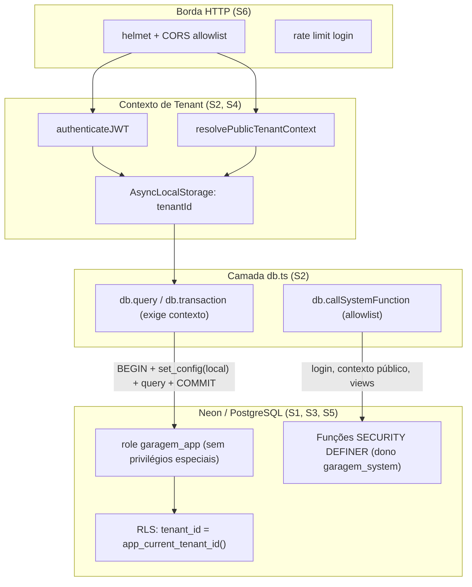

# Roadmap de Segurança e LGPD — Execução TDD com Quality Gates

> **Objetivo**: Reduzir ao máximo a chance de vazamento de dados entre empresas (tenants) e de dados pessoais em um ambiente com **banco compartilhado (Neon / PostgreSQL)**, **API única multi-tenant (Render / Koyeb / Northflank)** e **arquivos no Cloudflare R2**, usando defesa em profundidade:
>
> 1. **Banco**: menor privilégio + Row Level Security (RLS) como segunda trava de isolamento.
> 2. **Aplicação**: contexto de tenant obrigatório por requisição (fail-closed).
> 3. **Borda HTTP**: headers, CORS, anti-enumeração, logs sem dados pessoais.
> 4. **Arquivos**: laudos privados, metadados removidos, chaves por tenant.
> 5. **Configuração**: validação de ambiente, TLS obrigatório, recusa de boot com usuário privilegiado.
> 6. **LGPD**: minimização, anonimização, checklist operacional e jurídico.
>
> **Executor previsto**: modelo menor, seguindo este documento à risca.
> **Revisor previsto**: humano ou modelo sênior, seguindo o Protocolo de Auditoria.

---

## ✅ Decisões definidas pelo humano (aplicar sem desvios)

O executor **DEVE** seguir estritamente as decisões registradas abaixo:

| ID | Decisão | Regra fechada |
|----|---------|---------------|
| D1 | O laudo pericial (PDF) é visível na vitrine pública? | **Sim**, o cliente final precisa visualizar o laudo, mas **somente** por rota da API com contexto de tenant (`GET /api/vehicles/:id/inspection-report` com `resolvePublicTenantContext`), **nunca** por pasta estática aberta. Quando o Cloudflare R2 entrar (Fase 6 / S7.4), o PDF fica em bucket privado e essa mesma rota valida o tenant/veículo e gera uma Presigned URL temporária (máx. 300s). |
| D2 | Quais campos da loja a rota pública `/api/stores/public/:id` pode retornar? | **Apenas** `id`, `name` e endereço (`zip_code`, `street`, `number`, `complement`, `neighborhood`, `city`, `state`) para uso em filtro de vitrine. **Proibido** retornar `cnpj`, `phone`, `tenant_id`, `is_active`, `deleted_at` ou `created_at`. |
| D3 | Origens CORS iniciais (URL do painel ADM e vitrines) | Ainda sem domínio de produção definido. Configurar via `CORS_ALLOWED_ORIGINS` (em dev/test: `http://localhost:5173,http://localhost:3000`; em produção: exigir `https://` obrigatório via variável de ambiente no painel do provedor). |
| D4 | Duração do JWT | **`1d`** (`86400` segundos) configurável via `JWT_EXPIRES_IN` (padrão `1d`). Futuramente será adicionado `token_version` na tabela `users` validado no `authenticateJWT` para revogação imediata. |
| D5 | Nome da branch de trabalho | **`security/hardening`** |

> [!NOTE]
> A pasta `Docs/roadmaps/` está no `.gitignore` (padrão `roadmaps`). Este arquivo e o log de execução **não vão para o git**. Se quiser versioná-los, ajuste o `.gitignore` antes de começar.

---

## 🚨 PROTOCOLO DE EXECUÇÃO ESTRITA (PARA O MODELO EXECUTOR)

Você é o **Agente Executor**. Implemente este roadmap **uma tarefa por vez**, em **TDD estrito**, na ordem exata. Segurança não aceita "quase certo".

### Regra 1 — Ciclo TDD obrigatório por tarefa

1. **RED**: escreva **primeiro** os testes listados na tarefa. Rode-os. Confirme que **falham pelo motivo esperado** (descrito na tarefa).
2. **GREEN**: escreva o **mínimo** de código de produção que faz os testes passarem **cumprindo todos os requisitos** da seção GREEN (não apenas os testes).
3. **REFACTOR**: limpe duplicação sem mudar comportamento. Todos os testes continuam verdes.
4. **GATE DA TAREFA**: rode os comandos do Gate. Só avance se **todos** derem o resultado esperado.

### Regra 2 — O que conta como RED válido

| ✅ RED válido | ❌ RED inválido (não conta, corrija o teste) |
|---|---|
| Falha de `expect` (asserção) | Erro de sintaxe no próprio teste |
| Módulo/export inexistente **que a tarefa manda criar** | Banco de testes desligado / erro de conexão |
| Erro SQL esperado ausente (ex.: esperava `42501`, não veio) | Timeout sem causa entendida |
| | Import de caminho digitado errado |

### Regra 3 — Testes de caracterização (tipo `CHAR`)

Algumas tarefas protegem comportamento que **já pode estar correto** (o teste nasce verde). Nesses casos é obrigatório fazer a **Prova de Sensibilidade**:

1. Escreva o teste e rode (pode passar).
2. Introduza **temporariamente** a falha descrita na tarefa no código de produção.
3. Rode o teste e confirme que ele **fica vermelho**.
4. **Reverta** a falha (confirme com `git diff` que o código de produção voltou ao original).
5. Registre no log: falha introduzida, saída vermelha, reversão confirmada.

Um teste de segurança que não fica vermelho quando a proteção é removida **não protege nada**.

### Regra 4 — Controle positivo obrigatório em testes de isolamento

Todo teste do tipo "tenant A não vê dados de B" **deve também** afirmar que:
- A **vê os próprios dados** (prova que a consulta funciona), e
- Os dados de B **existem de fato** no banco (consultando via `adminPool`).

Sem controle positivo, uma consulta que retorna sempre vazio passaria no teste. Isso é proibido.

### Regra 5 — Evidência e commits

- Trabalhe na branch definida em **D5**.
- Para **cada tarefa**, faça dois commits (Conventional Commits):
  - `test(security): Sx.y RED - <resumo>` (só os testes, vermelhos)
  - `feat(security): Sx.y GREEN - <resumo>` (produção + refactor, verde)
- Registre cada tarefa no arquivo `Docs/roadmaps/roadmap-seguranca-log.md` usando o **Template de Log** do fim deste documento.

### Regra 6 — BLOQUEIO (quando parar)

Pare imediatamente, registre `🛑 BLOQUEIO` no log com o motivo e peça ajuda humana se:
- Um teste só passaria violando alguma regra deste documento.
- Um teste **existente** (de fases anteriores) quebrar e a tarefa **não** listar esse arquivo como permitido.
- O baseline (S0.1) não estiver 100% verde.
- O working tree não estiver limpo no início.
- Uma decisão D1–D5 necessária não estiver respondida.
- Você não entender o motivo de uma falha após 3 tentativas.

---

## ⛔ GAMBIARRAS PROIBIDAS (lista exaustiva mínima)

Qualquer item abaixo invalida a tarefa inteira, mesmo com testes verdes.

### Nos testes
1. `.skip`, `.only`, `.todo`, `it.fails`, `describe.skip`, `test.skip` ou equivalentes.
2. Comentar, apagar ou renomear testes existentes.
3. Afrouxar asserções (`toBe` → `toBeDefined`, remover campos, trocar valor esperado para "bater" com saída errada).
4. `try/catch` que engole falha em teste, ou `if (...) return` condicional que pula asserções.
5. Mockar o que está sendo testado. **Testes de banco (`*.db.spec.ts`) usam o Postgres real de testes**, nunca mock de `pg`.
6. Editar testes de tarefas anteriores fora da lista "Arquivos de teste permitidos".

### No código de produção
7. Qualquer ramo baseado em ambiente de teste: `NODE_ENV === 'test'`, `process.env.VITEST`, detecção de `vitest`/`jest`.
8. Backdoors: variável de ambiente que desliga RLS, rota só para testes, header mágico, flag "skipTenantCheck".
9. `as any`, `@ts-ignore`, `@ts-expect-error`, `@ts-nocheck`.
10. Novos `eslint-disable` (o baseline atual tem 9 ocorrências e não pode crescer).
11. Remover filtros explícitos `tenant_id = $n` já existentes nas queries. **RLS é segunda trava, não substitui a primeira.**
12. Ler `tenant_id` de corpo/query/header **não validado** para definir contexto. Contexto só vem de JWT validado ou do middleware público validado.
13. Importar `src/tests/**` em código de produção.

### No banco
14. Conceder `SUPERUSER`, `BYPASSRLS`, `CREATEROLE`, `CREATEDB` ao `garagem_app` ou ao `garagem_system`.
15. `DISABLE ROW LEVEL SECURITY` em qualquer tabela.
16. Política `USING (true)` ou `WITH CHECK (true)` para `garagem_app`. Só é permitida para `garagem_system`.
17. Tornar `garagem_app` membro de qualquer role (`GRANT garagem_system TO garagem_app` é proibido).
18. Tornar `garagem_app` ou `garagem_system` dono (`OWNER`) de tabelas.
19. Usar `docker compose down -v` no banco de **desenvolvimento**. No banco de **testes**, só quando a tarefa mandar.

---

## 🔒 DEFINIÇÃO DOS GATES

### GT — Gate de Tarefa (rodar ao fim de CADA tarefa)

```powershell
npx tsc --noEmit
npm run lint
npx vitest run <arquivos de teste listados na tarefa>
npx vitest run src/tests/security/anti-cheat.spec.ts src/tests/security/anti-cheat.repo.spec.ts
Get-FileHash src/tests/security/anti-cheat.spec.ts, src/tests/security/anti-cheat.repo.spec.ts, src/tests/security/support/anti-cheat.scanner.ts, src/tests/security/anti-cheat.baseline.json -Algorithm SHA256 | Format-Table Hash, Path
```

**Resultado esperado**:
- `tsc`: zero erros.
- `lint`: zero erros e zero warnings novos.
- Testes da tarefa: 100% verdes.
- Anti-cheat: 100% verde.
- Hashes: **idênticos** aos registrados no log na tarefa S0.2. Hash diferente = arquivo de guarda adulterado = tarefa inválida.

### TS — Trava de Subfase (rodar ao fim de CADA subfase)

```powershell
# Tudo do GT, mais:
npx vitest run
git status --short
```

**Resultado esperado**:
- Suíte completa 100% verde. Quantidade de testes **≥ baseline + testes novos**. Nunca menor.
- `git status` limpo (tudo commitado).
- Log da subfase preenchido.

**PROIBIDO** iniciar a próxima subfase com qualquer item do TS falhando.

---

## 🔍 PROTOCOLO DE AUDITORIA (PARA O REVISOR)

Ao revisar cada subfase, verifique:

1. **Ordem RED → GREEN**: no `git log`, o commit `RED` vem antes do `GREEN` em cada tarefa e o `RED` contém só testes.
2. **Diff de testes antigos**: `git diff <inicio-da-subfase> -- src/tests` só toca arquivos permitidos pelas tarefas.
3. **Controle positivo**: testes de isolamento afirmam "A vê o próprio" **e** "B existe".
4. **Provas de sensibilidade** (tarefas `CHAR`) registradas no log com saída vermelha.
5. **SQL**: nenhuma política `USING (true)` para `garagem_app`; funções `SECURITY DEFINER` com `SET search_path` fixo e dono `garagem_system`.
6. **Filtros duplicados preservados**: queries ainda filtram `tenant_id` explicitamente mesmo com RLS.
7. **Hashes do anti-cheat** batem com S0.2.
8. **Sabotagem opcional** (recomendada nas Subfases S5): no banco de testes, rode `ALTER TABLE vehicles DISABLE ROW LEVEL SECURITY;` como `postgres`, rode `npx vitest run src/tests/security/rls-strict.db.spec.ts`, confirme falhas, depois reaplique `scripts/db-apply-security.ps1`.

---

## 📐 Visão Arquitetural Alvo



### Decisões arquiteturais (ADRs curtos)

| ADR | Decisão | Motivo |
|-----|---------|--------|
| A1 | RLS **habilitado** (`ENABLE`) em todas as tabelas, **sem** `FORCE` | O dono das tabelas (migrations / console Neon) precisa de acesso total para operação. A app nunca conecta como dono: garantido por teste (S5.6) e por checagem no boot (S8.3). |
| A2 | Contexto via `set_config('app.current_tenant_id', $1, true)` **local à transação** | Conexões do pool são reaproveitadas. Variável de sessão vazaria para outra requisição. |
| A3 | `db.query` sem contexto **lança erro** (fail-closed na app) | Detecta esquecimento de contexto em teste, antes de virar vazamento. |
| A4 | Fluxos pré-autenticação usam funções `SECURITY DEFINER` com dono `garagem_system` (role `NOLOGIN`, privilégio mínimo) | Login e vitrine pública precisam ler sem tenant definido. Função estreita é mais segura que um usuário com `BYPASSRLS`. |
| A5 | Tabelas filhas sem `tenant_id` (fotos, opcionais, métricas, auditoria, taxas, banners) usam política `EXISTS` no pai | Evita mudar schema e código agora. O RLS do pai é aplicado dentro da subquery. |
| A6 | Sem `ALTER DEFAULT PRIVILEGES` | Tabela nova nasce inacessível para a app até alguém conceder acesso e criar RLS conscientemente (fail-closed). |

---

## 🗺️ Mapa das Subfases

| Subfase | Tema | Depende de |
|---------|------|------------|
| S0 | Preparação, baseline, guarda anti-gambiarra, pool admin de testes | — |
| S1 | Menor privilégio no banco (`garagem_app`) | S0 |
| S2 | Contexto de tenant (AsyncLocalStorage) e camada `db.ts` | S1 |
| S3 | Funções de sistema (`SECURITY DEFINER`) para fluxos pré-auth | S2 |
| S4 | Contexto obrigatório em toda a aplicação | S3 |
| S5 | Row Level Security em todas as tabelas | S4 |
| S6 | Endurecimento HTTP (headers, CORS, uploads, login, logs) | S5 |
| S7 | Segurança de arquivos (EXIF, assinatura, chaves, R2) | S6 |
| S8 | Configuração e segredos (env, TLS, boot seguro, JWT) | S7 |
| S9 | LGPD no código (minimização e anonimização) | S8 |
| S10 | Checklist operacional (Neon, host, R2, contas, jurídico) | S9 |

---

# Subfase S0 — Preparação

## Tarefa S0.1 — Branch, working tree limpo e baseline

**Tipo:** CONFIG (sem TDD; só medição)

**Passos:**
1. Rode `git status --short`. Se houver qualquer alteração → `🛑 BLOQUEIO` (peça ao humano para commitar ou descartar).
2. Crie a branch D5 a partir da branch atual.
3. Garanta que o container `garagem_db_test_container` está rodando (`docker compose up -d garagem_db_test`).
4. Rode e registre no log:
   - `npx tsc --noEmit` → número de erros (esperado: 0)
   - `npm run lint` → erros/warnings
   - `npx vitest run` → total de arquivos, testes, aprovados, falhos
5. Crie `Docs/roadmaps/roadmap-seguranca-log.md` com o cabeçalho e a seção S0.1 preenchida.

**Gate:** baseline 100% verde. Se não estiver → `🛑 BLOQUEIO`. Não corrija falhas pré-existentes sem autorização.

---

## Tarefa S0.2 — Guarda anti-gambiarra automatizada

**Tipo:** TDD
**Por que:** o executor e futuros commits não podem burlar testes de segurança sem que um teste perceba.

**Arquivos de teste permitidos (criar):**
- `src/tests/security/support/anti-cheat.scanner.ts`
- `src/tests/security/anti-cheat.spec.ts`
- `src/tests/security/anti-cheat.repo.spec.ts`
- `src/tests/security/anti-cheat.baseline.json`

**Arquivos de produção permitidos:** nenhum.

**Especificação do scanner** (`anti-cheat.scanner.ts`, funções puras, sem I/O exceto `scanRepository`):

| Função | Entrada | Saída |
|--------|---------|-------|
| `scanTestSource(path, content)` | arquivo `.ts` em `src/tests` | lista de violações |
| `scanProductionSource(path, content)` | arquivo `.ts` fora de `src/tests` | lista de violações |
| `scanSql(path, content)` | arquivo `.sql` em `db/` | lista de violações |
| `countEslintDisable(content)` | qualquer `.ts` | número |
| `scanRepository(rootDir)` | raiz do projeto | `{ violations, eslintDisableByFile }` |

**Regras que o scanner detecta:**

| Contexto | Padrão proibido |
|----------|-----------------|
| Testes e produção | `.skip(`, `.only(`, `.todo(`, `it.fails(`, `as any`, `@ts-ignore`, `@ts-expect-error`, `@ts-nocheck` |
| Só produção | `NODE_ENV` comparado com `'test'`, `process.env.VITEST`, import contendo `tests/` |
| SQL | `BYPASSRLS` (exceto `NOBYPASSRLS`), `SUPERUSER` (exceto `NOSUPERUSER`), `DISABLE ROW LEVEL SECURITY`, `GRANT garagem_system TO garagem_app`, qualquer `CREATE POLICY` contendo `USING (true)` ou `WITH CHECK (true)` que **não** contenha `TO garagem_system` (analisar por instrução, separando por `;`) |

**Exclusões obrigatórias do scan:** apenas os 3 arquivos do próprio anti-cheat (eles contêm os padrões como texto). Nenhuma outra exclusão.

**RED — `anti-cheat.spec.ts` (unitário, com conteúdo em memória):**

| ID | Cenário | Esperado |
|----|---------|----------|
| AC-01 | teste com `it.skip(` | 1 violação |
| AC-02 | teste com `describe.only(` | 1 violação |
| AC-03 | produção com `as any` | 1 violação |
| AC-04 | produção com `process.env.NODE_ENV === 'test'` | 1 violação |
| AC-05 | produção com `process.env.NODE_ENV === 'production'` | 0 violações (permitido) |
| AC-06 | produção importando `'#src/tests/support/admin-pool.js'` | 1 violação |
| AC-07 | SQL com `CREATE ROLE x LOGIN BYPASSRLS` | 1 violação |
| AC-08 | SQL com `NOBYPASSRLS NOSUPERUSER` | 0 violações |
| AC-09 | SQL com política `TO garagem_app USING (true)` | 1 violação |
| AC-10 | SQL com política `TO garagem_system USING (true)` | 0 violações |
| AC-11 | SQL com `ALTER TABLE t DISABLE ROW LEVEL SECURITY` | 1 violação |
| AC-12 | `countEslintDisable` em texto com 2 ocorrências | 2 |

**Motivo esperado da falha (RED):** módulo `anti-cheat.scanner.ts` sem as funções exportadas.

**RED — `anti-cheat.repo.spec.ts` (varre o repositório real):**

| ID | Cenário | Esperado |
|----|---------|----------|
| AC-R1 | `scanRepository(process.cwd()).violations` | lista vazia |
| AC-R2 | para cada arquivo, contagem de `eslint-disable` | `<=` valor do baseline; arquivo fora do baseline deve ter 0 |

**Baseline** (`anti-cheat.baseline.json`): mapa `caminho relativo → contagem` com as 9 ocorrências atuais:
`src/middlewares/error.middleware.ts: 1`, `src/schemas/user.schema.ts: 1`, `src/services/user.service.ts: 6`, `src/services/vehicle.service.ts: 1`. Confirme com uma varredura antes de gravar.

**GREEN:** implemente o scanner até AC-01..AC-12 e AC-R1..AC-R2 passarem.

**Pós-GREEN obrigatório:** rode o `Get-FileHash` do GT e **registre os 4 hashes no log**. A partir daqui, esses 4 arquivos estão **congelados**. Só o humano pode alterá-los.

**Gate:** GT com `src/tests/security/anti-cheat.spec.ts src/tests/security/anti-cheat.repo.spec.ts`.

---

## Tarefa S0.3 — Pool administrativo exclusivo para testes

**Tipo:** TDD
**Por que:** na S1 a aplicação passa a conectar com um usuário sem privilégios. Seeds e limpezas dos testes precisam de um pool administrativo **separado**, que nunca pode ser usado pela produção.

**Arquivos de teste permitidos:**
- Criar `src/tests/support/admin-pool.ts`
- Criar `src/tests/support/admin-pool.spec.ts`
- Alterar **todos** os arquivos em `src/tests/**` que usam `pool` de `#src/config/database.js` **para seed, limpeza ou verificação direta de dados** → trocar por `adminPool`.

**Arquivos de produção permitidos:** `.env.example` (documentar variáveis novas).
**Arquivos locais (não versionados):** `.env.test` (adicionar variáveis).

**Requisitos de `admin-pool.ts`:**
1. Lê `DB_HOST`, `DB_PORT`, `DB_NAME`, `DB_ADMIN_USER`, `DB_ADMIN_PASSWORD`.
2. Se `DB_ADMIN_USER` ou `DB_ADMIN_PASSWORD` estiver ausente/vazio → lança `Error` com mensagem clara **na importação**. Sem fallback para `DB_USER`.
3. Exporta `adminPool` (instância de `Pool`).

**RED — `admin-pool.spec.ts`:**

| ID | Cenário | Esperado |
|----|---------|----------|
| AP-01 | `SELECT current_user` via `adminPool` | igual a `process.env.DB_ADMIN_USER` |
| AP-02 | importar o módulo com `DB_ADMIN_USER` vazio (`vi.stubEnv` + `vi.resetModules` + import dinâmico) | rejeita com erro mencionando `DB_ADMIN_USER` |

**Regras da migração dos testes:**
- Chamadas a repositories, services e rotas **continuam** usando o código de produção (que usa `pool`).
- Só inserts/deletes/selects **diretos** de preparação/verificação passam a usar `adminPool`.
- Replique para `adminPool` o mesmo padrão de encerramento (`await adminPool.end()` em `afterAll`) que o arquivo já usa para `pool`.
- Nenhuma asserção muda. Nenhum teste é removido.

**Valores em `.env.test`:** `DB_ADMIN_USER=postgres` e `DB_ADMIN_PASSWORD=<senha atual do container de testes>`. Neste momento `DB_USER` continua `postgres`.

**Gate:** GT com `src/tests/support/admin-pool.spec.ts` **+ TS completo** (refactor de testes não pode mudar o total de testes aprovados, exceto +2).

### 🔒 TRAVA DA SUBFASE S0
Rodar TS. Registrar no log: total de testes, hashes do anti-cheat.

---

# Subfase S1 — Menor Privilégio no Banco

## Tarefa S1.1 — Roles e grants

**Tipo:** TDD (teste de banco real)
**Por que:** hoje a API conecta como `postgres` (superusuário). Uma única falha de SQL injection daria controle total do banco. A app deve conectar com um usuário que só lê/escreve dados, sem DDL, sem `TRUNCATE`, sem apagar empresas.

**Arquivos de teste permitidos (criar):**
- `src/tests/security/db-privileges.db.spec.ts`
- `src/tests/support/db-session.ts`

**Arquivos de produção permitidos (criar/alterar):**
- `db/security/00_dev_roles.sql` (**somente dev/test**)
- `db/security/01_grants.sql`
- `scripts/db-apply-security.ps1`
- `docker-compose.yml` (apenas montagens de init)
- `.env.example`

**Arquivos locais:** `.env.test`, `.env`.

### Especificação SQL

**Regras gerais para todos os arquivos `db/security/*.sql`:**
- Salvar em **UTF-8 sem BOM**. Comentários só em ASCII (sem acentos).
- **Idempotentes**: rodar duas vezes não pode falhar. Use bloco `DO $$ ... IF NOT EXISTS ... $$` para roles e `DROP POLICY IF EXISTS` antes de `CREATE POLICY`.
- Sem senha real de produção em nenhum arquivo.

**`00_dev_roles.sql`** (primeira linha: comentário `-- DEV/TEST ONLY. NEVER RUN IN PRODUCTION.`):
- Cria `garagem_app` com `LOGIN PASSWORD 'garagem_app_dev_only' NOSUPERUSER NOBYPASSRLS NOCREATEDB NOCREATEROLE NOINHERIT`, se não existir.

**`01_grants.sql`:**
1. Cria `garagem_system` com `NOLOGIN NOSUPERUSER NOBYPASSRLS NOCREATEDB NOCREATEROLE`, se não existir.
2. `REVOKE CREATE ON SCHEMA public FROM PUBLIC;`
3. `GRANT USAGE ON SCHEMA public TO garagem_app, garagem_system;`
4. `GRANT SELECT, INSERT, UPDATE, DELETE` ao `garagem_app` em **cada tabela listada explicitamente** (não use `ALL TABLES`): `stores, users, brands, features, promotions, models, financing_banks, hero_banner, bank_rates, vehicles, vehicle_photos, trade_in_proposals, lead_interests, vehicle_metrics, vehicle_audits, vehicle_features`.
5. `GRANT SELECT, INSERT, UPDATE ON tenants TO garagem_app;` (**sem DELETE**).
6. **Não** conceder `TRUNCATE`, `REFERENCES`, `TRIGGER` nem nada ao `PUBLIC`.

**`scripts/db-apply-security.ps1`:**
- Parâmetros: `-Container` (padrão `garagem_db_test_container`), `-Database` (padrão `api_garage_test`), `-IncludeDevRoles` (switch).
- Passos: remove `/tmp/security` no container → `docker cp db/security <container>:/tmp/security` → executa em ordem (`00_` só com `-IncludeDevRoles`, depois `01_`, `02_`, `03_` se existirem) com `psql -U postgres -d <db> -v ON_ERROR_STOP=1 -f <arquivo>` → se `$LASTEXITCODE -ne 0`, lança erro e para.

**`docker-compose.yml`:** monte `schema.sql` como `/docker-entrypoint-initdb.d/00_schema.sql` e os arquivos de segurança como `10_dev_roles.sql`, `20_grants.sql` (e depois `30_system_functions.sql`, `40_rls.sql`). Isso só vale para volumes novos. Volumes existentes usam o script.

**`src/tests/support/db-session.ts`:** helper `withAppSession(tenantId: string | null, fn: (client) => Promise<T>)`:
- Pega cliente de `pool` (`#src/config/database.js`), `BEGIN`, se `tenantId` não for nulo executa `SELECT set_config('app.current_tenant_id', $1, true)`, roda `fn`, **sempre** `ROLLBACK` e `release()` no `finally`.

### RED — `db-privileges.db.spec.ts`

> **Guarda obrigatória:** o primeiro teste do arquivo afirma `current_user = 'garagem_app'`. Todas as sondagens destrutivas rodam dentro de `withAppSession` (com `ROLLBACK`). DDL no Postgres é transacional.

| ID | Cenário (como `garagem_app`) | Esperado |
|----|------------------------------|----------|
| PR-01 | `SELECT current_user` | `garagem_app` |
| PR-02 | `SELECT rolsuper, rolbypassrls, rolcreaterole, rolcreatedb FROM pg_roles WHERE rolname = current_user` | todos `false` |
| PR-03 | `CREATE TABLE sec_probe (id int)` | erro código `42501` |
| PR-04 | `DROP TABLE vehicles` | erro código `42501` |
| PR-05 | `TRUNCATE vehicles` | erro código `42501` |
| PR-06 | `DELETE FROM tenants WHERE false` | erro código `42501` |
| PR-07 | `ALTER TABLE vehicles DISABLE ROW LEVEL SECURITY` | erro código `42501` |
| PR-08 | `SELECT count(*) FROM tenants` (controle positivo) | sucesso |
| PR-09 | `SELECT count(*) FROM pg_auth_members m JOIN pg_roles r ON r.oid = m.member WHERE r.rolname = 'garagem_app'` | `0` |
| PR-10 | `SELECT count(*) FROM pg_tables WHERE schemaname = 'public' AND tableowner IN ('garagem_app','garagem_system')` | `0` |

**Motivo esperado da falha (RED):** PR-01 falha (`current_user` ainda é `postgres`) e PR-03..PR-07 não lançam erro.

### GREEN
1. Crie os arquivos SQL e o script.
2. Aplique no banco de testes: `./scripts/db-apply-security.ps1 -IncludeDevRoles`.
3. Altere `.env.test`: `DB_USER=garagem_app`, `DB_PASSWORD=garagem_app_dev_only`.
4. Aplique também no banco de desenvolvimento (`-Container garagem_db_container -Database api_garage -IncludeDevRoles`) e ajuste `.env` do mesmo jeito.
5. Documente no `.env.example` as variáveis `DB_ADMIN_USER`/`DB_ADMIN_PASSWORD` (só testes) e que `DB_USER` **nunca** deve ser `postgres`.

**Proibido:** resolver falha concedendo privilégio extra além da lista. Se um teste existente precisar de `TRUNCATE` ou `DELETE` em `tenants`, isso é seed/limpeza → ele deveria estar usando `adminPool` (corrigir o teste, permitido nesta tarefa **apenas** para essa troca).

**Gate:** GT com `src/tests/security/db-privileges.db.spec.ts`.

---

## Tarefa S1.2 — Regressão completa como `garagem_app`

**Tipo:** CONFIG + regressão
**Passos:** rode `npx vitest run`. Toda falha deve ser classificada no log:
- (a) teste usando `pool` para seed/limpeza → trocar para `adminPool` (permitido);
- (b) qualquer outro caso → `🛑 BLOQUEIO`.

### 🔒 TRAVA DA SUBFASE S1
Rodar TS.

---

# Subfase S2 — Contexto de Tenant e Camada `db.ts`

## Tarefa S2.1 — `request-context.ts` (AsyncLocalStorage)

**Tipo:** TDD (unitário)
**Por que:** o tenant da requisição precisa chegar ao banco sem depender de cada função lembrar de passá-lo.

**Arquivos de teste permitidos:** criar `src/tests/config/request-context.spec.ts`.
**Arquivos de produção permitidos:** criar `src/config/request-context.ts`.

**API obrigatória:**
- `runWithTenant<R>(tenantId: string, fn: () => R): R`
- `getCurrentTenantId(): string | null`
- `class InvalidTenantIdError extends Error`
- `class TenantContextConflictError extends Error`

**RED:**

| ID | Cenário | Esperado |
|----|---------|----------|
| RC-01 | `getCurrentTenantId()` fora de contexto | `null` |
| RC-02 | dentro de `runWithTenant(A, ...)` | `A` |
| RC-03 | após `await` (ex.: `setTimeout` em Promise) dentro do contexto | ainda `A` |
| RC-04 | duas execuções em paralelo (`Promise.all`) com A e B intercalando `await`s | cada uma lê o próprio id |
| RC-05 | `runWithTenant('nao-e-uuid', ...)` | lança `InvalidTenantIdError` sem executar `fn` |
| RC-06 | aninhado com o **mesmo** tenant | permitido, retorna `A` |
| RC-07 | aninhado com tenant **diferente** | lança `TenantContextConflictError` |
| RC-08 | após `runWithTenant` terminar | `getCurrentTenantId()` volta a `null` |
| RC-09 | retorno de `fn` (inclusive Promise) | é repassado intacto |

**Motivo esperado da falha:** módulo inexistente.

**GREEN:** use `AsyncLocalStorage` de `node:async_hooks`. Valide UUID com `zod` (`z.string().uuid()`), como o restante do projeto.

**Gate:** GT com `src/tests/config/request-context.spec.ts`.

---

## Tarefa S2.2 — `db.ts`: `query` e `transaction` com contexto obrigatório

**Tipo:** TDD (integração com banco real)
**Por que:** é aqui que o tenant vira `set_config` **local à transação**. Errar aqui faz contexto vazar entre requisições.

**Arquivos de teste permitidos:** criar `src/tests/config/db.db.spec.ts`.
**Arquivos de produção permitidos:** criar `src/config/db.ts`.

**API obrigatória:**
- `interface Queryable { query<T extends QueryResultRow = QueryResultRow>(text: string, values?: unknown[]): Promise<QueryResult<T>> }`
- `interface Db extends Queryable { transaction<R>(fn: (tx: Queryable) => Promise<R>): Promise<R> }` (S2.3 adiciona `callSystemFunction`)
- `function createDb(pool: Pool): Db`
- `const db: Db = createDb(pool)` (pool padrão de `database.ts`)
- `class MissingTenantContextError extends Error`

**Comportamento obrigatório:**
1. `query` e `transaction` leem `getCurrentTenantId()`. Se `null` → lançam `MissingTenantContextError` **antes** de pegar conexão do pool.
2. Fluxo: `pool.connect()` → `BEGIN` → `SELECT set_config('app.current_tenant_id', $1, true)` → consulta(s) → `COMMIT` → `release()`.
3. Em erro: `ROLLBACK`, `release()`, relança o erro original.
4. `release()` sempre acontece (bloco `finally`).
5. Nunca interpolar o tenant no SQL. Sempre parâmetro `$1`.

**RED** (use `createDb(new Pool({ ...mesma config, max: 1 }))` nos testes que verificam reaproveitamento de conexão):

| ID | Cenário | Esperado |
|----|---------|----------|
| DB-01 | `db.query('SELECT 1')` fora de contexto | rejeita `MissingTenantContextError`; `pool.connect` **não** chamado (`vi.spyOn`) |
| DB-02 | dentro de `runWithTenant(A)`: `SELECT current_setting('app.current_tenant_id', true) AS t` | `t = A` |
| DB-03 | pool `max: 1`: query em contexto A, depois query **crua** no mesmo pool `SELECT current_setting('app.current_tenant_id', true)` | `''` ou `null` (contexto **não** vazou) |
| DB-04 | `transaction` que insere tenant (via `INSERT` em `tenants` com id A, dentro de contexto A) e depois lança erro | `adminPool` confirma que o tenant **não** existe |
| DB-05 | pool `max: 1`: após DB-04, nova `query` em contexto | resolve em menos de 2s (conexão foi liberada) |
| DB-06 | `transaction` bem-sucedida com 2 queries | ambas veem o mesmo `current_setting` = A |
| DB-07 | `transaction` fora de contexto | rejeita `MissingTenantContextError` |

**Motivo esperado da falha:** módulo inexistente.

**Proibido:** usar `SET` sem `LOCAL`/`set_config(..., false)`. Usar uma conexão por requisição inteira (fora de escopo).

**Gate:** GT com `src/tests/config/db.db.spec.ts`.

---

## Tarefa S2.3 — `callSystemFunction` com allowlist

**Tipo:** TDD (unitário)
**Arquivos de teste permitidos:** alterar `src/tests/config/db.db.spec.ts` (adicionar casos).
**Arquivos de produção permitidos:** alterar `src/config/db.ts`.

**API:** `type SystemFunctionName = 'auth_login_candidates' | 'public_find_store' | 'public_find_tenant' | 'increment_vehicle_views'` e `Db.callSystemFunction<T>(name: SystemFunctionName, args: unknown[]): Promise<T[]>`.

**Comportamento:**
1. Valida `name` em **tempo de execução** contra um `Set` constante. Nome fora → lança `Error('Função de sistema não permitida')` sem tocar no pool.
2. Monta `SELECT * FROM public.<name>($1, $2, ...)` só com placeholders. Argumentos sempre parametrizados.
3. Não exige contexto de tenant. Não chama `set_config`.

**RED:**

| ID | Cenário | Esperado |
|----|---------|----------|
| DB-08 | `callSystemFunction('pg_sleep' as SystemFunctionName, [1])` | rejeita; `pool.query`/`pool.connect` não chamados |
| DB-09 | nome com injeção `"auth_login_candidates; DROP TABLE users; --"` | rejeita; pool não chamado |

> O teste positivo (função real) fica na S3.1, quando as funções existirem.

**Gate:** GT com `src/tests/config/db.db.spec.ts`.

### 🔒 TRAVA DA SUBFASE S2
Rodar TS.

---

# Subfase S3 — Funções de Sistema para Fluxos Pré-Autenticação

## Tarefa S3.1 — SQL das funções `SECURITY DEFINER`

**Tipo:** TDD (banco real)
**Por que (`garagem_system` vs `BYPASSRLS`):** login (busca por e-mail em todas as empresas), resolução da vitrine pública e contador de views acontecem **sem tenant definido**. Se a aplicação usasse um usuário com `BYPASSRLS` ("chave mestra"), o RLS ficaria desligado em 100% das rotas do sistema, e qualquer `WHERE tenant_id` esquecido vazaria dados. Usando funções `SECURITY DEFINER` cujo dono é `garagem_system` ("crachá restrito"):
1. A aplicação (`garagem_app`) continua 100% presa ao RLS em todas as tabelas.
2. O acesso sem tenant só existe dentro dessas 4 funções estreitas e auditadas.
3. O próprio `garagem_system` **não tem `BYPASSRLS`** e **não tem permissão** de `DELETE`, `TRUNCATE` nem leitura em tabelas sensíveis de negócio (`trade_in_proposals`, `lead_interests`, `vehicle_audits`, `financing_banks`, `promotions`). Mesmo uma falha dentro da função teria raio de impacto mínimo.

**Arquivos de teste permitidos:** criar `src/tests/security/system-functions.db.spec.ts`.
**Arquivos de produção permitidos:** criar `db/security/02_system_functions.sql`; alterar `docker-compose.yml` (montagem `30_system_functions.sql`).

### Grants estritos do `garagem_system` (no `02_system_functions.sql`)
- `REVOKE ALL ON ALL TABLES IN SCHEMA public FROM garagem_system;` (garante estado limpo na reexecução)
- `GRANT SELECT ON users, tenants, stores TO garagem_system;`
- `GRANT SELECT ON vehicles TO garagem_system;`
- `GRANT UPDATE (total_views) ON vehicles TO garagem_system;` (**somente** a coluna `total_views`, nunca a tabela inteira)
- `GRANT SELECT, INSERT, UPDATE ON vehicle_metrics TO garagem_system;`
- **PROIBIDO** conceder `DELETE`, `TRUNCATE` ou qualquer permissão em outras tabelas para `garagem_system`.

### Modelo obrigatório de função (referência)

```sql
CREATE OR REPLACE FUNCTION public.auth_login_candidates(p_email text, p_tenant_id uuid DEFAULT NULL)
RETURNS SETOF public.users
LANGUAGE sql
STABLE
SECURITY DEFINER
SET search_path = pg_catalog, pg_temp
AS $$
  SELECT u.*
  FROM public.users u
  JOIN public.tenants t ON t.id = u.tenant_id
  WHERE lower(u.email) = lower(p_email)
    AND u.deleted_at IS NULL
    AND u.is_active = true
    AND t.deleted_at IS NULL
    AND t.is_active = true
    AND (p_tenant_id IS NULL OR u.tenant_id = p_tenant_id)
  ORDER BY u.created_at ASC;
$$;

ALTER FUNCTION public.auth_login_candidates(text, uuid) OWNER TO garagem_system;
REVOKE ALL ON FUNCTION public.auth_login_candidates(text, uuid) FROM PUBLIC;
GRANT EXECUTE ON FUNCTION public.auth_login_candidates(text, uuid) TO garagem_app;
```

**Regras para TODAS as funções de sistema:**
- `SECURITY DEFINER` + `SET search_path = pg_catalog, pg_temp`.
- Todo objeto do usuário qualificado com `public.`.
- Dono `garagem_system`. `REVOKE ALL ... FROM PUBLIC`. `GRANT EXECUTE` só ao `garagem_app`.
- Sem SQL dinâmico (`EXECUTE format(...)` proibido).

### Especificação das demais funções

| Função | Assinatura | Retorno | Regra |
|--------|-----------|---------|-------|
| `public_find_store` | `(p_store_id uuid)` | `TABLE (id uuid, tenant_id uuid, is_active boolean, deleted_at timestamp)` | Só essas 4 colunas. Sem filtro de ativo (o middleware decide, mantendo as mensagens atuais). |
| `public_find_tenant` | `(p_tenant_id uuid)` | `TABLE (id uuid, is_active boolean, deleted_at timestamp)` | Só essas 3 colunas. |
| `increment_vehicle_views` | `(p_vehicle_ids uuid[], p_counts integer[])` | `void` | `LANGUAGE plpgsql`. Erro `22023` se arrays nulos, de tamanhos diferentes, ou algum count nulo, `<= 0` ou `> 100000`. Faz `UPDATE public.vehicles ... total_views = total_views + count` e upsert em `public.vehicle_metrics` (mesma lógica de `incrementBatchViews` atual). |

### RED — `system-functions.db.spec.ts`
Seed via `adminPool`: tenant A ativo, tenant B ativo, tenant C **inativo**; usuários: `a@x` em A, `shared@x` em A e B, `inactive@x` inativo em A, `deleted@x` soft-deletado em A, `c@x` em C; lojas em A; 1 veículo em A.

| ID | Cenário (como `garagem_app`, **sem** contexto) | Esperado |
|----|-----------------------------------------------|----------|
| SF-01 | `auth_login_candidates('A@X')` (maiúsculas) | 1 linha, id do usuário de A |
| SF-02 | `auth_login_candidates('shared@x')` | 2 linhas |
| SF-03 | `auth_login_candidates('shared@x', B)` | 1 linha, tenant B |
| SF-04 | `inactive@x`, `deleted@x`, `c@x` | 0 linhas cada |
| SF-05 | `public_find_store(loja A)` | `Object.keys` exatamente `['id','tenant_id','is_active','deleted_at']` |
| SF-06 | `public_find_tenant(A)` | `Object.keys` exatamente `['id','is_active','deleted_at']` |
| SF-07 | `increment_vehicle_views([v], [3])` | `adminPool` vê `total_views` +3 e `vehicle_metrics` do dia com +3 |
| SF-08 | `increment_vehicle_views([v], [1, 2])` | erro `22023` |
| SF-09 | `increment_vehicle_views([v], [0])` | erro `22023` |
| SF-10 | `SET ROLE garagem_system` | erro `42501` (app não é membro) |
| SF-11 | `pg_proc` das 4 funções | `prosecdef = true`, dono `garagem_system`, `proconfig` contém `search_path=pg_catalog, pg_temp` |
| SF-12 | `db.callSystemFunction('auth_login_candidates', ['a@x', null])` (via `db.ts`) | 1 linha |
| SF-13 | `information_schema.role_table_grants` para `grantee = 'garagem_system'` | contém **apenas** `SELECT` em `users, tenants, stores, vehicles, vehicle_metrics`, `INSERT/UPDATE` em `vehicle_metrics` e `UPDATE` (coluna `total_views`) em `vehicles`; zero `DELETE`/`TRUNCATE` e zero acesso a `trade_in_proposals`, `lead_interests` ou `vehicle_audits` |

**Motivo esperado da falha:** funções inexistentes (erro `42883`).

**GREEN:** crie o SQL e aplique com `./scripts/db-apply-security.ps1` (teste e dev).

**Gate:** GT com `src/tests/security/system-functions.db.spec.ts`.

---

## Tarefa S3.2 — Login usa `auth_login_candidates`

**Tipo:** TDD
**Arquivos de teste permitidos:** `src/tests/services/user/*.spec.ts` (só mocks do repositório para o método novo), `src/tests/repositories/user/user.repository.spec.ts` (casos novos).
**Arquivos de produção permitidos:** `src/repositories/user.repository.ts`, `src/services/user.service.ts`.

**Requisitos:**
1. Novo método `userRepository.findLoginCandidates(email: string, tenantId?: string): Promise<User[]>` usando `db.callSystemFunction('auth_login_candidates', [email, tenantId ?? null])`.
2. `UserService.login` usa **só** esse método (para os dois caminhos: com e sem `tenant_id`).
3. Comportamento externo **idêntico** ao atual (mensagens e status). A mudança anti-enumeração vem na S6.4.
4. `findAllActiveByEmail` deixa de ser usado no login (remova se não tiver outro uso).

**RED:**

| ID | Cenário | Esperado |
|----|---------|----------|
| LG-01 | repository: `findLoginCandidates` de e-mail existente em 1 tenant | 1 usuário |
| LG-02 | service (mock): login chama `findLoginCandidates(email, tenant_id)` | chamado com argumentos corretos |
| LG-03 | e2e de login existentes (`user.e2e.login.spec.ts`) | continuam verdes **sem alteração** |

**Gate:** GT com os specs alterados + `src/tests/e2e/user/user.e2e.login.spec.ts`.

---

## Tarefa S3.3 — Middleware público usa funções de sistema

**Tipo:** TDD
**Arquivos de teste permitidos:** criar `src/tests/repositories/public-context.repository.spec.ts`.
**Arquivos de produção permitidos:** criar `src/repositories/public-context.repository.ts`; alterar `src/middlewares/tenant.middleware.ts`.

**Requisitos:**
1. `public-context.repository.ts` exporta `publicStoreFinder` (implementa `StoreFinder`) e `publicTenantFinder` (implementa `TenantFinder`), usando `public_find_store` / `public_find_tenant`.
2. Ajuste os tipos `StoreFinder`/`TenantFinder` para retornarem só os campos usados (`Pick<...>` com `id`, `tenant_id`, `is_active`, `deleted_at`).
3. `createTenantMiddleware` passa a ter esses finders como padrão.
4. `tenant.middleware.spec.ts` existente **não muda** e continua verde (ele injeta mocks).

**RED:**

| ID | Cenário | Esperado |
|----|---------|----------|
| PC-01 | `publicStoreFinder.findById(loja A)` | objeto com `tenant_id = A` |
| PC-02 | `publicStoreFinder.findById(uuid inexistente)` | `null` |
| PC-03 | `publicTenantFinder.findById(A)` | objeto com `id = A` |

**Gate:** GT com `src/tests/repositories/public-context.repository.spec.ts src/tests/middlewares/tenant.middleware.spec.ts`.

---

## Tarefa S3.4 — Perfil público da loja

**Tipo:** TDD
**Arquivos de teste permitidos:** specs de `store.service` (casos novos/mocks do finder).
**Arquivos de produção permitidos:** `src/services/store.service.ts`.

**Requisitos:**
1. `findPublicById(id)`: resolve loja via `publicStoreFinder`, tenant via `publicTenantFinder`. Inativo/deletado/inexistente → `NotFoundError('Loja não encontrada')` (mesma mensagem atual).
2. Depois busca os dados completos com `runWithTenant(store.tenant_id, () => repository.findById(id, store.tenant_id))`.
3. Resposta igual à atual (filtragem de campos é a S9.2).

**RED:** testes unitários com finders mockados cobrindo: loja inexistente, loja inativa, tenant inativo, sucesso (verificar que `getCurrentTenantId()` durante a chamada ao repository é o tenant da loja).

**Gate:** GT com specs de store service + e2e de store.

---

## Tarefa S3.5 — Job de views usa `increment_vehicle_views`

**Tipo:** TDD
**Arquivos de teste permitidos:** `src/tests/repositories/vehicle/vehicle.repository.spec.ts` (casos novos).
**Arquivos de produção permitidos:** `src/repositories/vehicle.repository.ts`.

**Requisitos:** `incrementBatchViews(Map)` converte o Map em dois arrays e chama `db.callSystemFunction('increment_vehicle_views', [ids, counts])`. Map vazio → retorna sem chamar o banco.

**RED:**

| ID | Cenário | Esperado |
|----|---------|----------|
| VW-01 | Map com 2 veículos (A e B, tenants diferentes) | `adminPool` confirma incrementos nos dois e métricas do dia |
| VW-02 | Map vazio | `callSystemFunction` não chamado (spy) |

**Gate:** GT com `src/tests/repositories/vehicle/vehicle.repository.spec.ts`.

### 🔒 TRAVA DA SUBFASE S3
Rodar TS.

---

# Subfase S4 — Contexto Obrigatório em Toda a Aplicação

> Ordem importa: primeiro **ligar** o contexto (S4.1–S4.3), depois **exigir** nos repositories (S4.4). Assim cada tarefa fica verde.

## Tarefa S4.1 — `authenticateJWT` define o contexto

**Tipo:** TDD
**Arquivos de teste permitidos:** `src/tests/middlewares/user/user.middleware.spec.ts` (casos novos).
**Arquivos de produção permitidos:** `src/middlewares/auth.middleware.ts`.

**Requisitos:**
1. A busca `findAuthUserById` roda dentro de `runWithTenant(payload.tenantId, ...)`.
2. Se `user.tenant_id !== payload.tenantId` → 401 com a mesma mensagem de token inválido.
3. `next()` é chamado dentro de `runWithTenant(user.tenant_id, () => next())`.

**RED:**

| ID | Cenário | Esperado |
|----|---------|----------|
| AU-01 | mock do finder registra `getCurrentTenantId()` no momento da chamada | igual a `payload.tenantId` |
| AU-02 | `next` mockado registra `getCurrentTenantId()` | igual a `user.tenant_id` |
| AU-03 | finder retorna usuário com `tenant_id` diferente do token | 401, `next` não chamado |

**Gate:** GT com o spec alterado.

---

## Tarefa S4.2 — `resolvePublicTenantContext` define o contexto

**Tipo:** TDD
**Arquivos de teste permitidos:** `src/tests/middlewares/tenant.middleware.spec.ts` (**apenas adicionar** casos).
**Arquivos de produção permitidos:** `src/middlewares/tenant.middleware.ts`.

**Requisitos:** após validar, chama `runWithTenant(resolvedTenantId, () => next())`.

**RED:** `next` mockado registra `getCurrentTenantId()` → igual ao tenant resolvido (casos: via `x-tenant-id`, via `x-store-id`).

**Gate:** GT com o spec.

---

## Tarefa S4.3 — Onboarding com contexto do novo tenant

**Tipo:** TDD
**Arquivos de teste permitidos:** `src/tests/services/tenant.service.spec.ts`, `src/tests/repositories/tenant.repository.spec.ts`.
**Arquivos de produção permitidos:** `src/services/tenant.service.ts`, `src/repositories/tenant.repository.ts`.

**Requisitos:**
1. O service gera o id do tenant com `crypto.randomUUID()` **antes** de inserir.
2. Toda a criação (tenant, loja, usuário admin) roda em `runWithTenant(novoId, () => db.transaction(...))`. O `INSERT` em `tenants` usa o id gerado.
3. O repository deixa de receber `Pool` por injeção e passa a receber `Db` (ou `Queryable` dentro da transação). Atualize os testes que injetavam pool mockado.
4. **Duplicidade de CNPJ**: com RLS, a pré-checagem não enxerga outras empresas. Trate o erro `23505` pelo campo `constraint`:
   - `idx_tenants_cnpj` → mesma mensagem/status que o teste atual espera para CNPJ de empresa duplicado.
   - `idx_stores_cnpj` → mesma mensagem/status atual para CNPJ de loja duplicado.

**RED:**

| ID | Cenário | Esperado |
|----|---------|----------|
| ON-01 | onboarding: `getCurrentTenantId()` dentro da transação | igual ao id gerado |
| ON-02 | erro `23505` com `constraint = 'idx_tenants_cnpj'` (mock) | mensagem/status atuais de CNPJ duplicado |
| ON-03 | erro na criação do usuário | nada persiste (`adminPool`) |
| ON-04 | e2e de onboarding existentes | verdes sem alteração |

**Gate:** GT com specs listados + `src/tests/e2e/tenants/tenant.e2e.spec.ts`.

---

## Tarefa S4.4 — Repositories usam `db.query` / `db.transaction`

**Tipo:** TDD (refactor guiado por testes)
**Por que:** a partir daqui, qualquer acesso a dados sem contexto falha no teste em vez de vazar em produção.

**Arquivos de teste permitidos:**
- Criar `src/tests/support/as-tenant.ts` com `asTenant(tenantId, fn)` (atalho para `runWithTenant`).
- Alterar `src/tests/repositories/**` **apenas** para envolver chamadas com `asTenant(...)` e adicionar os casos abaixo.

**Arquivos de produção permitidos:** todos em `src/repositories/`; `src/services/store.service.ts` (mapeamento `23505` de `idx_stores_cnpj`).

**Ordem sugerida (um commit GREEN por repository é aceitável):** `base` → `store` → `user` → `brand` → `feature` → `model` → `vehicle` → `vehicle-photo` → `tenant`.

**Requisitos:**
1. `pool.query(...)` → `db.query(...)`.
2. Blocos `pool.connect()` + `BEGIN/COMMIT/ROLLBACK` → `db.transaction(async (tx) => { ... tx.query(...) ... })`.
3. **Manter todos os filtros `tenant_id = $n` existentes.**
4. `store.service` create/update: além da pré-checagem atual, trate `23505` com `constraint = 'idx_stores_cnpj'` → mensagens atuais (`'CNPJ já cadastrado'` / `'CNPJ já em uso por outra loja'`, status 409).

**RED (adicionar por repository):**

| ID | Cenário | Esperado |
|----|---------|----------|
| RP-01 | qualquer método público chamado **sem** `asTenant` | rejeita `MissingTenantContextError` |
| RP-02 | mesmo método dentro de `asTenant(A)` | comportamento atual |

**Gate:** GT com `src/tests/repositories/**` + TS parcial: `npx vitest run src/tests/e2e`.

---

## Tarefa S4.5 — Contexto sobrevive a uploads (multer)

**Tipo:** TDD (e2e)
**Por que:** callbacks de stream podem perder o contexto do AsyncLocalStorage. Se isso acontecer, upload de foto quebra com `MissingTenantContextError`.

**Arquivos de teste permitidos:** criar `src/tests/e2e/security/tenant-context-binding.e2e.spec.ts`.
**Arquivos de produção permitidos (somente se o RED falhar):** `src/middlewares/tenant-context.middleware.ts` (criar), `src/routes/vehicle.routes.ts`.

**RED:**

| ID | Cenário | Esperado |
|----|---------|----------|
| CB-01 | `POST /api/vehicles/:id/photos` com imagem válida (token ADMIN do tenant) | 201 |
| CB-02 | `PATCH /api/vehicles/:id/inspection-report` com PDF válido | 200 |
| CB-03 | `GET /api/vehicles/admin` | 200 |
| CB-04 | `GET /api/vehicles` com `x-tenant-id` | 200 |

**GREEN (só se CB-01/CB-02 falharem com 500 por contexto perdido):**
- Crie `bindTenantContext`: lê `req.user?.tenantId`; se ausente → 401; senão `runWithTenant(req.user.tenantId, () => next())`.
- Posicione-o **logo após** `uploadVehiclePhotos` e `uploadInspectionReport` nas rotas.
- Se os testes passarem sem isso, **não crie** o middleware (registre no log que o contexto sobreviveu).

**Gate:** GT com o spec novo.

---

## Tarefa S4.6 — Fronteira de acesso ao banco (teste de arquitetura)

**Tipo:** TDD
**Arquivos de teste permitidos:** criar `src/tests/security/db-access-boundary.spec.ts`.
**Arquivos de produção permitidos:** os que o teste apontar (remover acesso direto restante).

**RED:** varre `src/**/*.ts` **fora de `src/tests`** e falha se encontrar `pool.query`, `pool.connect` ou import de `#src/config/database.js` / `config/database`, **exceto** em: `src/config/database.ts`, `src/config/db.ts`, `src/server.ts`.

| ID | Cenário | Esperado |
|----|---------|----------|
| BD-01 | varredura do repositório | zero ocorrências fora da allowlist |

**Gate:** GT com o spec.

---

## Tarefa S4.7 — Tratamento de erros de contexto e RLS

**Tipo:** TDD
**Arquivos de teste permitidos:** `src/tests/middlewares/error.middleware.spec.ts` (adicionar casos).
**Arquivos de produção permitidos:** `src/middlewares/error.middleware.ts`.

| ID | Cenário | Esperado |
|----|---------|----------|
| ER-01 | `MissingTenantContextError` | 500 `{ message: 'Erro interno do servidor' }` (sem detalhes) |
| ER-02 | erro pg com `code = '42501'` | 403 `{ message: 'Operação não permitida.' }` |
| ER-03 | erro pg `42501` | corpo da resposta não contém `row-level security` nem nome de tabela |

**Gate:** GT com o spec.

### 🔒 TRAVA DA SUBFASE S4
Rodar TS. **Suíte completa verde aqui é pré-requisito absoluto para ligar RLS.**

---

# Subfase S5 — Row Level Security

> Todo SQL desta subfase vai em `db/security/03_rls.sql` (montado como `40_rls.sql` no compose). Aplique com o script após cada tarefa (teste **e** dev).

## Tarefa S5.1 — Função de contexto e prova de não-vazamento de sessão

**Tipo:** TDD (banco real)
**Arquivos de teste permitidos:** criar `src/tests/security/rls-context.db.spec.ts`.
**Arquivos de produção permitidos:** criar `db/security/03_rls.sql`; `docker-compose.yml`.

**Referência obrigatória:**

```sql
CREATE OR REPLACE FUNCTION public.app_current_tenant_id()
RETURNS uuid
LANGUAGE sql
STABLE
AS $$
  SELECT NULLIF(pg_catalog.current_setting('app.current_tenant_id', true), '')::uuid
$$;
```

> `NULLIF(..., '')` é obrigatório: depois que uma transação com `set_config(..., true)` termina, o valor na mesma conexão vira string vazia, não `NULL`.

**RED** (cliente único de `pool`, **sem** `withAppSession`, controlando transações manualmente):

| ID | Cenário | Esperado |
|----|---------|----------|
| CTX-01 | conexão nova: `SELECT public.app_current_tenant_id()` | `null` |
| CTX-02 | `BEGIN`; `set_config(A, true)`; `SELECT app_current_tenant_id()` | `A` |
| CTX-03 | após `COMMIT` na **mesma** conexão | `null` |
| CTX-04 | `BEGIN`; `set_config(A, true)`; `ROLLBACK`; consulta | `null` |

**Gate:** GT com o spec.

---

## Tarefa S5.2 — RLS em `tenants` e tabelas com `tenant_id` direto

**Tipo:** TDD (banco real)
**Tabelas:** `tenants, stores, users, models, promotions, financing_banks, vehicles, trade_in_proposals, lead_interests`.

**Arquivos de teste permitidos:** criar `src/tests/security/rls-strict.db.spec.ts`.
**Arquivos de produção permitidos:** `db/security/03_rls.sql`.

**Modelo obrigatório (tabelas com `tenant_id`):**

```sql
ALTER TABLE public.stores ENABLE ROW LEVEL SECURITY;
DROP POLICY IF EXISTS stores_tenant_isolation ON public.stores;
CREATE POLICY stores_tenant_isolation ON public.stores
  FOR ALL TO garagem_app
  USING (tenant_id = public.app_current_tenant_id())
  WITH CHECK (tenant_id = public.app_current_tenant_id());
```

**`tenants`:** mesma ideia com `id = public.app_current_tenant_id()`.

**Políticas do `garagem_system` (mesma tarefa, senão login quebra):**
- `users`, `tenants`, `stores`: `FOR SELECT TO garagem_system USING (true)`.
- `vehicles`: `FOR SELECT TO garagem_system USING (true)` **e** `FOR UPDATE TO garagem_system USING (true) WITH CHECK (true)`.

**RED** (seed via `adminPool`: tenants A e B, cada um com 1 linha em **cada** tabela da lista):

Para **cada** tabela da lista, gere os casos (use `describe.each` / `it.each` — permitido):

| ID | Cenário (como `garagem_app`) | Esperado |
|----|------------------------------|----------|
| ST-01 | controle: `adminPool` conta linhas de A e B | ambas existem |
| ST-02 | contexto A: `SELECT id` | contém id de A, **não** contém id de B |
| ST-03 | sem contexto: `SELECT count(*)` das linhas do seed | `0` |
| ST-04 | contexto A: `INSERT` com `tenant_id = B` | erro `42501` |
| ST-05 | contexto A: `UPDATE` da linha de B | `rowCount = 0`; `adminPool` confirma valor inalterado |
| ST-06 | contexto A: `UPDATE` da linha de A mudando `tenant_id` para B | erro `42501` |
| ST-07 | contexto A: `DELETE` da linha de B (tabelas com DELETE concedido) | `rowCount = 0`; linha existe no `adminPool` |
| ST-08 | contexto A: consulta com `WHERE tenant_id = B` explícito | 0 linhas |

Mais:

| ID | Cenário | Esperado |
|----|---------|----------|
| ST-09 | funções de sistema (rodar de novo SF-01..SF-07) | continuam verdes |

**Motivo esperado da falha:** sem RLS, ST-02/03/04/05/06/07/08 enxergam ou alteram dados de B.

**GREEN:** escreva as políticas, aplique o script, rode o spec **e** `npx vitest run src/tests/security/system-functions.db.spec.ts`.

**Gate:** GT com `rls-strict.db.spec.ts` e `system-functions.db.spec.ts` + **`npx vitest run` completo** (a app inteira precisa continuar funcionando com RLS).

---

## Tarefa S5.3 — RLS no catálogo híbrido (`brands`, `features`)

**Tipo:** TDD (banco real)
**Arquivos de teste permitidos:** criar `src/tests/security/rls-hybrid.db.spec.ts`.
**Arquivos de produção permitidos:** `db/security/03_rls.sql`.

**Modelo obrigatório (4 políticas por tabela):**

```sql
CREATE POLICY brands_select ON public.brands FOR SELECT TO garagem_app
  USING (tenant_id IS NULL OR tenant_id = public.app_current_tenant_id());
CREATE POLICY brands_insert ON public.brands FOR INSERT TO garagem_app
  WITH CHECK (tenant_id = public.app_current_tenant_id());
CREATE POLICY brands_update ON public.brands FOR UPDATE TO garagem_app
  USING (tenant_id = public.app_current_tenant_id())
  WITH CHECK (tenant_id = public.app_current_tenant_id());
CREATE POLICY brands_delete ON public.brands FOR DELETE TO garagem_app
  USING (tenant_id = public.app_current_tenant_id());
```

**RED** (seed: 1 global, 1 de A, 1 de B, em cada tabela):

| ID | Cenário (contexto A) | Esperado |
|----|----------------------|----------|
| HY-01 | `SELECT` | contém global e A; **não** contém B |
| HY-02 | `UPDATE` da global | `rowCount = 0`; inalterada no `adminPool` |
| HY-03 | `UPDATE` (soft delete) da de B | `rowCount = 0` |
| HY-04 | `INSERT` com `tenant_id = NULL` | erro `42501` |
| HY-05 | `INSERT` com `tenant_id = B` | erro `42501` |
| HY-06 | `UPDATE` da de A | `rowCount = 1` (controle positivo) |
| HY-07 | sem contexto: `SELECT` | só globais (comportamento esperado e documentado) |

**Gate:** GT com o spec + `npx vitest run` completo.

---

## Tarefa S5.4 — RLS nas tabelas filhas (sem `tenant_id`)

**Tipo:** TDD (banco real)
**Tabelas e pai:** `vehicle_photos, vehicle_features, vehicle_metrics, vehicle_audits → vehicles`; `bank_rates → financing_banks`; `hero_banner → promotions`.

**Arquivos de teste permitidos:** criar `src/tests/security/rls-child.db.spec.ts`.
**Arquivos de produção permitidos:** `db/security/03_rls.sql`.

**Modelo obrigatório:**

```sql
ALTER TABLE public.vehicle_photos ENABLE ROW LEVEL SECURITY;
DROP POLICY IF EXISTS vehicle_photos_via_vehicle ON public.vehicle_photos;
CREATE POLICY vehicle_photos_via_vehicle ON public.vehicle_photos
  FOR ALL TO garagem_app
  USING (EXISTS (SELECT 1 FROM public.vehicles v WHERE v.id = vehicle_photos.vehicle_id))
  WITH CHECK (EXISTS (SELECT 1 FROM public.vehicles v WHERE v.id = vehicle_photos.vehicle_id));
```

**Extras obrigatórios:**
- `vehicle_features` WITH CHECK também exige `EXISTS` da feature visível (global ou do tenant).
- `vehicle_metrics`: políticas `TO garagem_system` para `SELECT`, `INSERT`, `UPDATE` com `true` (o job de views depende disso).
- Índices para as subqueries: `CREATE INDEX IF NOT EXISTS` em `vehicle_photos(vehicle_id)`, `vehicle_audits(vehicle_id)`, `bank_rates(bank_id)`, `hero_banner(promotion_id)`.

**RED** (seed: veículo A com foto, opcional, métrica, auditoria; idem para B; banco/taxa e promoção/banner para A e B):

| ID | Cenário (contexto A) | Esperado |
|----|----------------------|----------|
| CH-01 | `SELECT` em cada tabela filha | só linhas ligadas a A (e controle: `adminPool` vê as de B) |
| CH-02 | `INSERT` de foto para veículo de B | erro `42501` |
| CH-03 | `INSERT` em `vehicle_features` ligando veículo A a feature de B | erro `42501` |
| CH-04 | `INSERT` em `vehicle_features` ligando veículo A a feature global | sucesso |
| CH-05 | `DELETE` de foto de B | `rowCount = 0` |
| CH-06 | `increment_vehicle_views` (SF-07) | continua verde |

**Gate:** GT com o spec + `system-functions.db.spec.ts` + `npx vitest run` completo.

---

## Tarefa S5.5 — Referências cruzadas entre tenants

**Tipo:** TDD (banco real)
**Por que:** checagem de chave estrangeira **ignora RLS**. Sem esta tarefa, um veículo de A poderia apontar para `model_id` de B.

**Arquivos de teste permitidos:** criar `src/tests/security/rls-references.db.spec.ts`.
**Arquivos de produção permitidos:** `db/security/03_rls.sql` (ampliar `WITH CHECK` das políticas existentes).

**Regras de `WITH CHECK` adicionais:**

| Tabela | Coluna(s) | Condição |
|--------|-----------|----------|
| `vehicles` | `model_id`, `registered_by_user_id` | `EXISTS` na tabela referenciada (visível pelo RLS) |
| `vehicles` | `sold_by_user_id`, `promotion_id` | `IS NULL OR EXISTS (...)` |
| `models` | `brand_id` | `EXISTS` em `brands` (global ou do tenant) |
| `lead_interests` | `vehicle_id`, `brand_id`, `model_id` | `IS NULL OR EXISTS (...)` |
| `trade_in_proposals` | `vehicle_id` | `EXISTS (...)` |

**RED (contexto A):**

| ID | Cenário | Esperado |
|----|---------|----------|
| RF-01 | `INSERT` veículo com `model_id` de B | erro `42501` |
| RF-02 | `INSERT` veículo com `registered_by_user_id` de B | erro `42501` |
| RF-03 | `UPDATE` veículo de A para `promotion_id` de B | erro `42501` |
| RF-04 | `INSERT` model com `brand_id` de B | erro `42501` |
| RF-05 | `INSERT` model com `brand_id` global | sucesso |
| RF-06 | `INSERT` veículo totalmente válido de A | sucesso (controle) |

**Gate:** GT com o spec + `npx vitest run` completo.

---

## Tarefa S5.6 — Cobertura total de RLS (teste-guardião)

**Tipo:** TDD (banco real)
**Por que:** impede que uma tabela nova seja criada no futuro sem RLS.

**Arquivos de teste permitidos:** criar `src/tests/security/rls-coverage.db.spec.ts`.
**Arquivos de produção permitidos:** `db/security/03_rls.sql` (se faltar algo).

| ID | Cenário | Esperado |
|----|---------|----------|
| CV-01 | toda tabela de `pg_tables` com `schemaname = 'public'` | `relrowsecurity = true` em `pg_class` |
| CV-02 | toda tabela pública | pelo menos 1 política em `pg_policies` para `garagem_app` |
| CV-03 | `pg_policies` com `qual = 'true'` ou `with_check = 'true'` | `roles` contém **somente** `garagem_system` |
| CV-04 | `garagem_app` e `garagem_system` | não são donos de tabelas, não são superuser, não têm `BYPASSRLS` |
| CV-05 | `pg_auth_members` | `garagem_app` não é membro de nenhuma role |
| CV-06 | toda função `SECURITY DEFINER` em `public` | está na allowlist das 4 funções e tem `search_path` fixo |
| CV-07 | privilégios do `garagem_system` (`pg_roles` + `role_table_grants`) | `rolcanlogin = false`, `rolbypassrls = false`, `rolsuper = false`, sem `DELETE`/`TRUNCATE` em nenhuma tabela e sem acesso a tabelas fora de `users, tenants, stores, vehicles, vehicle_metrics` |

**Gate:** GT com o spec.

### 🔒 TRAVA DA SUBFASE S5
Rodar TS. Recomenda-se o revisor executar a **sabotagem opcional** do Protocolo de Auditoria.

---

# Subfase S6 — Endurecimento HTTP

## Tarefa S6.1 — Headers de segurança (`helmet`)

**Tipo:** TDD (e2e)
**Arquivos de teste permitidos:** criar `src/tests/e2e/security/security-headers.e2e.spec.ts`.
**Arquivos de produção permitidos:** `src/app.ts`, `package.json` (dependência `helmet`).

| ID | Cenário | Esperado |
|----|---------|----------|
| HD-01 | `GET /health` | sem header `x-powered-by` |
| HD-02 | `GET /health` | `x-content-type-options: nosniff` |
| HD-03 | `GET /health` | `strict-transport-security` presente |
| HD-04 | `GET /health` | `x-frame-options` presente |
| HD-05 | `GET` de foto existente em `/uploads/vehicles/thumbs/...` | `cross-origin-resource-policy: cross-origin` (vitrine em outro domínio precisa carregar a imagem) |

**GREEN:** `helmet()` antes das rotas. Para o estático de fotos, sobrescreva só o `Cross-Origin-Resource-Policy`.

**Gate:** GT com o spec + `src/tests/e2e/swagger.e2e.spec.ts`.

---

## Tarefa S6.2 — CORS com allowlist

**Tipo:** TDD
**Arquivos de teste permitidos:** criar `src/tests/config/cors.spec.ts` e `src/tests/e2e/security/cors.e2e.spec.ts`.
**Arquivos de produção permitidos:** criar `src/config/cors.ts`; alterar `src/app.ts`, `.env.example`.

**Requisitos:**
1. `parseAllowedOrigins(raw: string | undefined, nodeEnv: string): Set<string>` (função pura).
2. Lê `CORS_ALLOWED_ORIGINS` (lista separada por vírgula, valores da decisão D3).
3. Em `production`: rejeita `*`, rejeita origem sem `https://`, rejeita lista vazia (lança erro).
4. `cors({ origin: callback })`: sem header `Origin` → permitido (chamadas servidor-servidor); origem na lista → permitido; fora → **sem** headers CORS. `credentials: false`.

> CORS não é autenticação. Ele só impede que **navegadores** em outros sites leiam respostas. Proteção real continua sendo JWT + RLS.

**RED:**

| ID | Cenário | Esperado |
|----|---------|----------|
| CO-01 | `parseAllowedOrigins('https://a.com, https://b.com', 'production')` | Set com 2 itens, sem espaços |
| CO-02 | `parseAllowedOrigins('*', 'production')` | lança erro |
| CO-03 | `parseAllowedOrigins('http://a.com', 'production')` | lança erro |
| CO-04 | `parseAllowedOrigins('http://localhost:5173', 'development')` | aceito |
| CO-05 | e2e: `Origin` permitido | `access-control-allow-origin` igual à origem |
| CO-06 | e2e: `Origin: https://evil.example` | sem `access-control-allow-origin` |
| CO-07 | e2e: preflight `OPTIONS` de origem não permitida | sem `access-control-allow-origin` |

**Gate:** GT com os 2 specs.

---

## Tarefa S6.3 — Laudos fora do diretório estático

**Tipo:** TDD (e2e)
**Pré-requisito:** decisão **D1** respondida.
**Por que:** hoje `app.use('/uploads', express.static(...))` expõe **todos** os PDFs de laudo para quem souber/adivinhar a URL, sem checar empresa.

**Arquivos de teste permitidos:** criar `src/tests/e2e/security/report-access.e2e.spec.ts`; ajustar `src/tests/e2e/vehicle/vehicle-media.e2e.spec.ts` **somente** onde ele acessa o laudo pela URL estática.
**Arquivos de produção permitidos:** `src/app.ts`, `src/routes/vehicle.routes.ts`, `src/controllers/vehicle-media.controller.ts`, `src/services/vehicle-media.service.ts`, `src/utils/vehicle-sanitizer.util.ts`.

**Requisitos (padrão D1 = público via rota):**
1. Estático só para `thumbs` e `full`, com `index: false` e `dotfiles: 'deny'`.
2. Nova rota `GET /api/vehicles/:id/inspection-report` com `resolvePublicTenantContext`: veículo precisa pertencer ao tenant e estar visível publicamente (mesma regra de `findByIdPublic`).
3. Resposta: `Content-Type: application/pdf`, `Cache-Control: no-store`, `Content-Disposition: inline; filename="laudo.pdf"`.
4. Respostas públicas trocam o caminho físico por `/api/vehicles/<id>/inspection-report` (ou `null` se não houver laudo).

**RED:**

| ID | Cenário | Esperado |
|----|---------|----------|
| RA-01 | `GET /uploads/vehicles/reports/<arquivo existente>` | 404 |
| RA-02 | `GET /api/vehicles/:id/inspection-report` com `x-tenant-id` correto | 200, `application/pdf`, `no-store` |
| RA-03 | mesmo veículo com `x-tenant-id` de **outra** empresa | 404 |
| RA-04 | resposta pública do veículo | não contém `/uploads/vehicles/reports/` |
| RA-05 | `GET /uploads/vehicles/thumbs/<foto existente>` | 200 (controle) |

**Gate:** GT com os specs.

---

## Tarefa S6.4 — Login sem enumeração de usuários

**Tipo:** TDD (unitário)
**Por que:** hoje um atacante descobre se um e-mail existe (mensagem "múltiplas empresas" antes de checar senha, e resposta mais rápida quando o e-mail não existe).

**Arquivos de teste permitidos:** specs de `user.service` (login).
**Arquivos de produção permitidos:** `src/services/user.service.ts`, `src/utils/hash.util.ts`.

**Requisitos:**
1. Constante `DUMMY_PASSWORD_HASH`: hash bcrypt válido (mesmo custo de `saltRounds`) de um valor aleatório. Não é segredo.
2. Nenhum candidato → roda `comparePassword(password, DUMMY_PASSWORD_HASH)` e lança `AppError('Credenciais inválidas', 401)`.
3. Vários candidatos sem `tenant_id` → compara a senha com **cada** candidato:
   - 0 correspondências → 401 `'Credenciais inválidas'`
   - 1 correspondência → login com esse usuário
   - 2+ correspondências → 400 com a mensagem atual de múltiplas empresas

**RED:**

| ID | Cenário | Esperado |
|----|---------|----------|
| LE-01 | e-mail inexistente | 401 `'Credenciais inválidas'`; `comparePassword` chamado 1 vez |
| LE-02 | senha errada | **mesmo** status e mensagem de LE-01 |
| LE-03 | 2 candidatos, senha confere com nenhum | 401 (não 400) |
| LE-04 | 2 candidatos, senha confere com 1 | sucesso com o usuário certo |
| LE-05 | 2 candidatos, senha confere com os 2 | 400 múltiplas empresas |
| LE-06 | `DUMMY_PASSWORD_HASH` | casa com regex de bcrypt `^\$2[aby]\$\d{2}\$.{53}$` |

**Gate:** GT com specs do service + `src/tests/e2e/user/user.e2e.login.spec.ts` (ajustar **apenas** caso que esperava 400 antes da senha, se houver; registrar no log).

---

## Tarefa S6.5 — Logs sem dados pessoais

**Tipo:** TDD (unitário)
**Por que:** erros do Postgres trazem `detail` com valores (ex.: `Key (email)=(fulano@x.com) already exists`). Isso vai parar no painel de logs do provedor.

**Arquivos de teste permitidos:** criar `src/tests/utils/logger.util.spec.ts`; alterar `src/tests/middlewares/error.middleware.spec.ts` e `src/tests/middlewares/tenant.middleware.spec.ts` só se espionavam `console.log`.
**Arquivos de produção permitidos:** criar `src/utils/logger.util.ts`; alterar `src/middlewares/error.middleware.ts`, `src/middlewares/tenant.middleware.ts`.

**Requisitos de `logError({ error, method, path, tenantId })`:**
1. Emite **uma** linha JSON via `console.error`.
2. Campos permitidos: `level`, `name`, `message`, `code`, `constraint`, `table`, `method`, `path` (sem query string), `tenantId`, `stack` (somente se `NODE_ENV !== 'production'`).
3. Para erros do Postgres (têm `code` de 5 caracteres): `message` = `'database_error'`. **Nunca** registrar `detail`, `where`, `query`, `parameters`, corpo, headers ou token.

**RED:**

| ID | Cenário | Esperado |
|----|---------|----------|
| LO-01 | erro pg com `detail` contendo `fulano@x.com` e `11999990000` | saída não contém e-mail nem telefone |
| LO-02 | `path = '/api/users?email=fulano@x.com'` | saída tem `/api/users` e não tem `fulano` |
| LO-03 | `NODE_ENV=production` | sem `stack` |
| LO-04 | saída | é JSON válido (`JSON.parse` não lança) |
| LO-05 | error middleware com erro pg | chama `logError` e não chama `console.log` |

**Gate:** GT com os specs.

### 🔒 TRAVA DA SUBFASE S6
Rodar TS.

---

# Subfase S7 — Segurança de Arquivos

## Tarefa S7.1 — Fotos sem metadados (EXIF/GPS)

**Tipo:** CHAR (caracterização + prova de sensibilidade)
**Por que:** foto de celular pode carregar GPS da casa do dono do carro.

**Arquivos de teste permitidos:** `src/tests/utils/image-processor.util.spec.ts` (adicionar casos).
**Arquivos de produção permitidos:** `src/utils/image-processor.util.ts` (só se o teste falhar).

| ID | Cenário | Esperado |
|----|---------|----------|
| EX-01 | controle: JPEG gerado com `sharp(...).withExif({ IFD0: { Copyright: 'SENTINELA-EXIF' } })` | `metadata().exif` definido na entrada |
| EX-02 | `processVehiclePhoto` dessa entrada | `thumbBuffer` e `fullBuffer` com `metadata().exif` indefinido |
| EX-03 | buffers de saída | não contêm a string `SENTINELA-EXIF` |

**Prova de sensibilidade:** adicione temporariamente `.keepMetadata()` no pipeline do processador → EX-02 deve ficar vermelho → reverta.

**Gate:** GT com o spec.

---

## Tarefa S7.2 — Validação por assinatura de arquivo (magic bytes)

**Tipo:** TDD
**Por que:** o `mimetype` do multer vem do cliente e pode ser falsificado.

**Arquivos de teste permitidos:** criar `src/tests/utils/file-signature.util.spec.ts`; adicionar casos em `src/tests/e2e/vehicle/vehicle-media.e2e.spec.ts`.
**Arquivos de produção permitidos:** criar `src/utils/file-signature.util.ts`; alterar `src/services/vehicle-media.service.ts`.

**Requisitos:**
- `detectFileType(header: Buffer): 'jpeg' | 'png' | 'webp' | 'pdf' | null` com:
  - JPEG `FF D8 FF`
  - PNG `89 50 4E 47 0D 0A 1A 0A`
  - WEBP `RIFF` (bytes 0–3) + `WEBP` (bytes 8–11)
  - PDF `%PDF-`
- O service lê os primeiros 12 bytes do arquivo temporário. Se o tipo detectado não bater com o esperado da rota → apaga o temporário e lança `AppError` 400.

| ID | Cenário | Esperado |
|----|---------|----------|
| FS-01..04 | cada assinatura válida | tipo correto |
| FS-05 | texto puro | `null` |
| FS-06 | `RIFF` sem `WEBP` | `null` |
| FS-07 | e2e: laudo com `mimetype application/pdf` e conteúdo texto | 400; arquivo temporário removido |
| FS-08 | e2e: foto com `mimetype image/jpeg` e conteúdo PDF | 400 |

**Gate:** GT com os specs.

---

## Tarefa S7.3 — Chaves de armazenamento por tenant

**Tipo:** TDD (unitário)
**Por que:** prefixo por tenant evita sobrescrita entre empresas e facilita apagar tudo de um cliente (LGPD / fim de contrato).

**Arquivos de teste permitidos:** criar `src/tests/utils/storage-key.util.spec.ts`.
**Arquivos de produção permitidos:** criar `src/utils/storage-key.util.ts`.

**Requisito:** `buildStorageKey({ tenantId, vehicleId, folder, extension })` → `tenants/<tenantId>/vehicles/<vehicleId>/<folder>/<uuid>.<extension>`. `folder ∈ {thumbs, full, reports}`, `extension ∈ {webp, pdf}`.

| ID | Cenário | Esperado |
|----|---------|----------|
| SK-01 | entrada válida | casa com regex do formato |
| SK-02 | duas chamadas iguais | chaves diferentes |
| SK-03 | `tenantId` inválido | lança erro |
| SK-04 | `folder = '../x'` | lança erro |
| SK-05 | `extension = 'php'` | lança erro |

> A integração com o provider vem na S7.4 / Fase 6.

**Gate:** GT com o spec.

---

## Tarefa S7.4 — Contrato de segurança do R2 (executar junto com a Fase 6 do roadmap principal)

**Tipo:** TDD (unitário, com cliente S3 mockado)
**Arquivos de teste permitidos:** criar `src/tests/utils/r2-storage.provider.spec.ts`.
**Arquivos de produção permitidos:** criar `src/utils/r2-storage.provider.ts`; `package.json` (`@aws-sdk/client-s3`, `@aws-sdk/s3-request-presigner`).

**Requisitos de segurança:**
1. Dois buckets: `R2_PUBLIC_BUCKET` (thumbs/full) e `R2_PRIVATE_BUCKET` (reports).
2. Chaves sempre geradas por `buildStorageKey`.
3. `getSignedReadUrl(key, ttlSeconds)`:
   - `ttlSeconds > 300` → erro.
   - `key` que não começa com `tenants/<getCurrentTenantId()>/` → erro (impede assinar arquivo de outra empresa).
   - Sem contexto de tenant → `MissingTenantContextError`.
4. Laudos **nunca** vão para o bucket público.

| ID | Cenário | Esperado |
|----|---------|----------|
| R2-01 | salvar `reports` | comando enviado ao bucket **privado** |
| R2-02 | salvar `thumbs` | bucket **público** |
| R2-03 | `getSignedReadUrl` com TTL 600 | erro |
| R2-04 | contexto A, chave de B | erro |
| R2-05 | contexto A, chave de A, TTL 300 | presigner chamado com `expiresIn: 300` |
| R2-06 | sem contexto | `MissingTenantContextError` |

**Gate:** GT com o spec.

### 🔒 TRAVA DA SUBFASE S7
Rodar TS (S7.4 pode ficar pendente até a Fase 6; registrar no log).

---

# Subfase S8 — Configuração e Segredos

## Tarefa S8.1 — Validação de ambiente no boot

**Tipo:** TDD (unitário)
**Arquivos de teste permitidos:** criar `src/tests/config/env.spec.ts`.
**Arquivos de produção permitidos:** criar `src/config/env.ts`; alterar `src/server.ts`, `.env.example`.

**Requisito:** `parseEnv(raw: NodeJS.ProcessEnv)` com `zod`. `server.ts` chama no início e encerra o processo com mensagem clara se falhar (sem imprimir valores dos segredos).

| ID | Cenário | Esperado |
|----|---------|----------|
| EV-01 | `JWT_SECRET` com 31 caracteres | erro mencionando `JWT_SECRET` |
| EV-02 | `ONBOARDING_SECRET` com 31 caracteres | erro |
| EV-03 | `production` sem `DATABASE_URL` | erro |
| EV-04 | `production` com `DATABASE_URL` sem `sslmode=require` nem `sslmode=verify-full` | erro |
| EV-05 | `production` com usuário `postgres` ou `neondb_owner` na URL | erro |
| EV-06 | `production` sem `CORS_ALLOWED_ORIGINS` | erro |
| EV-07 | `development` com `DB_*` discretos válidos | sucesso |
| EV-08 | mensagem de erro | não contém o valor do segredo |

**Gate:** GT com o spec.

---

## Tarefa S8.2 — Pool com `DATABASE_URL` e TLS

**Tipo:** TDD (unitário)
**Arquivos de teste permitidos:** criar `src/tests/config/database.spec.ts`.
**Arquivos de produção permitidos:** `src/config/database.ts`.

**Requisito:** `buildPoolConfig(env)` (pura). Com `DATABASE_URL` → `connectionString`; em `production` → `ssl: { rejectUnauthorized: true }`; `connectionTimeoutMillis: 10000`; `max` configurável (`DB_POOL_MAX`, padrão 10).

| ID | Cenário | Esperado |
|----|---------|----------|
| PC-01 | production + URL | `ssl.rejectUnauthorized === true` |
| PC-02 | development + `DB_*` | sem `ssl`, campos discretos |
| PC-03 | `DB_POOL_MAX=5` | `max = 5` |

**Gate:** GT com o spec + suíte de banco (`npx vitest run src/tests/security`).

---

## Tarefa S8.3 — Recusar boot com usuário privilegiado

**Tipo:** TDD
**Por que:** se alguém configurar o deploy com o usuário dono, o RLS deixa de valer (ADR A1). A app deve se recusar a subir.

**Arquivos de teste permitidos:** criar `src/tests/config/least-privilege.spec.ts`.
**Arquivos de produção permitidos:** criar `src/config/least-privilege.ts`; alterar `src/server.ts`.

**Requisito:** `assertLeastPrivilege(q: Queryable)` consulta `rolsuper`, `rolbypassrls` de `current_user` e se `current_user` é dono de alguma tabela em `public`. Qualquer `true` → lança erro. `server.ts` chama antes de `listen` (em **todos** os ambientes).

| ID | Cenário | Esperado |
|----|---------|----------|
| LP-01 | fake retornando `rolsuper = true` | lança |
| LP-02 | fake retornando `owns_tables = true` | lança |
| LP-03 | fake tudo `false` | resolve |
| LP-04 | pool real de testes (`garagem_app`) | resolve |
| LP-05 | `adminPool` (`postgres`) | lança (controle positivo) |

**Gate:** GT com o spec.

---

## Tarefa S8.4 — Segredos fora do repositório e expiração configurável do JWT

**Tipo:** TDD + CONFIG
**Arquivos de teste permitidos:** `src/tests/utils/jwt.util.spec.ts` (casos novos).
**Arquivos de produção permitidos:** `docker-compose.yml`, `.env.example`, `src/utils/jwt.util.ts`, `src/config/env.ts`.

**Requisitos:**
1. `docker-compose.yml` usa `${POSTGRES_PASSWORD}` (lida do `.env`), sem senha literal.
2. `JWT_EXPIRES_IN` (padrão = decisão D4 = `'1d'`) validado em `env.ts`; `generateToken` usa o valor.

| ID | Cenário | Esperado |
|----|---------|----------|
| JW-01 | token gerado sem `JWT_EXPIRES_IN` (padrão `1d`) | `exp - iat = 86400` (24h) |
| JW-02 | anti-cheat/grep | `Select-String -Path docker-compose.yml -Pattern 'Raul@'` não encontra nada |

> [!CAUTION]
> A senha antiga do Postgres de dev está no histórico do git. Troque-a nos containers locais. Nunca reutilize em produção.

**Gate:** GT com o spec + JW-02.

### 🔒 TRAVA DA SUBFASE S8
Rodar TS.

---

# Subfase S9 — LGPD no Código

## Tarefa S9.1 — Regressão: rotas públicas não vazam dados pessoais

**Tipo:** CHAR (caracterização + prova de sensibilidade)
**Arquivos de teste permitidos:** criar `src/tests/e2e/security/public-pii.e2e.spec.ts`.
**Arquivos de produção permitidos:** `src/utils/vehicle-sanitizer.util.ts` (só se falhar).

**Seed via `adminPool`** (valores sentinela):
`owner_name = 'SENTINELA_DONO'`, `owner_contact = '11900000001'`, `buyer_name = 'SENTINELA_COMPRADOR'`, `buyer_contact = 'sentinela@comprador.com'`, `purchase_price = 12345.67`, `owner_price = 23456.78`, `store_commission_rate = 7.77`, `full_license_plate = 'SNT1A23'`.

| ID | Cenário | Esperado |
|----|---------|----------|
| PII-01 | controle: `GET /api/vehicles/admin/:id` (ADMIN) | contém `SENTINELA_DONO` |
| PII-02 | `GET /api/vehicles` (público) | `JSON.stringify(body)` sem nenhuma sentinela |
| PII-03 | `GET /api/vehicles/:id` (público) | idem |
| PII-04 | `GET /api/vehicles/compare` (público) | idem |
| PII-05 | as 3 rotas públicas | nenhuma chave `owner_name, owner_contact, buyer_name, buyer_contact, purchase_price, owner_price, store_commission_rate, full_license_plate, registered_by_user_id, sold_by_user_id` em qualquer nível (busca recursiva) |

**Prova de sensibilidade:** remova temporariamente `owner_contact` da lista de campos ocultos do sanitizer → PII-02 vermelho → reverta.

**Gate:** GT com o spec.

---

## Tarefa S9.2 — Perfil público da loja com allowlist de campos

**Tipo:** TDD
**Regra fechada (D2):** retornar apenas `id`, `name` e endereço (`zip_code`, `street`, `number`, `complement`, `neighborhood`, `city`, `state`) para uso no filtro por loja na vitrine.
**Arquivos de teste permitidos:** criar `src/tests/e2e/security/public-store.e2e.spec.ts`; ajustar e2e de store **só** em asserções de campos removidos (registrar no log).
**Arquivos de produção permitidos:** `src/services/store.service.ts` ou `src/controllers/store.controller.ts`.

| ID | Cenário | Esperado |
|----|---------|----------|
| PS-01 | `GET /api/stores/public/:id` | `Object.keys(body)` (ou do objeto de dados) **exatamente** igual a `['id', 'name', 'zip_code', 'street', 'number', 'complement', 'neighborhood', 'city', 'state']` (mesma ordem ou conjunto exato) |
| PS-02 | resposta | sem `cnpj`, `phone`, `tenant_id`, `is_active`, `deleted_at`, `created_at` |

**Gate:** GT com os specs.

---

## Tarefa S9.3 — Anonimizar dados pessoais de um veículo

**Tipo:** TDD (e2e)
**Por que:** direito do titular à eliminação (LGPD art. 18). Soft delete **não** é eliminação.

**Arquivos de teste permitidos:** criar `src/tests/e2e/security/vehicle-anonymize.e2e.spec.ts`.
**Arquivos de produção permitidos:** `src/routes/vehicle.routes.ts`, `src/controllers/vehicle.controller.ts`, `src/services/vehicle.service.ts`, `src/repositories/vehicle.repository.ts`.

**Requisito:** `POST /api/vehicles/:id/anonymize` (`authenticateJWT`, `authorizeRoles('ADMIN')`) → `owner_name`, `owner_contact`, `buyer_name`, `buyer_contact` = `NULL`. Resposta 204. Filtrar por `tenant_id` explicitamente.

| ID | Cenário | Esperado |
|----|---------|----------|
| AN-01 | ADMIN do tenant | 204; `adminPool` confirma os 4 campos `NULL` |
| AN-02 | demais campos do veículo | inalterados |
| AN-03 | VENDEDOR | 403 |
| AN-04 | ADMIN de outra empresa | 404; dados intactos |
| AN-05 | sem token | 401 |

**Gate:** GT com o spec.

---

## Tarefa S9.4 — Anonimizar usuário

**Tipo:** TDD (e2e)
**Arquivos de teste permitidos:** criar `src/tests/e2e/security/user-anonymize.e2e.spec.ts`.
**Arquivos de produção permitidos:** `src/routes/user.routes.ts`, `src/controllers/user.controller.ts`, `src/services/user.service.ts`, `src/repositories/user.repository.ts`.

**Requisito:** `POST /api/users/:id/anonymize` (ADMIN):
- `name = 'Usuario removido'`
- `email = 'anon+<id>@invalid.local'`
- `phone = '00000000000'`
- `password_hash` = hash bcrypt de 32 bytes aleatórios
- `is_active = false`, `deleted_at = now()` se nulo
- ADMIN não pode anonimizar a si mesmo (400).

| ID | Cenário | Esperado |
|----|---------|----------|
| AU-A1 | ADMIN anonimiza VENDEDOR | 204; `adminPool` não encontra nome, e-mail nem telefone originais |
| AU-A2 | login com credenciais antigas | 401 |
| AU-A3 | token antigo do usuário anonimizado | 401 |
| AU-A4 | ADMIN de outra empresa | 404 |
| AU-A5 | ADMIN anonimiza a si mesmo | 400 |
| AU-A6 | VENDEDOR chama a rota | 403 |

**Gate:** GT com o spec.

### 🔒 TRAVA DA SUBFASE S9
Rodar TS.

---

# Subfase S10 — Checklist Operacional (manual, com evidência)

> Sem TDD. Cada item precisa de **evidência** no log (print, saída de comando ou link). Item sem evidência = não feito.

### Neon (banco)
- [ ] Projeto na região mais próxima do backend (verificar se há região São Paulo disponível).
- [ ] Rodar `01_grants.sql`, `02_system_functions.sql`, `03_rls.sql` como dono. **Nunca** o `00_dev_roles.sql`.
- [ ] Criar `garagem_app` **via SQL** (não pelo Console), com senha aleatória de 32+ caracteres. Verificar se roles criadas pelo Console viram membros de `neon_superuser`; a app não pode ter essa herança.
- [ ] Se `ALTER FUNCTION ... OWNER TO garagem_system` falhar por permissão, conceder `garagem_system` ao **dono** (nunca à app).
- [ ] Rodar no Neon as consultas de CV-01..CV-06 e PR-09/PR-10. Todas devem passar.
- [ ] Connection string da app: endpoint pooled, `sslmode=require` (ou `verify-full`).
- [ ] Restore point-in-time configurado e um teste de restauração feito em branch.
- [ ] IP Allow ativado, se o plano permitir.
- [ ] Branches de dev/preview **sem** dados reais, ou com dados anonimizados.

### Backend (Render / Koyeb / Northflank)
- [ ] Segredos só no painel do provedor. Nada em repositório ou imagem Docker.
- [ ] `NODE_ENV=production`, `TRUST_PROXY_HOPS` correto, HTTPS obrigatório.
- [ ] Ambientes de preview **não** usam o banco de produção.
- [ ] Logs do provedor revisados: sem e-mail, telefone ou token.

### Cloudflare R2
- [ ] Bucket privado (laudos) sem acesso público e sem `r2.dev`.
- [ ] Bucket público (fotos) servido por domínio próprio.
- [ ] Token de API restrito aos buckets, só `Object Read & Write`.
- [ ] CORS do bucket restrito às origens da decisão D3.

### Contas e repositório
- [ ] 2FA em GitHub, Neon, Cloudflare, provedor do backend e npm.
- [ ] Secret scanning e Dependabot ativos no GitHub.
- [ ] CI rodando `tsc`, `lint`, `vitest` (com Postgres de serviço) e `npm audit --omit=dev --audit-level=high`.
- [ ] Varredura do histórico do git atrás de segredos (ex.: `gitleaks`). Rotacionar o que aparecer.

### LGPD / jurídico (validar com profissional)
- [ ] Contrato com cada garagem definindo papéis: garagem = **controladora**, você = **operador** (art. 39).
- [ ] Política de privacidade padrão para as vitrines.
- [ ] Registro das operações de tratamento (art. 37).
- [ ] Plano de resposta a incidentes: comunicação à ANPD e aos titulares em até 3 dias úteis (Resolução CD/ANPD nº 15/2024).
- [ ] Transferência internacional (Neon, R2 e host fora do Brasil): cláusulas-padrão (Resolução CD/ANPD nº 19/2024).
- [ ] Canal de atendimento ao titular e definição do encarregado (verificar dispensa para agente de pequeno porte, Resolução CD/ANPD nº 2/2022).
- [ ] Política de retenção: prazo para anonimizar dono/comprador após a venda.

---

## 📌 Requisitos de segurança para fases futuras (Fases 6, 8 e 9 do roadmap principal)

| Fase | Requisito |
|------|-----------|
| 6 (R2) | Executar S7.4. Remover estático `/uploads` quando o R2 entrar. |
| 8 (Leads / Troca) | Campos `consent_at` e `consent_version` obrigatórios. Rate limit por IP nas rotas públicas de escrita. Considerar CAPTCHA no formulário da vitrine. Tabelas novas entram em `03_rls.sql` (S5.6 falha se esquecer). |
| 8 | Atenção: vitrine com SSR faz todas as requisições do mesmo IP do servidor. Rate limit por IP precisa considerar isso. |
| 9 (Auditoria) | `vehicle_audits` **não** pode gravar valores de campos pessoais (`owner_*`, `buyer_*`). Gravar só o nome do campo. |
| Backlog | Revogação imediata de token via coluna `token_version` em `users` (comparada no `authenticateJWT` contra `tokenVersion` do payload JWT, incrementada ao trocar senha/desativar usuário). MFA para ADMIN. CORS dinâmico por tenant. Criptografia de colunas pessoais (avaliar custo de gestão de chaves). |

---

## 📝 Template de Log (`Docs/roadmaps/roadmap-seguranca-log.md`)

```markdown
# Log de Execução — Roadmap de Segurança

## Baseline (S0.1)
- Data:
- Branch:
- tsc: X erros | lint: X erros, Y warnings
- vitest: X arquivos, Y testes, Y aprovados, 0 falhos

## Hashes congelados do anti-cheat (S0.2)
| Arquivo | SHA256 |
|---------|--------|

---

## Tarefa Sx.y — <título>
- Commit RED: <hash>
- Testes criados/alterados:
- Saída RED (nomes dos testes que falharam + primeira linha do erro):
- Motivo da falha confere com o esperado? (sim/não)
- Commit GREEN: <hash>
- Arquivos de produção alterados:
- Saída do Gate (tsc / lint / testes / anti-cheat / hashes):
- Prova de sensibilidade (se CHAR): falha introduzida / saída vermelha / reversão confirmada
- Testes antigos alterados (arquivo + justificativa):
- Observações / 🛑 BLOQUEIO:
```
