# Roadmap de Desenvolvimento — Back-end SiteGaragem

Este roadmap foi estruturado com base na especificação de [Docs/docs.md](../docs.md) e no estado atual do código do projeto. As etapas seguem uma ordem lógica de dependências (do núcleo básico até regras complexas, mídias e relatórios), divididas em tarefas curtas e acionáveis.

---

## Visão Geral das Fases

```mermaid
flowchart LR
    F0["Fase 0: Alinhamento de Banco"] --> F1["Fase 1: Finalizar Usuários & Lojas"]
    F1 --> F2["Fase 2: Catálogo Base (Marcas, Modelos, Opcionais)"]
    F2 --> F3["Fase 3: Veículos (CRUD, Vitrine e Filtros)"]
    F3 --> F4["Fase 4: Galeria de Fotos & Laudo PDF"]
    F4 --> F5["Fase 5: Arquitetura Multi-Tenant"]
    F5 --> F6["Fase 6: Armazenamento Cloudflare R2"]
    F6 --> F7["Fase 7: Bancos & Simulador Financeiro"]
    F7 --> F8["Fase 8: CRM (Leads e Trocas)"]
    F8 --> F9["Fase 9: Vendas, Reservas, Auditoria e Cartaz"]
```

---

## Fase 0: Setup Inicial e Alinhamento do Banco de Dados
> **Objetivo**: Garantir que o esquema físico do banco (`schema.sql`) e a documentação técnica reflitam a remoção do agendamento de test-drive/visitas.

### O que já está pronto
- [x] Configuração do projeto (Node.js, TypeScript, Express 5, Path Aliases `#*`).
- [x] Ambiente Docker (`docker-compose.yml`) e conexão com PostgreSQL (`src/config/database.ts`).
- [x] Configuração de Linter (ESLint) e Testes (Vitest + Supertest).
- [x] Estrutura inicial do `schema.sql` e `Docs/database_schema.md`.

### O que falta fazer
- [x] **0.1. Limpar `schema.sql`**:
  - Remover o enum `visit_appointment_status_types` e a tabela `visit_appointments`.
  - Remover a coluna `has_scheduled_visit` da tabela `vehicles`.
- [x] **0.2. Adaptar `lead_interests` no `schema.sql`**:
  - Adicionar coluna opcional `vehicle_id` (FK para `vehicles(id)` com `ON DELETE SET NULL`).
  - Tornar `brand_id`, `model_id`, `min_year`, `max_year` e `max_price` opcionais (`NULLABLE`), pois o lead pode vir tanto de um veículo específico quanto de um alerta geral de procura.
  - Adicionar colunas `status` (ex: `PENDENTE`, `EM_ATENDIMENTO`, `CONVERTIDO`, `ARQUIVADO`) e `notes` (`TEXT`).
- [x] **0.3. Sincronizar `Docs/database_schema.md`**:
  - Refletir as mesmas remoções e ajustes de `lead_interests` no dicionário de dados.

---

## Fase 1: Finalização do Módulo de Usuários (`users`) e Loja (`stores`)
> **Objetivo**: Concluir o controle de acesso (RBAC) e permitir a configuração dos dados da garagem (`UC12`).

### O que já está pronto
- [x] Utilitários de hash (`bcrypt`) e token (`jwt`).
- [x] Middlewares de autenticação (`authenticateJWT`), rate limit (`loginLimit`, `registerLimit`), validação (`validate`) e autorização por papel (`authorizeRoles`).
- [x] Cadastro (`POST /api/user/register`), Login (`POST /api/user/login`) e Busca por ID (`GET /api/user/:id`).
- [x] Testes unitários e E2E iniciais de usuário.

### O que falta fazer
- [x] **1.1. Ajustes finos no módulo `user` existente**:
  - Corrigir typo `RETURNIG *` no método `delete` do `UserRepository`.
  - Ajustar tratamento de erro no `UserController.findById` (capturar `'Usuário inexistente.'` retornando status `404`).
  - Ajustar `deleteUserSchema` em `user.schema.ts` (usar `z.object({ id: idValidation })` em `params`).
- [x] **1.2. Completar CRUD de Usuários (`UC12`)**:
  - Implementar listagem de colaboradores (`GET /api/user`) restrita a `ADMIN`.
  - Implementar atualização de usuário (`PATCH /api/user/:id`) e desativação/exclusão (`DELETE /api/user/:id`) no `Service`, `Controller` e `Routes`.
  - Criar testes unitários e E2E para atualização, listagem e exclusão.
- [x] **1.3. Módulo de Lojas (`stores`)**:
  - Criar `schema`, `repository`, `service`, `controller` e `routes` (`/api/stores`).
  - Endpoints para cadastrar a loja, consultar dados públicos da loja (telefone, endereço, CNPJ) e atualizar parâmetros (`ADMIN`).
  - Criar testes unitários e E2E do módulo `stores`.
- [ ] **1.4. Backlog de Segurança (`users` — Troca de Senha e Revogação de Sessão)**:
  - Ao implementar a rota de troca de senha (`PATCH /api/users/change-password`) ou logout global, adicionar a coluna `token_version INTEGER NOT NULL DEFAULT 1` na tabela `users` (e `tokenVersion` no `TokenPayload`), incrementar `token_version` na alteração de senha e validar `user.token_version === payload.tokenVersion` dentro de `authenticateJWT` para revogar tokens anteriores.

---

## Fase 2: Cadastros Auxiliares do Catálogo (`brands`, `models`, `features`)
> **Objetivo**: Construir a base de marcas, modelos vinculados e opcionais de veículos, suportando o cadastro rápido inline (`RN010`).

### O que falta fazer
- [x] **2.1. Módulo de Marcas (`brands`)**:
  - Criar CRUD (`GET /api/brands`, `POST /api/brands`, `PUT /api/brands/:id`, `DELETE /api/brands/:id`).
  - Regra: Impedir duplicidade de nomes de marcas (case-insensitive).
  - Leitura pública (`PUBLIC`); escrita restrita a `ADMIN` e `VENDEDOR` (`RN010`).
- [x] **2.2. Módulo de Modelos (`models`)**:
  - Criar CRUD vinculado a `brand_id` (`GET /api/brands/:brandId/models` e `POST /api/models`).
  - Validar se a marca informada existe antes de criar o modelo.
- [x] **2.3. Módulo de Opcionais (`features`)**:
  - Criar CRUD (`GET /api/features`, `POST /api/features`, `DELETE /api/features/:id`).
  - Garantir unicidade do nome do opcional (ex: "Ar-condicionado", "Teto Solar").
- [x] **2.4. Testes da Fase 2**:
  - Testes unitários de serviço e E2E das rotas de marcas, modelos e opcionais.

---

## Fase 3: Módulo Central de Veículos (`vehicles`) e Vitrine Pública
> **Objetivo**: Implementar o cadastro híbrido (próprio vs. consignado), listagem com filtros avançados e regras de visibilidade/LGPD (`UC01`, `UC02`, `UC06`).

### O que falta fazer
- [x] **3.1. Cadastro e Edição de Veículos (`UC06`)**:
  - Validar condicional no Zod/Service:
    - Se `sale_type === 'PROPRIO'`: exigir `purchase_price` e `sale_price`.
    - Se `sale_type === 'CONSIGNADO'`: exigir `owner_name`, `owner_contact`, `owner_price` e `store_commission_rate`.
  - Extrair automaticamente `plate_last_digit` a partir de `full_license_plate`.
  - Vincular opcionais na tabela associativa `vehicle_features` (transação SQL).
- [x] **3.2. Listagem Pública e Filtros Multicritério (`UC01`)**:
  - Endpoint `GET /api/vehicles` com paginação (`limit`: 12, 24, 36, 48 e `page`).
  - Filtros dinâmicos: categoria, marca, modelo, faixa de preço, ano, câmbio, final de placa e opcionais.
  - **`[RN001]` Regra do Flex**: Filtrar por `GASOLINA` ou `ALCOOL` deve incluir veículos `FLEX`.
  - **`[RN002]` Visibilidade**: Retornar apenas veículos `ATIVO` e `RESERVADO` na rota pública.
  - **`[RN003]` LGPD**: Omitir `full_license_plate`, `purchase_price`, `owner_price`, `owner_name` e `owner_contact` para visitantes (`PUBLIC`) e `VISUALIZADOR`.
- [x] **3.3. Detalhes do Veículo e Métricas Anti-Fraude (`RN007`)**:
  - Endpoint `GET /api/vehicles/:id` trazendo dados do carro, marca/modelo, lista de opcionais e fotos ordenadas.
  - **`[RN007]` Visualizações**: Registrar incremento em `total_views` e `vehicle_metrics` controlando janela de 30 minutos por `IP + User-Agent`.
- [x] **3.4. Endpoint de Comparação (`UC02`)**:
  - Permitir buscar especificações completas de até 3 veículos por IDs (`GET /api/vehicles/compare?ids=uuid1,uuid2,uuid3`).
- [x] **3.5. Testes da Fase 3**:
  - Testes unitários para regras `RN001`, `RN002`, `RN003` e testes E2E de filtros e cadastro.

---

## Fase 4: Processamento de Mídias, Galeria Drag & Drop e Laudo PDF
> **Objetivo**: Gerenciar upload otimizado de imagens com Sharp, ordenação da galeria e upload de laudo cautelar (`UC07`, `RN006`, `RN008`).

### O que falta fazer
- [x] **4.1. Infraestrutura de Upload (`multer` + `sharp`)**:
  - Instalar e configurar `multer` (armazenamento temporário/memória) e `sharp`.
  - Validar tipos de arquivo permitidos (JPEG/PNG/WebP para fotos; PDF para laudo cautelar) e tamanho máximo.
- [x] **4.2. Upload e Otimização de Fotos (`RN006`)**:
  - Endpoint `POST /api/vehicles/:id/photos`.
  - Converter cada imagem para `.webp` (qualidade 80%) gerando duas versões em disco: `thumb` (400x300px) e `full` (1280x960px).
  - Descartar arquivo bruto original e salvar caminhos em `vehicle_photos`.
- [x] **4.3. Ordenação Drag & Drop e Foto de Capa (`UC07`, `RN008`)**:
  - Endpoint `PATCH /api/vehicles/:id/photos/reorder` recebendo array ordenado de UUIDs.
  - Atualizar `display_order` de cada foto e definir `is_primary = true` exclusivamente para o índice `0`.
- [x] **4.4. Upload de Laudo Cautelar em PDF**:
  - Endpoint `PATCH /api/vehicles/:id/inspection-report` para anexar o PDF e atualizar `inspection_report_url`.
- [x] **4.5. Testes da Fase 4**:
  - Testes da lógica de reordenação (`RN008`) e validação de uploads.

---

## Fase 5: Adaptação para Arquitetura Multi-Tenant e Multi-Store (Banco e Aplicação)
> **Objetivo**: Converter o banco de dados para isolamento por empresa (`tenant_id`) e filial/loja (`store_id`), adaptando e criando funções para operar em modelo Multi-Tenant hierárquico.

### O que falta fazer
- [x] **5.1. Adaptação e Conversão do Banco de Dados (`schema.sql` e `Docs/database_schema.md`)**:
  - **Criação da Entidade Tenant (`tenants`)**:
    - Criar tabela `tenants` (id, corporate_name, trade_name, cnpj, status, timestamps).
    - Ajustar tabela `stores` para adicionar `tenant_id UUID NOT NULL REFERENCES tenants(id) ON DELETE CASCADE`.
  - **Entidades com Isolamento Operacional (`tenant_id` e `store_id`)**:
    - `vehicles`, `promotions`, `lead_interests`, `trade_in_proposals`: incluir `tenant_id UUID NOT NULL` e `store_id UUID NOT NULL`.
    - `vehicles`: unicidade de placa por tenant `(tenant_id, full_license_plate) WHERE deleted_at IS NULL`.
    - `users`: incluir `tenant_id UUID NOT NULL` (vínculo com a empresa) e `store_id UUID NULLABLE` (opcional: restringe o usuário a uma filial específica ou permite atuação global na rede se `NULL`). Unicidade de email por empresa `(tenant_id, lower(email)) WHERE deleted_at IS NULL`.
    - `models`: incluir `tenant_id UUID NOT NULL`. Unicidade composta `(tenant_id, brand_id, lower(name)) WHERE deleted_at IS NULL`.
  - **Entidades Híbridas de Catálogo (`brands` e `features`)**:
    - `tenant_id UUID NULLABLE`: `NULL` para catálogo global do sistema; `NOT NULL` para registros criados pela empresa.
    - Unicidade de nomes: índice condicional global `UNIQUE (lower(name)) WHERE tenant_id IS NULL` e índice condicional por empresa `UNIQUE (tenant_id, lower(name)) WHERE tenant_id IS NOT NULL`.
    - Consultas de catálogo: filtrar registros ativos com cláusula `(tenant_id IS NULL OR tenant_id = :currentTenantId)`.
  - **Índices de Performance e Integridade**:
    - Criar índices compostos com prefixo `(tenant_id, store_id)` nas tabelas de alto volume (`vehicles`, `models`, `lead_interests`, `trade_in_proposals`).
- [x] **5.2. Contexto de Tenant e Loja na Autenticação e Middlewares**:
  - Incluir `tenantId` e `storeId` (quando restrito) no payload do token JWT (`jwt.util.ts`) e na tipagem `Express.Request['user']` (`src/@types/express.d.ts`).
  - Criar/ajustar middleware de resolução de tenant/loja para extrair `tenantId` e `storeId` do token JWT (rotas autenticadas) ou do identificador da loja/subdomínio na requisição (rotas públicas da vitrine).
- [x] **5.3. Ajustes de Funções Existentes e Criação de Novas Funções (`Repositories`, `Services`, `Controllers`)**:
  - **Ajustes em funções existentes**: Refatorar queries de `BaseRepository`, `UserRepository`, `BrandRepository`, `ModelRepository`, `FeatureRepository`, `VehicleRepository`, `StoreRepository` e `VehiclePhotoRepository` para exigir `tenantId` (e `storeId` onde aplicável) em buscas, criações, atualizações e exclusões, impedindo vazamento de dados (*Cross-Tenant Access*).
  - **Novas funções para o modelo Multi-Tenant**:
    - Fluxo de *Onboarding* de Tenant (criação transacional da empresa `tenant` + primeira filial `store` + primeiro usuário `ADMIN` vinculado ao `tenant_id`).
    - Validação de escopo e integridade (assegurar que o `store_id` informado pertence ao `tenant_id` do contexto).
    - Busca pública da vitrine e dados da loja por identificador (`tenant_id` + `store_id` / slug).
- [x] **5.4. Atualização e Novos Testes Multi-Tenant e Multi-Store**:
  - Atualizar fixtures, mocks e helpers dos testes unitários e E2E das Fases 1 a 4 para contemplar `tenant_id` e `store_id`.
  - Criar testes garantindo isolamento total entre empresas (Empresa A não acessa dados da Empresa B) e restrição adequada entre filiais da mesma empresa.

---

## Fase 6: Preparação para Armazenamento de Imagens e Documentos no Cloudflare R2
> **Objetivo**: Desacoplar o armazenamento em disco local e preparar a infraestrutura S3-compatible para salvar fotos (`.webp`) e laudos (`.pdf`) no Cloudflare R2 com isolamento por tenant e loja.

### O que falta fazer
- [ ] **6.1. Configuração de Ambiente e SDK (`@aws-sdk/client-s3`)**:
  - Instalar `@aws-sdk/client-s3` (compatível com a API S3 do Cloudflare R2).
  - Mapear variáveis de ambiente (`STORAGE_DRIVER=local|r2`, `R2_ACCOUNT_ID`, `R2_ACCESS_KEY_ID`, `R2_SECRET_ACCESS_KEY`, `R2_BUCKET_NAME`, `R2_PUBLIC_URL`).
- [ ] **6.2. Evolução do Contrato `StorageProvider` e Padronização de Keys Multi-Tenant**:
  - Adaptar `StorageProvider` (`src/utils/storage.util.ts`) para suportar chaves hierárquicas por tenant, loja e veículo (ex: `tenants/{tenantId}/stores/{storeId}/vehicles/{vehicleId}/thumbs/{photoId}.webp`).
  - Substituir chamadas diretas ao sistema de arquivos (`deletePhotoFiles` e `deleteReportFile` em `VehicleMediaService`) pelos métodos da abstração `this.storage.delete(...)`.
- [ ] **6.3. Implementação do `R2StorageProvider`**:
  - Implementar envio de `Buffer` e stream de arquivo temporário via `PutObjectCommand` definindo `ContentType` (`image/webp` e `application/pdf`).
  - Implementar remoção de objetos no bucket via `DeleteObjectCommand` (ou `DeleteObjectsCommand` em lote para rollback e purga).
  - Criar *Factory* de storage para alternar entre `LocalStorageProvider` (desenvolvimento/testes) e `R2StorageProvider` (produção/homologação) via configuração.
- [ ] **6.4. Testes de Armazenamento e Rollback no R2**:
  - Testes unitários do `R2StorageProvider` (mockando o cliente S3) cobrindo upload, exclusão e falha de rede.
  - Validar funcionamento do rollback compensatório em `VehicleMediaService` usando a abstração do provider.

---

## Fase 7: Bancos Parceiros e Simulador de Financiamento
> **Objetivo**: Permitir a gestão de bancos/taxas por faixas de prazo (isolados por `tenant_id` e `store_id`) e o cálculo público de parcelas com aviso legal (`UC03`, `UC11`, `RN011`).

### O que falta fazer
- [ ] **7.1. Gestão de Bancos (`financing_banks`) (`UC11`)**:
  - CRUD de bancos parceiros (`GET`, `POST`, `PATCH`, `DELETE /api/banks`) escopado por `tenant_id` (e opcionalmente `store_id`) e restrito a `ADMIN` para escrita.
- [ ] **7.2. Matriz de Taxas por Faixa (`bank_rates`) (`UC11`)**:
  - Cadastro de faixas de meses (`months_from`, `months_to`, `monthly_interest_rate`) vinculadas a um banco.
  - Regra: Impedir sobreposição de faixas de meses para o mesmo banco (ex: 1–12 e 10–24).
- [ ] **7.3. Simulador de Financiamento (`UC03`, `RN011`)**:
  - Endpoint público `POST /api/financing/simulate` recebendo `vehicle_id`, `bank_id`, `down_payment` (entrada) e `installments` (12, 24, 36, 48, 60), validando se o veículo e o banco pertencem ao mesmo tenant e loja.
  - Buscar taxa em `bank_rates` onde `months_from <= installments <= months_to`.
  - Calcular valor da parcela (Tabela Price) + retornar texto do **Aviso Legal Obrigatório (`RN011`)** + link pré-formatado para WhatsApp da loja.
- [ ] **7.4. Testes da Fase 7**:
  - Testes unitários do cálculo matemático de financiamento, validação de sobreposição de faixas e isolamento entre tenants e lojas.

---

## Fase 8: CRM Multicanal — Leads de Interesse e Propostas de Troca
> **Objetivo**: Captar solicitações de contato e avaliações de veículos usados na troca por tenant e loja (`tenant_id`, `store_id`), organizando a fila de atendimento dos vendedores (`UC04`, `UC05`, `UC08`).

### O que falta fazer
- [ ] **8.1. Propostas de Troca (`trade_in_proposals`) (`UC04`, `UC08`)**:
  - Endpoint público `POST /api/trade-ins` (com rate limit anti-spam) vinculando ao `tenant_id`, `store_id` e `vehicle_id` para o cliente enviar dados do seu usado, canal (`WHATSAPP`, `LIGACAO`, `EMAIL`) e turno (`MANHA`, `TARDE`, `NOITE`).
  - Endpoints operacionais (`GET /api/trade-ins`, `PATCH /api/trade-ins/:id/status`) filtrados por `tenant_id` e `store_id` para `VENDEDOR` e `ADMIN` gerenciarem o status (`PENDENTE`, `EM_AVALIACAO`, `APROVADA`, `RECUSADA`, `CANCELADA`).
- [ ] **8.2. Leads de Interesse e Contato (`lead_interests`) (`UC05`, `UC08`)**:
  - Endpoint público `POST /api/leads` (com rate limit) vinculando ao `tenant_id` e `store_id` para registrar interesse em um veículo específico (`vehicle_id`) ou procura de modelo (`brand_id`, `model_id`, faixa de ano/preço).
  - Endpoints operacionais (`GET /api/leads`, `PATCH /api/leads/:id`) escopados por `tenant_id` e `store_id` para vendedores atualizarem status de atendimento e anotações (`notes`).
- [ ] **8.3. Contabilização de Cliques no WhatsApp**:
  - Endpoint `POST /api/vehicles/:id/metrics/whatsapp` para incrementar `whatsapp_clicks_count` em `vehicle_metrics`.
- [ ] **8.4. Testes da Fase 8**:
  - Testes unitários e E2E do fluxo de criação pública, triagem pelo vendedor e isolamento de leads por loja e empresa.

---

## Fase 9: Negociação, Vendas, Auditoria, Campanhas e Cartaz PDF
> **Objetivo**: Fechar o ciclo de vida do veículo (reserva, venda, cálculo de lucro/comissão, expurgo de mídia no R2/disco), banners promocionais e geração de cartaz A4 (`UC09`, `UC10`, `UC13`, `UC14`).

### O que falta fazer
- [ ] **9.1. Reserva e Expiração Automática (`RN004`)**:
  - Endpoint para alterar status para `RESERVADO` ou `EM_NEGOCIACAO` definindo `reservation_expires_at` (padrão 7 dias), validando `tenant_id` e `store_id`.
  - Rotina agendada (cron/job ou verificação) que retorna para `ATIVO` veículos cuja reserva venceu sem fechamento de venda.
- [ ] **9.2. Fechamento de Venda e Cálculo de Comissões (`UC09`, `RN009`)**:
  - Endpoint `POST /api/vehicles/:id/sell` (`VENDEDOR` / `ADMIN` da respectiva loja).
  - Registrar `sold_by_user_id`, `sold_at`, `buyer_name`, `buyer_contact` e `website_lead_origin`.
  - Calcular e retornar o resumo financeiro:
    - Se `PROPRIO`: lucro bruto (`sale_price - purchase_price`) e comissão do vendedor.
    - Se `CONSIGNADO`: margem da loja (`sale_price - owner_price`) e comissão do vendedor sobre a margem retida.
- [ ] **9.3. Política de Purga de Mídias no Storage (`RN005`)**:
  - Agendar limpeza das fotos e laudo via `StorageProvider` (Cloudflare R2 / disco local) para veículos com `sold_at` superior a 7 dias (mantendo os dados históricos no banco).
  - Excluir objetos do bucket R2 / disco imediatamente caso o veículo seja marcado como excluído.
- [ ] **9.4. Trilha de Auditoria (`vehicle_audits`) (`UC14`)**:
  - Registrar automaticamente em `vehicle_audits` alterações sensíveis em veículos (ex: mudança de `sale_price`, `status`, `purchase_price`), guardando `old_value`, `new_value` e `user_id`, vinculados ao `tenant_id`.
- [ ] **9.5. Emissão de Cartaz de Showroom em PDF (`UC10`)**:
  - Endpoint `GET /api/vehicles/:id/poster` gerando PDF A4 (`pdfkit` + `qrcode`) com dados da loja (`store_id` e `tenant_id`), foto principal, ficha técnica, preço e QR Code apontando para a URL pública do anúncio.
- [ ] **9.6. Promoções e Hero Banners (`promotions`, `hero_banner`) (`UC13`)**:
  - CRUD de campanhas promocionais e banners da Home escopados por `tenant_id` e `store_id`, utilizando `StorageProvider` (R2) para a imagem do banner, com ordenação e `duration_seconds`.
- [ ] **9.7. Relatórios Analíticos (`UC14`)**:
  - Endpoint de dashboard (`GET /api/reports/summary` para `ADMIN` e `VISUALIZADOR`, filtrado por `tenant_id` e opcionalmente por `store_id`) consolidando total vendido no período, margem bruta, comissões por vendedor, taxa de conversão de leads do site e veículos mais visualizados.

