# Roadmap de Desenvolvimento — Back-end SiteGaragem

Este roadmap foi estruturado com base na especificação de [Docs/docs.md](../docs.md), no estado atual do código do projeto, no plano de segurança [roadmap-seguranca.md](./roadmap-seguranca.md) e no guia de revisão manual [roadmap-revisao-socratica-fase-5.md](./roadmap-revisao-socratica-fase-5.md). As etapas seguem uma ordem lógica de dependências (do núcleo básico até endurecimento de segurança, mídias em nuvem, financeiro, CRM e relatórios), divididas em tarefas curtas e acionáveis.

---

## Visão Geral das Fases

```mermaid
flowchart LR
    F0["Fase 0: Alinhamento de Banco"] --> F1["Fase 1: Usuários & Lojas"]
    F1 --> F2["Fase 2: Catálogo Base (Marcas, Modelos, Opcionais)"]
    F2 --> F3["Fase 3: Veículos (CRUD, Vitrine e Filtros)"]
    F3 --> F4["Fase 4: Galeria de Fotos & Laudo PDF"]
    F4 --> F5["Fase 5: Arquitetura Multi-Tenant & Hardening Inicial"]
    F5 --> FS["Fase 5.5 (Segurança): Menor Privilégio, RLS, HTTP & LGPD (S0–S10)"]
    FS --> F6["Fase 6: Armazenamento Cloudflare R2 (+ S7.4)"]
    F6 --> F65["Fase 6.5: Deploy Homologação (dev) & Vertical Slice Frontends"]
    F65 --> F7["Fase 7: Bancos & Simulador Financeiro"]
    F7 --> F8["Fase 8: CRM (Leads e Trocas)"]
    F8 --> F9["Fase 9: Vendas, Reservas, Auditoria e Cartaz"]
    F9 --> F10["Fase 10: Backoffice SaaS & Super Usuário"]
```

---

## Fase 0: Setup Inicial e Alinhamento do Banco de Dados
> **Objetivo**: Garantir que o esquema físico do banco (`schema.sql`) e a documentação técnica reflitam a remoção do agendamento de test-drive/visitas e os ajustes estruturais de integridade.

### O que já está pronto
- [x] Configuração do projeto (Node.js, TypeScript, Express 5, Path Aliases `#*`).
- [x] Ambiente Docker (`docker-compose.yml`) e conexão com PostgreSQL (`src/config/database.ts`).
- [x] Configuração de Linter (ESLint) e Testes (Vitest + Supertest).
- [x] Estrutura inicial do `schema.sql` e `Docs/database_schema.md`.
- [x] Documentação interativa Swagger/OpenAPI 3.1 (`src/config/swagger.ts` + `Docs/openapi.yaml` em `/api-docs` e `/api-docs.json`).

### Tarefas
- [x] **0.1. Limpar `schema.sql`**:
  - Remover o enum `visit_appointment_status_types` e a tabela `visit_appointments`.
  - Remover a coluna `has_scheduled_visit` da tabela `vehicles`.
- [x] **0.2. Adaptar `lead_interests` no `schema.sql`**:
  - Adicionar coluna opcional `vehicle_id` (FK para `vehicles(id)` com `ON DELETE SET NULL`).
  - Tornar `brand_id`, `model_id`, `min_year`, `max_year` e `max_price` opcionais (`NULLABLE`), pois o lead pode vir tanto de um veículo específico quanto de um alerta geral de procura.
  - Adicionar colunas `status` (`PENDENTE`, `EM_ATENDIMENTO`, `CONVERTIDO`, `ARQUIVADO`) e `notes` (`TEXT`).
- [x] **0.3. Sincronizar `Docs/database_schema.md`**:
  - Refletir as mesmas remoções e ajustes de `lead_interests` no dicionário de dados.

---

## Fase 1: Finalização do Módulo de Usuários (`users`) e Loja (`stores`)
> **Objetivo**: Concluir o controle de acesso (RBAC) e permitir a configuração dos dados da garagem (`UC12`).

### O que já está pronto
- [x] Utilitários de hash (`bcrypt`) e token (`jwt`).
- [x] Middlewares de autenticação (`authenticateJWT`), rate limit (`loginLimit`, `registerLimit`), validação (`validate`) e autorização por papel (`authorizeRoles`).
- [x] Cadastro (`POST /api/users/register`), Login (`POST /api/users/login`) e Busca por ID (`GET /api/users/:id`).
- [x] Testes unitários e E2E iniciais de usuário.

### Tarefas
- [x] **1.1. Ajustes finos no módulo `users` existente**:
  - Corrigir typo `RETURNIG *` no método `delete` do `UserRepository`.
  - Ajustar tratamento de erro no `UserController.findById` (capturar `'Usuário inexistente.'` retornando status `404`).
  - Ajustar `deleteUserSchema` em `user.schema.ts` (usar `z.object({ id: idValidation })` em `params`).
- [x] **1.2. Completar CRUD de Usuários (`UC12`)**:
  - Implementar listagem de colaboradores (`GET /api/users`) restrita a `ADMIN` e `VENDEDOR`.
  - Implementar atualização de usuário (`PUT /api/users/:id`) e desativação/exclusão (`DELETE /api/users/:id`) no `Service`, `Controller` e `Routes`.
  - Criar testes unitários e E2E para atualização, listagem e exclusão.
- [x] **1.3. Módulo de Lojas (`stores`)**:
  - Criar `schema`, `repository`, `service`, `controller` e `routes` (`/api/stores`).
  - Endpoints para cadastrar a loja, consultar dados públicos da loja (`GET /api/stores/public/:id`) e atualizar parâmetros (`ADMIN`).
  - Criar testes unitários e E2E do módulo `stores`.
- [ ] **1.4. Backlog de Segurança (`users` — Troca de Senha e Revogação de Sessão)**:
  - Ao implementar a rota de troca de senha (`PATCH /api/users/change-password`) ou logout global, adicionar a coluna `token_version INTEGER NOT NULL DEFAULT 1` na tabela `users` (e `tokenVersion` no `TokenPayload`), incrementar `token_version` na alteração de senha e validar `user.token_version === payload.tokenVersion` dentro de `authenticateJWT` para revogar tokens anteriores (ver [roadmap-seguranca.md](./roadmap-seguranca.md)).

---

## Fase 2: Cadastros Auxiliares do Catálogo (`brands`, `models`, `features`)
> **Objetivo**: Construir a base de marcas, modelos vinculados e opcionais de veículos, suportando o cadastro rápido inline (`RN010`).

### Tarefas
- [x] **2.1. Módulo de Marcas (`brands`)**:
  - Criar CRUD (`GET /api/brands`, `GET /api/brands/:id`, `POST /api/brands`, `PUT /api/brands/:id`, `DELETE /api/brands/:id`).
  - Regra: Impedir duplicidade de nomes de marcas (case-insensitive).
  - Leitura e escrita inicial autenticadas para `ADMIN` e `VENDEDOR`; `DELETE` restrito a `ADMIN`.
- [x] **2.2. Módulo de Modelos (`models`)**:
  - Criar CRUD vinculado a `brand_id` (`GET /api/models`, `GET /api/models/:id`, `POST /api/models`, `PUT /api/models/:id`, `DELETE /api/models/:id`).
  - Validar se a marca informada existe antes de criar/atualizar o modelo.
- [x] **2.3. Módulo de Opcionais (`features`)**:
  - Criar CRUD (`GET /api/features`, `GET /api/features/:id`, `POST /api/features`, `PUT /api/features/:id`, `DELETE /api/features/:id`).
  - Garantir unicidade do nome do opcional (ex: "Ar-condicionado", "Teto Solar").
- [x] **2.4. Testes da Fase 2**:
  - Testes unitários de serviço e E2E das rotas de marcas, modelos e opcionais.

---

## Fase 3: Módulo Central de Veículos (`vehicles`) e Vitrine Pública
> **Objetivo**: Implementar o cadastro híbrido (próprio vs. consignado), listagem com filtros avançados e regras de visibilidade/LGPD (`UC01`, `UC02`, `UC06`).

### Tarefas
- [x] **3.1. Cadastro e Edição de Veículos (`UC06`)**:
  - Validar condicional no Zod/Service:
    - Se `sale_type === 'PROPRIO'`: exigir `purchase_price > 0` e `sale_price > 0`.
    - Se `sale_type === 'CONSIGNADO'`: exigir `owner_name`, `owner_contact`, `owner_price > 0` e `store_commission_rate >= 0`.
  - Extrair automaticamente `plate_last_digit` a partir de `full_license_plate`.
  - Vincular opcionais na tabela associativa `vehicle_features` (transação SQL).
- [x] **3.2. Listagem Pública e Filtros Multicritério (`UC01`)**:
  - Endpoint `GET /api/vehicles` com paginação (`limit`: 12, 24, 36, 48 e `page`).
  - Filtros dinâmicos: categoria, marca, modelo, faixa de preço, ano, câmbio, final de placa e opcionais.
  - **`[RN001]` Regra do Flex**: Filtrar por `GASOLINA` ou `ALCOOL` inclui veículos `FLEX`.
  - **`[RN002]` Visibilidade**: Retornar apenas veículos `ATIVO` e `RESERVADO` na rota pública.
  - **`[RN003]` LGPD**: Omitir `full_license_plate`, `purchase_price`, `owner_price`, `owner_name`, `owner_contact` e `store_commission_rate` para visitantes (`PUBLICO`) e `VISUALIZADOR`.
- [x] **3.3. Detalhes do Veículo e Métricas Anti-Fraude (`RN007`)**:
  - Endpoint `GET /api/vehicles/:id` trazendo dados do carro, marca/modelo, lista de opcionais e fotos ordenadas.
  - **`[RN007]` Visualizações**: Registrar incremento em memória com janela anti-fraude de 30 minutos por `IP + User-Agent` (`viewTracker.trackView`) e consolidar em lote no banco (`incrementBatchViews`) a cada 60s via job em `server.ts`.
- [x] **3.4. Endpoint de Comparação (`UC02`)**:
  - Permitir buscar especificações completas de 2 a 3 veículos por IDs (`GET /api/vehicles/compare?ids=uuid1,uuid2,uuid3`).
- [x] **3.5. Testes da Fase 3**:
  - Testes unitários para regras `RN001`, `RN002`, `RN003`, `RN007` e testes E2E de filtros, cadastro e comparador.

---

## Fase 4: Processamento de Mídias, Galeria Drag & Drop e Laudo PDF
> **Objetivo**: Gerenciar upload otimizado de imagens com Sharp, rollback compensatório, ordenação da galeria e upload de laudo cautelar (`UC07`, `RN006`, `RN008`).

### Tarefas
- [x] **4.1. Infraestrutura de Upload (`multer` + `sharp` + `StorageProvider`)**:
  - Configurar `multer` com `diskStorage` em `uploads/vehicles/temp` e limpeza garantida no `finally` (`deleteTempFile`).
  - Validar tipos de arquivo permitidos (JPEG/PNG/WebP até 10MB e 15 fotos; PDF até 20MB para laudo cautelar).
  - Definir contrato `StorageProvider` (`LocalStorageProvider` em `src/utils/storage.util.ts`).
- [x] **4.2. Upload e Otimização de Fotos (`RN006`)**:
  - Endpoint `POST /api/vehicles/:id/photos`.
  - Converter cada imagem para `.webp` (qualidade 80%) gerando `thumbBuffer` (400x300px) e `fullBuffer` (1280x960px) via `processVehiclePhoto`, salvando via `StorageProvider`.
  - Implementar rollback compensatório caso ocorra falha no processamento em lote ou na persistência em `vehicle_photos`.
- [x] **4.3. Ordenação Drag & Drop e Foto de Capa (`UC07`, `RN008`)**:
  - Endpoint `PATCH /api/vehicles/:id/photos/reorder` recebendo array ordenado de UUIDs.
  - Atualizar `display_order` de cada foto e definir `is_primary = true` exclusivamente para o índice `0`.
  - Endpoint `DELETE /api/vehicles/:id/photos/:photoId` removendo arquivos e elegendo nova capa quando necessário.
- [x] **4.4. Upload e Exclusão de Laudo Cautelar em PDF**:
  - Endpoint `PATCH /api/vehicles/:id/inspection-report` com substituição segura (remove o PDF antigo apenas após confirmação no banco).
  - Endpoint `DELETE /api/vehicles/:id/inspection-report`.
- [x] **4.5. Testes da Fase 4**:
  - Testes unitários, de repositório e E2E da lógica de reordenação (`RN008`), rollback compensatório e validação de uploads.

---

## Fase 5: Arquitetura Multi-Tenant, Multi-Store e Hardening Inicial
> **Objetivo**: Converter o banco de dados e toda a aplicação para isolamento por empresa (`tenant_id`) e filial/loja (`store_id`), aplicando as correções de segurança levantadas no code review e iniciando a revisão manual socrática.

### Tarefas Concluídas
- [x] **5.1. Adaptação e Conversão do Banco de Dados (`schema.sql` e `Docs/database_schema.md`)**:
  - **Entidade `tenants`**: criada com `id`, `corporate_name`, `trade_name`, `cnpj` (índice único parcial `WHERE deleted_at IS NULL`), `is_active`, `created_at`, `deleted_at`.
  - **Constraint composta em `stores`**: adicionada `UNIQUE (tenant_id, id)` e chaves estrangeiras compostas `(tenant_id, store_id) REFERENCES stores(tenant_id, id)` em `users`, `promotions`, `financing_banks`, `vehicles`, `trade_in_proposals` e `lead_interests`.
  - **Entidades com Isolamento Operacional**: `vehicles` (unicidade de placa por tenant), `users` (`tenant_id NOT NULL`, `store_id NULLABLE`, e-mail único por tenant), `models` (`tenant_id NOT NULL`, unicidade `(tenant_id, brand_id, lower(name))`), `promotions`, `financing_banks`, `trade_in_proposals`, `lead_interests`.
  - **Catálogo Híbrido (`brands` e `features`)**: `tenant_id NULLABLE` (`NULL` = global, `NOT NULL` = exclusivo do tenant), índices únicos condicionais (`WHERE deleted_at IS NULL`), `features` com `is_active`/`deleted_at` e `ON DELETE RESTRICT` em `vehicle_features`.
  - **Integridade adicional no `schema.sql`**: trigger `update_date_trigger` e constraint `check_plate_last_digit` em `vehicles`; `old_value`/`new_value` como `TEXT` e `ON DELETE RESTRICT` em `vehicle_audits`.
- [x] **5.2. Contexto de Tenant/Loja, JWT e Hardening de Autenticação (`auth`, `jwt`, `tenant.middleware`)**:
  - `jwt.util.ts`: `InvalidTokenError`, `getSecretKey()` validada no boot (`server.ts`), assinatura/verificação estrita em `HS256` (`expiresIn: '1d'`), validação em runtime via `tokenPayloadSchema` (`id`, `tenantId`, `storeId` UUIDs).
  - `auth.middleware.ts`: extração via regex `/^Bearer\s+(\S+)$/i`, factory `createAuthMiddleware`, query única `findAuthUserById` (`INNER JOIN tenants` + `LEFT JOIN stores` validando empresa e filial ativas/não deletadas), separação `401` vs `500`, `loginLimit` com `skipSuccessfulRequests: true` (`TRUST_PROXY_HOPS` em `src/app.ts`), e `authenticateOnboardingSecret` com `crypto.timingSafeEqual` (`x-onboarding-secret`) + `registerLimit` protegendo `POST /api/tenants/onboard`.
  - `tenant.middleware.ts`: `resolvePublicTenantContext` para rotas públicas da vitrine (`GET /api/vehicles`, `GET /api/vehicles/compare`, `GET /api/vehicles/:id`) com precedência `header > query` (`x-tenant-id`/`x-store-id` > `tenant_id`/`store_id`), sem fallback para `req.user` ou tenant padrão, validação dupla de loja e empresa ativas/não deletadas e resposta `404` unificada anti-enumeração.
- [x] **5.3. Isolamento nos Módulos e Proteções Pós-Code Review (`Repositories`, `Services`, `Controllers`, `Utils`)**:
  - `query.util.ts`: `buildUpdateQuery` bloqueia mutação em `id`, `tenant_id`, `created_at` e aplica filtro `tenant_id` no `WHERE`.
  - `BaseRepository` e `BaseService`: repasse opcional de `tenantId` condicionado a `this.columns.includes('tenant_id')`.
  - Módulo `tenants` (`/api/tenants`): `POST /onboard` (transacional: tenant + matriz + admin), `GET /me` e `PUT /me` (`ADMIN`).
  - Módulo `stores` (`/api/stores`): `findByIdAndTenant`, isolamento por tenant no CRUD/CNPJ e `GET /api/stores/public/:id` validando loja e tenant ativos/não deletados.
  - Módulo `users` (`/api/users`): login multi-tenant com `findAllActiveByEmail` e desambiguação por `tenant_id`, validação de `store_id` pertencente ao `tenantId` em `create`/`update`, e bloqueio de auto-exclusão.
  - Catálogo híbrido (`brands` e `features`) e `models`: leitura `(tenant_id IS NULL OR tenant_id = $n)`, bloqueio `403` para edição/exclusão de itens globais, e `models` isolados por `tenant_id` validando visibilidade da marca.
  - Módulo `vehicles` e `vehicle-media`: `TenantExecutionContext`, bloqueio `403` por filial (`userStoreId`), validação de loja/modelo/placa/opcionais no tenant, sobrescrita defensiva de `filters.store_id` em `findPublic`/`findAdmin`, uso exclusivo de `req.tenantContext` nas rotas públicas e `ensureVehicleAccess` em fotos e laudos.
- [x] **5.4. Suíte de Testes Multi-Tenant, Multi-Store e Pós-Code Review**:
  - Suítes E2E (`multi-tenant-isolation.e2e.spec.ts`, `tenant.e2e.spec.ts`, `store.e2e.spec.ts`, `user.e2e.*.spec.ts`, `vehicle*.e2e.spec.ts`).
  - Testes unitários adicionados após code review (`jwt.util.spec.ts`, `user.middleware.spec.ts`, `query.util.spec.ts`, `tenant.middleware.spec.ts`, `vehicle.schema.spec.ts`).

### Pendências de Revisão e Alinhamento da Fase 5
- [ ] **5.5. Concluir Revisão Manual & Socrática da Fase 5** ([roadmap-revisao-socratica-fase-5.md](./roadmap-revisao-socratica-fase-5.md)):
  - Bloco 1: `schema.sql` e `tenant.middleware.ts` já revisados `[x]`; pendentes `auth.middleware.ts` + `jwt.util.ts` + `app.ts` + `server.ts`, `query.util.ts`, `base.repository.ts` + `base.service.ts`.
  - Blocos 2 a 6: módulos `tenants`, `stores`, `users`, `brands`/`features`/`models`, `vehicles`/`vehicle-media` e auditoria de testes.
- [ ] **5.6. Alinhar `FeatureRepository` com `schema.sql`**:
  - `schema.sql` passou a incluir `is_active` e `deleted_at` em `features` (com índices únicos parciais `WHERE deleted_at IS NULL` e `ON DELETE RESTRICT` em `vehicle_features`), mas `FeatureRepository` ainda opera com `{ softDelete: false, hasActiveStatus: false }` (hard delete). Decidir e alinhar se `features` adotará soft delete ou manterá hard delete com tratamento explícito de `409`.

---

## Fase 5.5 (Segurança & LGPD): Defesa em Profundidade (`S0–S10`)
> **Objetivo**: Blindar o ambiente multi-tenant com banco compartilhado (PostgreSQL/Neon), API única e arquivos no R2 por meio de menor privilégio, Row Level Security (RLS), endurecimento HTTP, segurança de arquivos, validação de ambiente e conformidade LGPD.
> **Execução estrita TDD:** Seguir o protocolo detalhado em [roadmap-seguranca.md](./roadmap-seguranca.md).

- [ ] **S0 — Preparação**: Branch `security/hardening`, baseline 100% verde, guarda anti-gambiarra automatizada (`anti-cheat.scanner.ts`) com hashes congelados e `adminPool` exclusivo para testes (`src/tests/support/admin-pool.ts`).
- [ ] **S1 — Menor Privilégio no Banco**: Roles `garagem_app` (DML estrito por tabela, sem DDL/`TRUNCATE` e sem `DELETE` em `tenants`) e `garagem_system` (`NOLOGIN`), scripts idempotentes em `db/security/` (`00_dev_roles.sql`, `01_grants.sql`, `scripts/db-apply-security.ps1`) e regressão completa rodando como `garagem_app`.
- [ ] **S2 — Contexto de Tenant (`AsyncLocalStorage`) e Camada `db.ts`**: Criar `src/config/request-context.ts` (`runWithTenant`, `getCurrentTenantId`) e `src/config/db.ts` (`db.query`/`db.transaction` fail-closed com `set_config('app.current_tenant_id', $1, true)` local à transação + `db.callSystemFunction` com allowlist).
- [ ] **S3 — Funções de Sistema (`SECURITY DEFINER`)**: Criar `db/security/02_system_functions.sql` com dono `garagem_system` (`auth_login_candidates`, `public_find_store`, `public_find_tenant`, `increment_vehicle_views`) e migrar login (`UserService`), contexto público (`tenant.middleware.ts`), `StoreService.findPublicById` e job de views (`VehicleRepository.incrementBatchViews`).
- [ ] **S4 — Contexto Obrigatório em Toda a Aplicação**: Ligar `runWithTenant` em `authenticateJWT`, `resolvePublicTenantContext` e onboarding (`TenantService` + `TenantRepository` com tratamento `23505`), migrar todos os repositories para `db.ts`, validar preservação de contexto com `multer`, criar teste de fronteira `db-access-boundary.spec.ts` e tratar `MissingTenantContextError` (`500`) e `42501` (`403` sem vazar detalhes) no `errorHandler`.
- [ ] **S5 — Row Level Security (RLS)**: Criar `db/security/03_rls.sql` habilitando RLS em todas as tabelas (`tenants`, tabelas com `tenant_id` direto, catálogo híbrido `brands`/`features`, tabelas filhas via `EXISTS` e validação de referências cruzadas no `WITH CHECK`) + teste-guardião `rls-coverage.db.spec.ts`.
- [ ] **S6 — Endurecimento HTTP**:
  - `helmet` em `src/app.ts` (preservando `cross-origin` para fotos em `/uploads/vehicles/thumbs` e `/full`).
  - CORS com allowlist (`CORS_ALLOWED_ORIGINS` em `src/config/cors.ts`, exigindo `https://` em produção).
  - Remover pasta de laudos (`/uploads/vehicles/reports`) do `express.static` e criar rota pública controlada `GET /api/vehicles/:id/inspection-report` (Decisão D1).
  - Login sem enumeração de usuários (`DUMMY_PASSWORD_HASH` em `hash.util.ts` + verificação de senha antes de reportar múltiplas empresas).
  - Logs estruturados em JSON sem dados pessoais (`src/utils/logger.util.ts`) no `errorHandler` e `tenant.middleware.ts`.
- [ ] **S7 — Segurança de Arquivos (S7.1–S7.3)**:
  - Caracterização e prova de sensibilidade garantindo remoção de EXIF/GPS pelo Sharp (`image-processor.util.ts`).
  - Validação por assinatura binária / *magic bytes* (`src/utils/file-signature.util.ts`) antes de processar fotos e PDFs.
  - Chaves de armazenamento por tenant (`src/utils/storage-key.util.ts`: `tenants/<tenantId>/vehicles/<vehicleId>/<folder>/<uuid>.<extension>`). *(Obs.: `S7.4` integra junto com a Fase 6).*
- [ ] **S8 — Configuração, TLS e Segredos**: Validação fail-fast de variáveis no boot (`src/config/env.ts`), pool com `DATABASE_URL` + TLS (`rejectUnauthorized: true`) em produção, recusa de boot com usuário privilegiado (`src/config/least-privilege.ts`), remoção de senha literal no `docker-compose.yml` e `JWT_EXPIRES_IN` configurável (`1d` padrão).
- [ ] **S9 — LGPD no Código**: Teste de regressão de PII nas rotas públicas de veículos, allowlist de campos em `GET /api/stores/public/:id` (`id`, `name` e endereço — Decisão D2), e endpoints de anonimização `POST /api/vehicles/:id/anonymize` (`ADMIN`) e `POST /api/users/:id/anonymize` (`ADMIN`).
- [ ] **S10 — Checklist Operacional (Produção)**: Provisionamento manual com evidência no Neon, PaaS (Render/Koyeb/Northflank), Cloudflare R2, 2FA/CI/`gitleaks` no repositório e adequação jurídica LGPD.

---

## Fase 6: Armazenamento de Imagens e Documentos no Cloudflare R2 (+ S7.4)
> **Objetivo**: Desacoplar o armazenamento em disco local e preparar a infraestrutura S3-compatible para salvar fotos (`.webp`) e laudos (`.pdf`) no Cloudflare R2 com isolamento por tenant, loja e buckets segregados.

### Tarefas
- [ ] **6.1. Configuração de Ambiente e SDK (`@aws-sdk/client-s3` + `@aws-sdk/s3-request-presigner`)**:
  - Instalar `@aws-sdk/client-s3` e `@aws-sdk/s3-request-presigner` (compatíveis com a API S3 do Cloudflare R2).
  - Mapear variáveis de ambiente (`STORAGE_DRIVER=local|r2`, `R2_ACCOUNT_ID`, `R2_ACCESS_KEY_ID`, `R2_SECRET_ACCESS_KEY`, `R2_PUBLIC_BUCKET`, `R2_PRIVATE_BUCKET`, `R2_PUBLIC_URL`).
- [ ] **6.2. Evolução do Contrato `StorageProvider` e Keys Multi-Tenant**:
  - Integrar `StorageProvider` (`src/utils/storage.util.ts`) com `buildStorageKey` (`S7.3`: `tenants/{tenantId}/vehicles/{vehicleId}/{folder}/{uuid}.{ext}`).
  - Substituir chamadas diretas ao sistema de arquivos (`deletePhotoFiles` e `deleteReportFile` em `VehicleMediaService`) pelos métodos da abstração `this.storage.delete(...)`.
- [ ] **6.3. Implementação do `R2StorageProvider` e Contrato de Segurança (`S7.4`)**:
  - Segregar estritamente dois buckets: `R2_PUBLIC_BUCKET` para fotos (`thumbs`/`full`) e `R2_PRIVATE_BUCKET` para laudos (`reports` — nunca no bucket público).
  - Implementar envio de `Buffer`/stream via `PutObjectCommand` definindo `ContentType` (`image/webp` e `application/pdf`) e remoção via `DeleteObjectCommand`/`DeleteObjectsCommand`.
  - Implementar `getSignedReadUrl(key, ttlSeconds)` validando contexto `AsyncLocalStorage` (`MissingTenantContextError`), prefixo `tenants/<tenantId>/` e limite máximo de `300` segundos (Decisão D1), servida pela rota `GET /api/vehicles/:id/inspection-report`.
  - Criar *Factory* de storage (`LocalStorageProvider` vs `R2StorageProvider`) e remover a rota estática `/uploads` em `src/app.ts` quando o R2 estiver ativo.
- [ ] **6.4. Testes de Armazenamento, Presigned URLs e Rollback no R2**:
  - Testes unitários de `R2StorageProvider` (`S7.4`, mockando S3) cobrindo buckets, TTL máximo 300s, isolamento de prefixo por tenant, falha de rede e rollback compensatório em `VehicleMediaService`.

---

## Fase 6.5: Deploy de Homologação (`dev`) & Vertical Slice dos Frontends
> **Objetivo**: Pausar a criação de novas fases do backend após a Fase 6 para subir o ambiente real de homologação (`dev`) e construir o **Vertical Slice** completo (Painel Admin + Pacote NPM `@garagem/sdk` + Vitrine Base/Template), validando ponta a ponta todo o núcleo já implementado (Fases 0 a 6).

### Tarefas
- [ ] **6.5.1. Provisionamento e Deploy de Homologação (`dev`)**:
  - Criar a branch `dev` no repositório do backend (`back-end-site-garagem`).
  - Provisionar banco PostgreSQL no **Neon** (criando branch `dev`), aplicando `schema.sql` e os scripts de segurança `db/security/00..03` (roles `garagem_app`/`garagem_system` e políticas RLS).
  - Criar os buckets de homologação no **Cloudflare R2** (`R2_PUBLIC_BUCKET` para fotos `.webp` e `R2_PRIVATE_BUCKET` para laudos `.pdf`).
  - Realizar o deploy da API no **Northflank** (ou Koyeb) conectado à branch `dev`, validando variáveis de ambiente, TLS e CORS (`CORS_ALLOWED_ORIGINS`).
- [ ] **6.5.2. Workspace Unificado (`Ecossistema-Garagem`) e Monorepo Frontend Core (`site-garagem-web`)**:
  - Organizar a pasta-mãe `Ecossistema-Garagem` (sem `.git` na raiz) agrupando `back-end-site-garagem`, `site-garagem-web` e `vitrine-template`, e criar a *Junction* em tempo real da documentação (`cmd /c mklink /J Docs back-end-site-garagem\Docs`).
  - Inicializar o repositório `site-garagem-web` (`pnpm workspaces`) contendo `packages/garagem-sdk`, `apps/admin` e `apps/vitrine-dev`.
  - Configurar geração automática de tipagens TypeScript no `packages/garagem-sdk` a partir do contrato OpenAPI do backend (`../../Docs/openapi.yaml` / `/api-docs.json` via `openapi-typescript`).
  - Implementar as **2 camadas** do `@garagem/sdk`:
    1. **Camada Headless (`/api`, `/hooks`, `/types`)**: cliente HTTP com injeção de `x-tenant-id`/`x-store-id` (ou `Bearer` no Admin) e hooks React Query para veículos, filtros, comparador, lojas e catálogo.
    2. **Camada de Componentes Base (`/ui`)**: componentes visuais prontos (`VehicleCard`, `VehicleFilters`, `PhotoGallery`) estilizados com variáveis CSS para customização rápida de tema.
- [ ] **6.5.3. Painel Administrativo Global (`apps/admin` — React + Vite)**:
  - Implementar login multi-tenant, gestão de lojas/usuários, catálogo (`brands`, `models`, `features`) e CRUD completo de veículos com galeria Drag & Drop e upload de laudo PDF no R2.
  - Configurar deploy contínuo da branch `dev` no **Cloudflare Pages**.
- [ ] **6.5.4. Vitrine Base (`apps/vitrine-dev`) e Template Repository (`vitrine-template` — Next.js SSR)**:
  - Construir a vitrine base em **Next.js (App Router / SSR)** consumindo `@garagem/sdk`, garantindo SEO dinâmico e meta tags *OpenGraph* (card com foto e preço do veículo no WhatsApp).
  - Publicar a primeira versão privada do `@garagem/sdk` no **GitHub Packages** e criar o repositório separado `vitrine-template` marcado como *Template Repository* no GitHub.
  - Configurar deploy SSR no **Cloudflare Workers** (`@opennextjs/cloudflare`) apontando para a API e bucket R2 de homologação.

---

## Fase 7: Bancos Parceiros e Simulador de Financiamento
> **Objetivo**: Permitir a gestão de bancos/taxas por faixas de prazo (isolados por `tenant_id` e `store_id`) e o cálculo público de parcelas com aviso legal (`UC03`, `UC11`, `RN011`).

### Tarefas
- [ ] **7.1. Gestão de Bancos (`financing_banks`) (`UC11`)**:
  - CRUD de bancos parceiros (`GET`, `POST`, `PATCH`, `DELETE /api/banks`) escopado por `tenant_id` e `store_id` e restrito a `ADMIN` para escrita (incluído nas políticas RLS).
- [ ] **7.2. Matriz de Taxas por Faixa (`bank_rates`) (`UC11`)**:
  - Cadastro de faixas de meses (`months_from`, `months_to`, `monthly_interest_rate`) vinculadas a um banco.
  - Regra: Impedir sobreposição de faixas de meses para o mesmo banco (ex: 1–12 e 10–24).
- [ ] **7.3. Simulador de Financiamento (`UC03`, `RN011`)**:
  - Endpoint público `POST /api/financing/simulate` com `resolvePublicTenantContext`, recebendo `vehicle_id`, `bank_id`, `down_payment` e `installments` (12, 24, 36, 48, 60), validando que veículo e banco pertencem ao mesmo tenant e loja.
  - Buscar taxa em `bank_rates` onde `months_from <= installments <= months_to`.
  - Calcular valor da parcela (Tabela Price) + retornar texto do **Aviso Legal Obrigatório (`RN011`)** + link pré-formatado para WhatsApp da loja.
- [ ] **7.4. Testes da Fase 7**:
  - Testes unitários do cálculo matemático de financiamento, validação de sobreposição de faixas e isolamento entre tenants e lojas.

---

## Fase 8: CRM Multicanal — Leads de Interesse e Propostas de Troca
> **Objetivo**: Captar solicitações de contato e avaliações de veículos usados na troca por tenant e loja (`tenant_id`, `store_id`), organizando a fila de atendimento dos vendedores (`UC04`, `UC05`, `UC08`) com conformidade LGPD.

### Tarefas
- [ ] **8.1. Propostas de Troca (`trade_in_proposals`) (`UC04`, `UC08`)**:
  - Endpoint público `POST /api/trade-ins` (`resolvePublicTenantContext`, rate limit por IP considerando SSR, CAPTCHA opcional na vitrine) vinculando ao `tenant_id`, `store_id` e `vehicle_id`, registrando campos obrigatórios de consentimento LGPD (`consent_at`, `consent_version`), canal (`WHATSAPP`, `LIGACAO`, `EMAIL`) e turno (`MANHA`, `TARDE`, `NOITE`).
  - Endpoints operacionais (`GET /api/trade-ins`, `PATCH /api/trade-ins/:id/status`) filtrados por `tenant_id` e `store_id` para `VENDEDOR` e `ADMIN` gerenciarem o status (`PENDENTE`, `EM_AVALIACAO`, `APROVADA`, `RECUSADA`, `CANCELADA`).
- [ ] **8.2. Leads de Interesse e Contato (`lead_interests`) (`UC05`, `UC08`)**:
  - Endpoint público `POST /api/leads` (`resolvePublicTenantContext`, rate limit por IP considerando SSR, `consent_at` e `consent_version` obrigatórios) vinculando ao `tenant_id` e `store_id` para interesse em veículo (`vehicle_id`) ou procura de modelo (`brand_id`, `model_id`, faixa de ano/preço).
  - Endpoints operacionais (`GET /api/leads`, `PATCH /api/leads/:id`) escopados por `tenant_id` e `store_id` para vendedores atualizarem status (`PENDENTE`, `EM_ATENDIMENTO`, `CONVERTIDO`, `ARQUIVADO`) e anotações (`notes`).
- [ ] **8.3. Contabilização de Cliques no WhatsApp**:
  - Endpoint `POST /api/vehicles/:id/metrics/whatsapp` (`resolvePublicTenantContext`) para incrementar `whatsapp_clicks_count` em `vehicle_metrics` (via função de sistema `SECURITY DEFINER` com RLS ativo).
- [ ] **8.4. Testes e RLS da Fase 8**:
  - Garantir políticas RLS em `03_rls.sql` para novas tabelas/colunas (validado por `rls-coverage.db.spec.ts`).
  - Testes unitários e E2E do fluxo de criação pública, consentimento LGPD, rate limit, triagem pelo vendedor e isolamento de leads por loja e empresa.

---

## Fase 9: Negociação, Vendas, Auditoria, Campanhas e Cartaz PDF
> **Objetivo**: Fechar o ciclo de vida do veículo (reserva, venda, cálculo de lucro/comissão, expurgo de mídia no R2/disco), banners promocionais e geração de cartaz A4 (`UC09`, `UC10`, `UC13`, `UC14`).

### Tarefas
- [ ] **9.1. Reserva e Expiração Automática (`RN004`)**:
  - Endpoint para alterar status para `RESERVADO` ou `EM_NEGOCIACAO` definindo `reservation_expires_at` (padrão 7 dias), validando `tenant_id` e `store_id`.
  - Rotina agendada (cron/job ou verificação) que retorna para `ATIVO` veículos cuja reserva venceu sem fechamento de venda.
- [ ] **9.2. Fechamento de Venda e Cálculo de Comissões (`UC09`, `RN009`)**:
  - Endpoint `POST /api/vehicles/:id/sell` (`VENDEDOR` / `ADMIN` da respectiva loja).
  - Registrar `sold_by_user_id`, `sold_at`, `buyer_name`, `buyer_contact` e `website_lead_origin`.
  - Calcular e retornar o resumo financeiro:
    - Se `PROPRIO`: lucro bruto (`sale_price - purchase_price`) e comissão do vendedor.
    - Se `CONSIGNADO`: margem da loja (`sale_price - owner_price`) e comissão do vendedor sobre a margem retida.
- [ ] **9.3. Política de Purga de Mídias no Storage (`RN005`)**:
  - Agendar limpeza das fotos e laudo via `StorageProvider` (Cloudflare R2 / disco local) para veículos com `sold_at` superior a 7 dias (mantendo os dados históricos no banco).
  - Excluir objetos do bucket R2 / disco imediatamente caso o veículo seja marcado como excluído.
- [ ] **9.4. Trilha de Auditoria (`vehicle_audits`) (`UC14`)**:
  - Registrar automaticamente em `vehicle_audits` alterações sensíveis em veículos (`sale_price`, `status`, `purchase_price`, etc.), guardando `user_id` e vínculo ao veículo/tenant.
  - **Regra LGPD (`roadmap-seguranca.md`)**: `vehicle_audits` **não** pode gravar valores literais de campos pessoais (`owner_*`, `buyer_*`); gravar apenas o nome do campo alterado (`changed_field`).
- [ ] **9.5. Emissão de Cartaz de Showroom em PDF (`UC10`)**:
  - Endpoint `GET /api/vehicles/:id/poster` gerando PDF A4 (`pdfkit` + `qrcode`) com dados da loja (`store_id` e `tenant_id`), foto principal, ficha técnica, preço e QR Code apontando para a URL pública do anúncio.
- [ ] **9.6. Promoções e Hero Banners (`promotions`, `hero_banner`) (`UC13`)**:
  - CRUD de campanhas promocionais e banners da Home escopados por `tenant_id` e `store_id`, utilizando `StorageProvider` (R2) para a imagem do banner, com ordenação e `duration_seconds`.
- [ ] **9.7. Relatórios Analíticos (`UC14`)**:
  - Endpoint de dashboard (`GET /api/reports/summary` para `ADMIN` e `VISUALIZADOR`, filtrado por `tenant_id` e opcionalmente por `store_id`) consolidando total vendido no período, margem bruta, comissões por vendedor, taxa de conversão de leads do site e veículos mais visualizados.
- [ ] **9.8. Backlog de Segurança Avançada**:
  - MFA para `ADMIN`, CORS dinâmico por tenant, e avaliação de criptografia de colunas pessoais com gestão de chaves.

---

## Fase 10: Backoffice SaaS & Super Usuário (Operador Global)
> **Objetivo**: Disponibilizar painel e API administrativa exclusivos para o dono/operador do SaaS gerenciar todas as empresas (`tenants`), catálogos globais e configurações da plataforma sem expor `ONBOARDING_SECRET` no navegador e sem quebrar o isolamento RLS das rotas de clientes.

### Tarefas
- [ ] **10.1. Identidade e Autenticação Isolada do Super Usuário (`saas_operators`)**:
  - Criar entidade/autenticação segregada dos usuários de garagem (`users`), evitando dependência de `tenant_id` obrigatório e prevenindo escalonamento acidental de privilégio a partir de tokens de tenant.
  - Exigir segredo/audiência JWT dedicada (ou sessão de backoffice com MFA obrigatório) e middleware próprio (ex.: `authenticatePlatformOperator`), separado de `authenticateJWT`.
- [ ] **10.2. Gestão Global de Empresas (`tenants`) e Onboarding via Painel**:
  - Endpoints exclusivos para listar empresas, consultar status/métricas consolidadas, ativar/suspender (`is_active`), editar dados cadastrais/planos e provisionar novas empresas diretamente pelo painel (encapsulando ou substituindo `x-onboarding-secret` no lado servidor — **nunca** expondo a chave no frontend).
- [ ] **10.3. Gestão de Catálogo Global e Configurações da Plataforma**:
  - Permitir CRUD de registros globais em `brands` e `features` (`tenant_id IS NULL`) e ajustes de parâmetros operacionais globais com validação estrita.
- [ ] **10.4. Compatibilidade com RLS (`S1–S5`), Auditoria e Acesso de Suporte**:
  - Executar consultas cross-tenant por papel/funções dedicadas e auditadas no PostgreSQL, mantendo RLS rígido intacto para todas as rotas de tenant (`garagem_app`).
  - Registrar trilha de auditoria para ações do Super Usuário (criação, suspensão, alteração global e eventual acesso temporário de suporte/*impersonation*).
